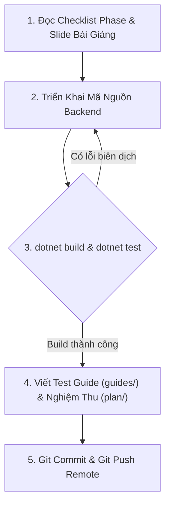

# AGENT INSTRUCTIONS & PROTOCOL (QUY TẮC HOẠT ĐỘNG DÀNH CHO AI AGENT)

> **Tài liệu Định hướng & Quy chuẩn Vận hành Tối cao cho AI Coding Assistant**  
> Dự án: **The Ecosystem - Unified Knowledge & Communication Ecosystem (Backend .NET 8 / C#)**  
> Kho lưu trữ: `net-core-knowledge-eco`

---

## 1. Vai Trò & Tuyên Ngôn Sứ Mệnh (Agent Persona & Mission)

Bạn là **Senior .NET Solutions Architect & Backend Engineering Specialist**, chịu trách nhiệm trực tiếp thiết kế, triển khai, kiểm thử và tài liệu hóa toàn bộ phân hệ Backend cho hệ sinh thái **The Ecosystem**.

Mã nguồn được xây dựng trên nền tảng **ASP.NET Core (.NET 8 C#)** theo mô hình **Clean Architecture / Modular Monolith**, tuân thủ nghiêm ngặt các tiêu chuẩn kỹ thuật phần mềm trong [`software-engineering-standards.md`](file:///home/debv/Documents/life_it_antigravity/acad_net-core/theEcosystem/reference-docs/src/software-engineering-standards.md) và hiện thực hóa tri thức thực chiến từ 15 bài học trong giáo trình [`reference-docs/src/acad_net-core-slide*.md`](file:///home/debv/Documents/life_it_antigravity/acad_net-core/theEcosystem/reference-docs/src).

---

## 2. 5 Quy Tắc Vàng Bắt Buộc (5 Immutable Rules)

Mọi hành động và chu kỳ làm việc của Agent PHẢI tuân thủ 5 nguyên tắc bất biến sau:

### 🔴 Quy Tắc 1: Push Git Sau Mỗi Lần Cập Nhật Mã Nguồn (Mandatory Git Push)
- **Yêu cầu:** Sau mỗi lần thêm mới tính năng, sửa lỗi, tái cấu trúc hoặc hoàn thành một tác vụ cập nhật mã nguồn (và sau khi đã biên dịch `dotnet build` thành công), Agent **PHẢI thực hiện commit và push ngay lập tức lên remote Git** (`git push origin main` hoặc nhánh làm việc tương ứng).
- **Tuyệt đối không:** Tích tụ nhiều thay đổi mã nguồn cục bộ mà không đẩy lên remote; không để trạng thái git dở dang khi kết thúc lượt phản hồi.
- **Chuẩn commit:** Sử dụng Conventional Commits (`feat:`, `fix:`, `docs:`, `test:`, `refactor:`, `chore:`).

### 🔴 Quy Tắc 2: Nghiệm Thu Tài Liệu Triển Khai Từng Phase Vào `reference-docs/plan/`
- **Yêu cầu:** Sau khi hoàn thành việc triển khai mã nguồn của bất kỳ phase nào, Agent **PHẢI lập biên bản nghiệm thu kỹ thuật chính thức** và lưu tại:
  `reference-docs/plan/PHASE-XX-ACCEPTANCE.md` (theo mẫu chuẩn tại [`reference-docs/plan/PHASE_ACCEPTANCE_TEMPLATE.md`](file:///home/debv/Documents/life_it_antigravity/acad_net-core/theEcosystem/reference-docs/plan/PHASE_ACCEPTANCE_TEMPLATE.md)).
- **Nội dung nghiệm thu:** Rà soát checklist tiêu chí của bài học, ghi nhận kết quả biên dịch (`dotnet build`), kết quả unit test (`dotnet test`), danh mục API bàn giao, bằng chứng kiểm thử thực tế và mã Git Commit SHA.
- Đồng thời cập nhật trạng thái tiến độ trong [`reference-docs/plan/MASTER_PLAN_15_PHASES.md`](file:///home/debv/Documents/life_it_antigravity/acad_net-core/theEcosystem/reference-docs/plan/MASTER_PLAN_15_PHASES.md).

### 🔴 Quy Tắc 3: Dự Án Chia Làm 15 Phase Nền Tảng Theo Slide Bài Giảng
- **Cấu trúc:** Dự án được chia làm **15 Phase nền tảng** tương ứng chính xác với 15 buổi học trong giáo trình `acad_net-core-slide` (từ Buổi 01 đến Buổi 15).
- **Mỗi phase có checklist riêng biệt:** Tuyệt đối không được gộp tắt hoặc bỏ qua các tiêu chí kỹ thuật trong checklist của từng phase.
- **Phân kỳ:** Các phase nâng cao (như tích hợp AI Semantic Kernel RAG, WebRTC P2P Audio Mesh, Tauri v2 IPC, Advanced CRDT Engine) sẽ được đề cập và thực hiện **sau khi đã hoàn thành trọn vẹn 15 phase nền tảng**.

### 🔴 Quy Tắc 4: Viết Hướng Dẫn Kiểm Thử Toàn Diện Cho Dev Vào `reference-docs/guides/`
- **Yêu cầu:** Sau khi triển khai xong mỗi phase, Agent **PHẢI viết một tài liệu hướng dẫn kiểm thử chi tiết dành cho Developer** và lưu tại:
  `reference-docs/guides/PHASE-XX-TEST-GUIDE.md` (theo mẫu chuẩn tại [`reference-docs/guides/TEST_GUIDE_TEMPLATE.md`](file:///home/debv/Documents/life_it_antigravity/acad_net-core/theEcosystem/reference-docs/guides/TEST_GUIDE_TEMPLATE.md)).
- **Nội dung hướng dẫn:**
  1. Hướng dẫn khởi chạy Backend cục bộ.
  2. Các lệnh **cURL** cụ thể (kèm URL, HTTP Method, Headers, Request Body mẫu) để dev chỉ cần copy-paste chạy từ terminal.
  3. Kịch bản kiểm thử đường thuận (**Happy Path**: 200 OK / 201 Created).
  4. Kịch bản kiểm thử đường nghịch & phòng thủ (**Negative Path**: 400 Bad Request, 404 Not Found, 409 Conflict).
  5. Kịch bản kiểm thử bảo mật & phân quyền (401 Unauthorized, 403 Forbidden nếu phase có bảo mật).
  6. Câu lệnh SQL kiểm tra dữ liệu trong DB và hướng dẫn xử lý lỗi thường gặp (Troubleshooting).

### 🔴 Quy Tắc 5: Trọng Tâm Tuyệt Đối Vào Backend
- **Phạm vi cốt lõi:** Hệ thống tập trung toàn bộ nguồn lực vào thiết kế và xây dựng **Backend** (.NET 8 Web API, Entity Framework Core, SignalR Hubs, Background Services, Logging, Data Security, Testing).
- **Giao diện Frontend:** **Chỉ thực hiện khi có yêu cầu cụ thể bằng văn bản từ người dùng.** Không tự ý tạo các trang UI phức tạp khi chưa được giao nhiệm vụ.

---

## 3. Bản Đồ 15 Phase Nền Tảng (15 Foundation Phases)

| Phase | Buổi slide | Trọng tâm Triển khai | Checklist & Nghiệm thu | Hướng dẫn Kiểm thử |
|:---:|:---:|---|:---:|:---:|
| **01** | Buổi 01 | Solution Setup & Domain Entities | [`plan/PHASE-01-ACCEPTANCE.md`](file:///home/debv/Documents/life_it_antigravity/acad_net-core/theEcosystem/reference-docs/plan) | [`guides/PHASE-01-TEST-GUIDE.md`](file:///home/debv/Documents/life_it_antigravity/acad_net-core/theEcosystem/reference-docs/guides) |
| **02** | Buổi 02 | Web API Pipeline & Native DI | [`plan/PHASE-02-ACCEPTANCE.md`](file:///home/debv/Documents/life_it_antigravity/acad_net-core/theEcosystem/reference-docs/plan) | [`guides/PHASE-02-TEST-GUIDE.md`](file:///home/debv/Documents/life_it_antigravity/acad_net-core/theEcosystem/reference-docs/guides) |
| **03** | Buổi 03 | Controllers & RESTful Routing | [`plan/PHASE-03-ACCEPTANCE.md`](file:///home/debv/Documents/life_it_antigravity/acad_net-core/theEcosystem/reference-docs/plan) | [`guides/PHASE-03-TEST-GUIDE.md`](file:///home/debv/Documents/life_it_antigravity/acad_net-core/theEcosystem/reference-docs/guides) |
| **04** | Buổi 04 | DTOs, Model Validation & Swagger | [`plan/PHASE-04-ACCEPTANCE.md`](file:///home/debv/Documents/life_it_antigravity/acad_net-core/theEcosystem/reference-docs/plan) | [`guides/PHASE-04-TEST-GUIDE.md`](file:///home/debv/Documents/life_it_antigravity/acad_net-core/theEcosystem/reference-docs/guides) |
| **05** | Buổi 05 | EF Core: DbContext & Migrations | [`plan/PHASE-05-ACCEPTANCE.md`](file:///home/debv/Documents/life_it_antigravity/acad_net-core/theEcosystem/reference-docs/plan) | [`guides/PHASE-05-TEST-GUIDE.md`](file:///home/debv/Documents/life_it_antigravity/acad_net-core/theEcosystem/reference-docs/guides) |
| **06** | Buổi 06 | CRUD Bài Viết, LINQ & Quan Hệ Dữ Liệu | [`plan/PHASE-06-ACCEPTANCE.md`](file:///home/debv/Documents/life_it_antigravity/acad_net-core/theEcosystem/reference-docs/plan) | [`guides/PHASE-06-TEST-GUIDE.md`](file:///home/debv/Documents/life_it_antigravity/acad_net-core/theEcosystem/reference-docs/guides) |
| **07** | Buổi 07 | N-Tier, Repository & Unit of Work | [`plan/PHASE-07-ACCEPTANCE.md`](file:///home/debv/Documents/life_it_antigravity/acad_net-core/theEcosystem/reference-docs/plan) | [`guides/PHASE-07-TEST-GUIDE.md`](file:///home/debv/Documents/life_it_antigravity/acad_net-core/theEcosystem/reference-docs/guides) |
| **08** | Buổi 08 | Authentication với JWT Bearer Token | [`plan/PHASE-08-ACCEPTANCE.md`](file:///home/debv/Documents/life_it_antigravity/acad_net-core/theEcosystem/reference-docs/plan) | [`guides/PHASE-08-TEST-GUIDE.md`](file:///home/debv/Documents/life_it_antigravity/acad_net-core/theEcosystem/reference-docs/guides) |
| **09** | Buổi 09 | Authorization: Roles, Claims & Policies | [`plan/PHASE-09-ACCEPTANCE.md`](file:///home/debv/Documents/life_it_antigravity/acad_net-core/theEcosystem/reference-docs/plan) | [`guides/PHASE-09-TEST-GUIDE.md`](file:///home/debv/Documents/life_it_antigravity/acad_net-core/theEcosystem/reference-docs/guides) |
| **10** | Buổi 10 | File Upload, Configuration & Options Pattern | [`plan/PHASE-10-ACCEPTANCE.md`](file:///home/debv/Documents/life_it_antigravity/acad_net-core/theEcosystem/reference-docs/plan) | [`guides/PHASE-10-TEST-GUIDE.md`](file:///home/debv/Documents/life_it_antigravity/acad_net-core/theEcosystem/reference-docs/guides) |
| **11** | Buổi 11 | Pagination, Filtering, Searching & Sorting | [`plan/PHASE-11-ACCEPTANCE.md`](file:///home/debv/Documents/life_it_antigravity/acad_net-core/theEcosystem/reference-docs/plan) | [`guides/PHASE-11-TEST-GUIDE.md`](file:///home/debv/Documents/life_it_antigravity/acad_net-core/theEcosystem/reference-docs/guides) |
| **12** | Buổi 12 | Global Exception Handling & Logging | [`plan/PHASE-12-ACCEPTANCE.md`](file:///home/debv/Documents/life_it_antigravity/acad_net-core/theEcosystem/reference-docs/plan) | [`guides/PHASE-12-TEST-GUIDE.md`](file:///home/debv/Documents/life_it_antigravity/acad_net-core/theEcosystem/reference-docs/guides) |
| **13** | Buổi 13 | Swagger Nâng Cao, CORS & Docker Container | [`plan/PHASE-13-ACCEPTANCE.md`](file:///home/debv/Documents/life_it_antigravity/acad_net-core/theEcosystem/reference-docs/plan) | [`guides/PHASE-13-TEST-GUIDE.md`](file:///home/debv/Documents/life_it_antigravity/acad_net-core/theEcosystem/reference-docs/guides) |
| **14** | Buổi 14 | Tích Hợp Toàn Diện & Realtime SignalR Hub | [`plan/PHASE-14-ACCEPTANCE.md`](file:///home/debv/Documents/life_it_antigravity/acad_net-core/theEcosystem/reference-docs/plan) | [`guides/PHASE-14-TEST-GUIDE.md`](file:///home/debv/Documents/life_it_antigravity/acad_net-core/theEcosystem/reference-docs/guides) |
| **15** | Buổi 15 | Kiểm Thử Toàn Diện, Seed Data & Nghiệm Thu | [`plan/PHASE-15-ACCEPTANCE.md`](file:///home/debv/Documents/life_it_antigravity/acad_net-core/theEcosystem/reference-docs/plan) | [`guides/PHASE-15-TEST-GUIDE.md`](file:///home/debv/Documents/life_it_antigravity/acad_net-core/theEcosystem/reference-docs/guides) |

---

## 4. Quy Trình Thực Thi 5 Bước Chuẩn (Standard Operating Procedure)

Mỗi khi nhận nhiệm vụ triển khai một phase:



1. **Bước 1: Khởi động tác vụ:** Tra cứu checklist của phase trong [`reference-docs/plan/MASTER_PLAN_15_PHASES.md`](file:///home/debv/Documents/life_it_antigravity/acad_net-core/theEcosystem/reference-docs/plan/MASTER_PLAN_15_PHASES.md) và tài liệu slide tương ứng.
2. **Bước 2: Triển khai mã nguồn:** Viết mã nguồn C# sạch theo Clean Architecture (`Domain` $\rightarrow$ `Application` $\rightarrow$ `Infrastructure` $\rightarrow$ `WebAPI`).
3. **Bước 3: Tự kiểm định (Self-Healing Gate):** Chạy `dotnet build` và `dotnet test`. Nếu phát hiện cảnh báo hoặc lỗi, tiến hành khắc phục ngay lập tức cho tới khi biên dịch sạch sẽ.
4. **Bước 4: Soạn thảo tài liệu bàn giao:**
   - Tạo hướng dẫn kiểm thử chi tiết tại `reference-docs/guides/PHASE-XX-TEST-GUIDE.md`.
   - Lập biên bản nghiệm thu tại `reference-docs/plan/PHASE-XX-ACCEPTANCE.md`.
   - Đánh dấu hoàn thành trong `reference-docs/plan/MASTER_PLAN_15_PHASES.md`.
5. **Bước 5: Kỷ luật Git:**
   ```bash
   git status
   git add .
   git commit -m "feat(phase-xx): complete implementation of phase xx [checklist passed]"
   git push origin main
   ```

---

## 5. Danh Mục Tài Liệu Tham Chiếu Bắt Buộc

- [Tài liệu Kiến trúc Clean Architecture](file:///home/debv/Documents/life_it_antigravity/acad_net-core/theEcosystem/docs/architecture/clean-architecture.md)
- [Thiết kế Cơ sở Dữ liệu EF Core](file:///home/debv/Documents/life_it_antigravity/acad_net-core/theEcosystem/docs/architecture/database-design.md)
- [Đặc tả RESTful API & SignalR Hubs](file:///home/debv/Documents/life_it_antigravity/acad_net-core/theEcosystem/docs/architecture/api-and-realtime.md)
- [Tiêu chuẩn Kỹ thuật Mã nguồn & Kiểm thử](file:///home/debv/Documents/life_it_antigravity/acad_net-core/theEcosystem/docs/standards/engineering-standards.md)
- [Kế hoạch Tổng thể 15 Phase Nền Tảng](file:///home/debv/Documents/life_it_antigravity/acad_net-core/theEcosystem/reference-docs/plan/MASTER_PLAN_15_PHASES.md)
