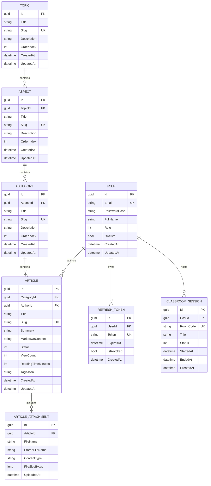

# Thiết Kế Cơ Sở Dữ Liệu & Mô Hình Dữ Liệu (EF Core)

Tài liệu này đặc tả thiết kế cơ sở dữ liệu quan hệ cho **The Ecosystem**, bao gồm lược đồ thực thể (Entity Schemas), các mối quan hệ toàn vẹn, chiến lược lập chỉ mục (Indexing Strategy) và cấu hình **Entity Framework Core (Code First)**.

---

## 1. Sơ Đồ Thực Thể - Quan Hệ Tổng Thể (ERD Overview)

Hệ thống được thiết kế xoay quanh hai trục chính: **Cây Tri Thức Phân Cấp 4 Tầng (Taxonomy)** và **Quản Lý Định Danh & Phiên Học (Identity & Sessions)**.



---

## 2. Đặc Tả Chi Tiết Các Thực Thể Chính

### 2.1. Nhóm Cây Tri Thức 4 Cấp (Taxonomy Entities)

#### 1. `Topic` (Chủ đề cấp 1)
- Đại diện cho các lĩnh vực tri thức lớn (ví dụ: *Nền tảng Lập trình .NET*, *Kiến trúc Hệ thống Phân tán*).
- **Ràng buộc:** `Slug` duy nhất (Unique Index) để phục vụ định tuyến URL thân thiện SEO.

#### 2. `Aspect` (Khía cạnh cấp 2)
- Thuộc về một `Topic` duy nhất (Khóa ngoại `TopicId`).
- Nhóm các mảng công nghệ chuyên biệt trong Topic (ví dụ: *Backend ASP.NET Core*, *Multiplayer Realtime*).

#### 3. `Category` (Chuyên mục cấp 3)
- Thuộc về một `Aspect` duy nhất (Khóa ngoại `AspectId`).
- Phân nhóm bài học cụ thể (ví dụ: *Web API Fundamentals*, *Entity Framework Core Advanced*).

#### 4. `Article` (Bài viết / Ghi chú tri thức cấp 4)
- Thuộc về một `Category` duy nhất (Khóa ngoại `CategoryId`) và một tác giả `User` (`AuthorId`).
- **Nội dung:** `MarkdownContent` chứa toàn văn ghi chú Markdown, sơ đồ Mermaid và công thức KaTeX.
- **`TagsJson`:** Mảng chuỗi các thẻ từ khóa được lưu dưới dạng JSON (ví dụ: `["csharp", "efcore", "linq"]`).
- **Trạng thái (`ArticleStatus`):** `0: Draft`, `1: Published`, `2: Archived`.

---

### 2.2. Nhóm Định Danh & Phiên Làm Việc (Identity & Sessions)

#### 1. `User`
- Đại diện cho tài khoản người dùng trong hệ sinh thái.
- **`Role`:** Enum định danh vai trò:
  - `0: Audience` (Học viên / Thành viên xem và tương tác cơ bản).
  - `1: Presenter` (Giảng viên / Báo cáo viên tạo bài viết, điều khiển phiên học).
  - `2: Host` (Quản trị viên toàn quyền hệ thống).

#### 2. `RefreshToken`
- Lưu trữ token làm mới phiên đăng nhập nhằm duy trì xác thực bảo mật không gián đoạn mà không cần lưu mật khẩu trên client.

#### 3. `ClassroomSession`
- Quản lý các phòng học/cộng tác trực tuyến thời gian thực.
- `RoomCode`: Mã phòng 6-8 ký tự ngẫu nhiên hoặc slug duy nhất để tham gia phòng.

---

## 3. Cấu Hình EF Core Fluent API & Indexing Strategy

Mọi cấu hình quan hệ, kiểu dữ liệu và chỉ mục đều được viết trong các class `IEntityTypeConfiguration<T>` tại tầng `Infrastructure`:

```csharp
public class ArticleConfiguration : IEntityTypeConfiguration<Article>
{
    public void Configure(EntityTypeBuilder<Article> builder)
    {
        builder.ToTable("Articles");
        builder.HasKey(a => a.Id);

        builder.Property(a => a.Title).HasMaxLength(250).IsRequired();
        builder.Property(a => a.Slug).HasMaxLength(280).IsRequired();
        builder.HasIndex(a => a.Slug).IsUnique();

        builder.Property(a => a.MarkdownContent).IsRequired();

        // Chỉ mục hỗ trợ tìm kiếm và lọc
        builder.HasIndex(a => a.CategoryId);
        builder.HasIndex(a => a.AuthorId);
        builder.HasIndex(a => a.Status);
        builder.HasIndex(a => a.CreatedAt);

        // Quan hệ với Category
        builder.HasOne(a => a.Category)
               .WithMany(c => c.Articles)
               .HasForeignKey(a => a.CategoryId)
               .OnDelete(DeleteBehavior.Restrict);

        // Quan hệ với Author
        builder.HasOne(a => a.Author)
               .WithMany(u => u.Articles)
               .HasForeignKey(a => a.AuthorId)
               .OnDelete(DeleteBehavior.Restrict);
    }
}
```

---

## 4. Quy Trình Quản Lý Migrations (Code First Workflow)

Quy trình chuẩn khi có bất kỳ thay đổi nào trong cấu trúc dữ liệu Domain:

1. **Thêm migration mới:**
   ```bash
   dotnet ef migrations add <MigrationName> --project src/Ecosystem.Infrastructure --startup-project src/Ecosystem.WebAPI
   ```

2. **Cập nhật cơ sở dữ liệu:**
   ```bash
   dotnet ef database update --project src/Ecosystem.Infrastructure --startup-project src/Ecosystem.WebAPI
   ```

3. **Cơ chế Tự động Seed Data:**
   Khi khởi động ứng dụng trong môi trường Development, `DatabaseSeeder` sẽ kiểm tra và khởi tạo dữ liệu mẫu mặc định (Tài khoản Admin, cấu trúc Taxonomy 4 cấp mẫu, một số bài viết Markdown tiêu chuẩn) nếu cơ sở dữ liệu còn trống.
