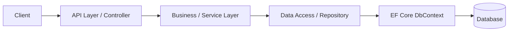

# Buổi 7: Kiến trúc nhiều tầng (Controller – Service – Repository) và Dependency Injection trong thực tế

## Mục lục

```text
Buổi 7: Kiến trúc nhiều tầng + Dependency Injection
│
├── 1. Lý thuyết nền tảng
│   ├── 1.1. Vấn đề đặt ra — Vì sao cần chia tầng?
│   │   ├── 1.1.1. Fat Controller là gì?
│   │   ├── 1.1.2. Hậu quả của Fat Controller
│   │   └── 1.1.3. Giải pháp: Separation of Concerns
│   ├── 1.2. Coupling và Cohesion
│   ├── 1.3. SOLID và Dependency Inversion
│   ├── 1.4. IoC và Dependency Injection
│   │   ├── 1.4.1. IoC là gì?
│   │   ├── 1.4.2. DI là gì?
│   │   └── 1.4.3. Các kiểu DI
│   ├── 1.5. Entity, DTO và Mapping
│   └── 1.6. Async/Await và EF Core
│
├── 2. Kiến trúc nhiều tầng — N-Tier Architecture
│   ├── 2.1. Sơ đồ tổng quát
│   ├── 2.2. Vai trò từng tầng
│   ├── 2.3. Lợi ích
│   └── 2.4. Quy tắc vàng giữa các tầng
│
├── 3. Repository Pattern
│   ├── 3.1. Khái niệm
│   ├── 3.2. Lợi ích
│   ├── 3.3. Triển khai (Interface + Class)
│   ├── 3.4. Lưu ý khi dùng Repository
│   └── 3.5. Generic Repository — có nên dùng?
│
├── 4. Service Layer
│   ├── 4.1. Khái niệm
│   ├── 4.2. Lợi ích
│   ├── 4.3. Triển khai (Interface + Class)
│   └── 4.4. Refactor Controller — Before/After
│
├── 5. Dependency Injection trong thực tế
│   ├── 5.1. DI Container trong ASP.NET Core
│   ├── 5.2. Lifetime — Transient / Scoped / Singleton
│   ├── 5.3. Đăng ký DI trong Program.cs
│   ├── 5.4. Lỗi thường gặp
│   └── 5.5. Best Practices
│
├── 6. Ví dụ nền tảng — API Quản lý Sinh viên – Khóa học
│   ├── 6.1. Model (Entity)
│   ├── 6.2. DbContext
│   ├── 6.3. DTO
│   ├── 6.4. Repository cho Course
│   ├── 6.5. Repository cho Enrollment
│   ├── 6.6. Service cho Course
│   ├── 6.7. StudentService + AssignStudentToCourseAsync
│   ├── 6.8. Controller
│   └── 6.9. Program.cs
│
├── 7. Thực hành / Lab cơ bản
│   ├── 7.1. Mục tiêu
│   ├── 7.2. Chuẩn bị
│   ├── 7.3. Các bước thực hành
│   ├── 7.4. Bài tập bắt buộc
│   ├── 7.5. Gợi ý code
│   └── 7.6. Checklist hoàn thành
│
├── 8. Bài tập mở rộng
│   └── 8.1. Bài thực hành (7 bài, giải chi tiết)
│
├── 9. Tổng kết
│   ├── 9.1. Ghi nhớ chính
│   ├── 9.2. Câu hỏi ôn tập
│   └── 9.3. Bảng thuật ngữ
│
└── 10. Cheatsheet
```

---

## 1. Lý thuyết nền tảng

### 1.1. Vấn đề đặt ra — Vì sao cần chia tầng?

#### 1.1.1. Fat Controller là gì?

**Fat Controller** là Controller chứa quá nhiều code:

- Truy vấn database trực tiếp.
- Xử lý nghiệp vụ.
- Ánh xạ dữ liệu.
- Kiểm tra điều kiện, tính toán, gửi email, ghi log…

**Ví dụ Fat Controller điển hình:**

```csharp
[HttpPost]
public async Task<IActionResult> CreateStudent(Student student)
{
    // 1. Validate dữ liệu
    if (string.IsNullOrEmpty(student.Name)) return BadRequest();

    // 2. Kiểm tra trùng lặp trong database
    var existing = await _db.Students
        .FirstOrDefaultAsync(s => s.Name == student.Name);
    if (existing != null) return Conflict();

    // 3. Thêm vào database
    _db.Students.Add(student);
    await _db.SaveChangesAsync();

    // 4. Gửi email chào mừng
    await _emailService.SendWelcomeEmail(student.Email);

    // 5. Trả kết quả
    return Ok(student);
}
```

#### 1.1.2. Hậu quả của Fat Controller

| Hậu quả | Giải thích |
|---|---|
| **Khó bảo trì** | Một Action có thể dài hàng trăm dòng — đọc không hiểu |
| **Khó kiểm thử** | Controller phụ thuộc chặt vào `DbContext` — phải có DB thật để test |
| **Lặp code** | Nhiều Controller cùng truy vấn một bảng nhưng phải viết lại logic |
| **Khó thay đổi** | Đổi database hoặc đổi công nghệ truy cập dữ liệu ảnh hưởng toàn bộ Controller |
| **Vi phạm SRP** | Controller làm quá nhiều việc — không có "một lý do để thay đổi" |

#### 1.1.3. Giải pháp: Separation of Concerns

**Separation of Concerns (SoC)** — Tách biệt trách nhiệm — là nguyên tắc chia phần mềm thành các phần độc lập, mỗi phần chỉ đảm nhận một nhóm trách nhiệm nhất định.

**Phân chia trách nhiệm trong Web API:**

| Thành phần | Chỉ nên làm | Không nên làm |
|---|---|---|
| **Controller** | Nhận HTTP request, trả HTTP response | Truy vấn DB, chứa nghiệp vụ |
| **Service** | Xử lý nghiệp vụ, điều phối dữ liệu | Biết HTTP, biết SQL |
| **Repository** | Truy cập database | Chứa nghiệp vụ phức tạp |
| **DbContext / EF Core** | Ánh xạ và thao tác database | Chứa business logic |

### 1.2. Coupling và Cohesion

> **Ghi chú bổ sung (kiến thức bị thiếu trong file gốc):** Đây là hai khái niệm **cốt lõi** của thiết kế phần mềm — file gốc không giải thích.

| Khái niệm | Ý nghĩa | Mục tiêu |
|---|---|---|
| **Coupling** (độ phụ thuộc) | Mức độ phụ thuộc giữa các module | **Càng thấp càng tốt** — module A đổi không ảnh hưởng B |
| **Cohesion** (độ tập trung) | Mức độ liên quan giữa các thành phần trong 1 module | **Càng cao càng tốt** — 1 class chỉ làm 1 việc |

**Ví dụ:**

- **Coupling cao:** `StudentController` new trực tiếp `StudentRepository(new DbContext())` → đổi Repository phải sửa Controller.
- **Coupling thấp:** `StudentController` inject `IStudentService` → chỉ cần đổi registration trong `Program.cs`.

**Mục tiêu cuối cùng:** **Low Coupling, High Cohesion.**

### 1.3. SOLID và Dependency Inversion

Một số nguyên lý SOLID liên quan trực tiếp:

| Nguyên lý | Ý nghĩa trong kiến trúc nhiều tầng |
|---|---|
| **S – Single Responsibility** | Mỗi lớp chỉ nên có **một lý do để thay đổi**. Controller chỉ lo HTTP, Service chỉ lo nghiệp vụ. |
| **O – Open/Closed** | Có thể **mở rộng** hành vi mà ít sửa code cũ. Thêm method vào Repository mới thay vì sửa Repository cũ. |
| **L – Liskov Substitution** | Lớp implement phải **thay thế được** interface. `StudentRepository` phải dùng được ở mọi nơi cần `IStudentRepository`. |
| **I – Interface Segregation** | **Không nên ép** lớp implement những method không dùng. Tách `IStudentReadRepository` và `IStudentWriteRepository` nếu cần. |
| **D – Dependency Inversion** | Tầng cao **không phụ thuộc** tầng thấp; cả hai phụ thuộc **abstraction**. Service phụ thuộc `IStudentRepository`, không phụ thuộc `StudentRepository`. |

**Cách nhớ SOLID:**

```text
S — Single Responsibility     Một việc
O — Open/Closed                Mở rộng không sửa
L — Liskov Substitution        Thay thế được
I — Interface Segregation      Chia nhỏ interface
D — Dependency Inversion       Phụ thuộc abstraction
```

### 1.4. IoC và Dependency Injection

#### 1.4.1. IoC là gì?

**IoC (Inversion of Control)** — Đảo ngược quyền điều khiển. Thay vì **lớp tự tạo dependency**, framework sẽ **cung cấp dependency**.

**Không dùng IoC:**

```csharp
public class StudentService
{
    private readonly IStudentRepository _repository;

    public StudentService()
    {
        // Lớp tự tạo → coupling cao
        _repository = new StudentRepository(new ApplicationDbContext());
    }
}
```

**Dùng IoC:**

```csharp
public class StudentService
{
    private readonly IStudentRepository _repository;

    // Framework cung cấp → coupling thấp
    public StudentService(IStudentRepository repository)
    {
        _repository = repository;
    }
}
```

#### 1.4.2. DI là gì?

**Dependency Injection (DI)** — Một cách **hiện thực hóa IoC** bằng cách **tiêm dependency từ bên ngoài** vào lớp.

**Quy tắc:** Lớp không bao giờ `new` dependency — nó **yêu cầu** dependency qua constructor.

#### 1.4.3. Các kiểu DI

| Kiểu | Cách hoạt động | Ưu điểm | Nhược điểm |
|---|---|---|---|
| **Constructor Injection** | Nhận qua constructor | Rõ ràng, **bắt buộc** có dependency | Không đổi được sau khi tạo |
| **Property Injection** | Gán qua setter | Linh hoạt, có thể optional | Không rõ ràng, dễ quên gán |
| **Method Injection** | Nhận qua tham số method | Chỉ inject khi cần | Phải truyền mỗi lần gọi |

**ASP.NET Core khuyến nghị:** **Constructor Injection** — vì rõ ràng, dễ test, và compiler bắt lỗi nếu thiếu.

### 1.5. Entity, DTO và Mapping

| Khái niệm | Vai trò | Ví dụ |
|---|---|---|
| **Entity** | Lớp ánh xạ trực tiếp với bảng trong database, dùng trong EF Core | `Student`, `Course`, `Enrollment` |
| **DTO (Data Transfer Object)** | Lớp dùng để truyền dữ liệu giữa các tầng hoặc ra API | `StudentDto`, `StudentCreateDto` |
| **Mapping** | Chuyển đổi giữa Entity và DTO | `student.ToDto()` hoặc thủ công |

> **Best Practice:** Controller **không nên trả Entity** trực tiếp ra ngoài. Nên trả DTO để **kiểm soát dữ liệu** và **bảo mật** (không lộ password, internal note, audit fields).

**Ví dụ sai lầm:**

```csharp
// Entity có trường nhạy cảm
public class User
{
    public int Id { get; set; }
    public string Name { get; set; }
    public string PasswordHash { get; set; }   // ← Lộ ra ngoài nếu trả Entity
    public string InternalNote { get; set; }   // ← Cũng lộ
}

// ❌ Trả Entity trực tiếp
return Ok(user);   // Response chứa PasswordHash → NGUY HIỂM
```

**Cách đúng — DTO:**

```csharp
public class UserDto
{
    public int Id { get; set; }
    public string Name { get; set; }
}

// ✅ Chỉ trả DTO
return Ok(new UserDto { Id = user.Id, Name = user.Name });
```

### 1.6. Async/Await và EF Core

Các thao tác database **nên dùng `async/await`** để không chặn luồng xử lý:

```csharp
// ❌ Block thread
var students = _context.Students.ToList();

// ✅ Không block thread
var students = await _context.Students.ToListAsync();
```

**Các method async phổ biến của EF Core:**

| Method sync        | Method async            |
| ------------------ | ----------------------- |
| `ToList()`         | `ToListAsync()`         |
| `FirstOrDefault()` | `FirstOrDefaultAsync()` |
| `Find()`           | `FindAsync()`           |
| `Any()`            | `AnyAsync()`            |
| `Count()`          | `CountAsync()`          |
| `SaveChanges()`    | `SaveChangesAsync()`    |

> **Ghi chú bổ sung:** Các method trong Repository và Service nên trả về `Task` hoặc `Task<T>` — để caller có thể `await`. Nếu không async → thread pool bị block khi DB chậm.

---

## 2. Kiến trúc nhiều tầng — N-Tier Architecture

### 2.1. Sơ đồ tổng quát



**Luồng dữ liệu:**

```text
Client (Postman/Swagger)
    ↓ HTTP Request
Controller              ← Nhận request, trả response
    ↓
Service                 ← Xử lý nghiệp vụ, gọi Repository
    ↓
Repository              ← Truy vấn database qua DbContext
    ↓
DbContext / EF Core
    ↓
Database (SQL Server)
```

### 2.2. Vai trò từng tầng

| Tầng | Trách nhiệm | Ví dụ |
|---|---|---|
| **API Layer / Controller** | Nhận HTTP Request, trả HTTP Response | `StudentsController`, `CoursesController` |
| **Business / Service Layer** | Xử lý nghiệp vụ, tính toán, gọi nhiều Repository | `StudentService`, `CourseService` |
| **Data Access / Repository** | Truy vấn, thêm, sửa, xóa dữ liệu | `StudentRepository`, `CourseRepository` |
| **Database / EF Core** | Lưu trữ và ánh xạ dữ liệu | `ApplicationDbContext` |

### 2.3. Lợi ích

- **Controller gọn nhẹ**, dễ đọc.
- **Dễ kiểm thử** từng tầng (mock Repository để test Service).
- **Tái sử dụng** logic nghiệp vụ ở nhiều nơi (API, background job, console app).
- **Giảm phụ thuộc** vào `DbContext`.
- **Dễ thay đổi** database hoặc công nghệ truy cập dữ liệu.

### 2.4. Quy tắc vàng giữa các tầng

> **Ghi chú bổ sung:** Đây là quy tắc bất biến — file gốc không hệ thống hóa.

```text
Controller KHÔNG BIẾT database là gì.
Service KHÔNG BIẾT HTTP là gì.
Repository KHÔNG CHỨA nghiệp vụ phức tạp.
DTO KHÔNG CHỨA logic.
```

**Kiểm tra nhanh:** Nếu bạn thấy `_context` trong Controller → **sai**. Nếu bạn thấy `HttpContext` trong Service → **sai**.

---

## 3. Repository Pattern

### 3.1. Khái niệm

**Repository Pattern** tạo ra một **lớp trừu tượng** giữa **Data Access Layer** và **Business Layer**. Repository **che giấu chi tiết truy cập dữ liệu**, giúp Service không cần biết dữ liệu đến từ SQL Server, MongoDB hay nguồn khác.

**Ví dụ thực tế:** Repository giống như **người thủ kho** — Service muốn lấy dữ liệu thì nói với Repository, chứ không tự vào kho (database) lấy.

### 3.2. Lợi ích

- **Tách logic truy cập dữ liệu** khỏi logic nghiệp vụ.
- **Giảm phụ thuộc** trực tiếp vào `DbContext` hoặc EF Core.
- **Dễ thay đổi CSDL** — đổi từ SQL Server sang MongoDB chỉ sửa Repository.
- **Dễ mock dữ liệu** để Unit Test — không cần database thật.

### 3.3. Triển khai

#### Bước 1: Tạo Interface (hợp đồng)

```csharp
public interface IStudentRepository
{
    Task<IEnumerable<Student>> GetAllAsync();
    Task<Student?> GetByIdAsync(int id);
    Task AddAsync(Student student);
    Task UpdateAsync(Student student);
    Task DeleteAsync(Student student);
}
```

#### Bước 2: Tạo Class Implement

```csharp
public class StudentRepository : IStudentRepository
{
    private readonly ApplicationDbContext _context;

    // DI: DbContext được tiêm vào, không tự tạo
    public StudentRepository(ApplicationDbContext context)
    {
        _context = context;
    }

    public async Task<IEnumerable<Student>> GetAllAsync()
    {
        return await _context.Students.ToListAsync();
    }

    public async Task<Student?> GetByIdAsync(int id)
    {
        return await _context.Students.FindAsync(id);
    }

    public async Task AddAsync(Student student)
    {
        _context.Students.Add(student);
        await _context.SaveChangesAsync();
    }

    public async Task UpdateAsync(Student student)
    {
        _context.Students.Update(student);
        await _context.SaveChangesAsync();
    }

    public async Task DeleteAsync(Student student)
    {
        _context.Students.Remove(student);
        await _context.SaveChangesAsync();
    }
}
```

### 3.4. Lưu ý khi dùng Repository

> **Lưu ý:** Repository **không nên chứa logic nghiệp vụ phức tạp**. Nếu có nhiều quy tắc nghiệp vụ, hãy đặt trong Service.

- **Không nên lạm dụng** Generic Repository nếu không thực sự cần.
- Có thể dùng **Unit of Work** nếu cần quản lý nhiều Repository trong một transaction.
- Repository có thể trả Entity cho Service, nhưng **Controller chỉ nên nhận DTO**.

### 3.5. Generic Repository — có nên dùng?

> **Ghi chú bổ sung (kiến thức bị thiếu trong file gốc):** File gốc chỉ nhắc "không nên lạm dụng" mà không giải thích.

**Generic Repository là gì?**

```csharp
public interface IRepository<T> where T : class
{
    Task<IEnumerable<T>> GetAllAsync();
    Task<T?> GetByIdAsync(int id);
    Task AddAsync(T entity);
    Task UpdateAsync(T entity);
    Task DeleteAsync(T entity);
}

public class Repository<T> : IRepository<T> where T : class
{
    protected readonly ApplicationDbContext _context;
    protected readonly DbSet<T> _dbSet;

    public Repository(ApplicationDbContext context)
    {
        _context = context;
        _dbSet = context.Set<T>();
    }

    public async Task<IEnumerable<T>> GetAllAsync() => await _dbSet.ToListAsync();
    // ...
}
```

**Khi nào dùng:**

| Nên dùng | Không nên dùng |
|---|---|
| Nhiều entity có CRUD đơn giản giống nhau | Entity cần query phức tạp (JOIN, group by, stored procedure) |
| Muốn giảm code lặp | Muốn kiểm soát chi tiết query |
| Dự án nhỏ, ít thay đổi | Dự án lớn, domain phức tạp |

**Best Practice:** **Kết hợp cả hai** — `IRepository<T>` cho CRUD cơ bản, và Repository riêng (`IStudentRepository`) cho query đặc thù.

---

## 4. Service Layer

### 4.1. Khái niệm

**Service Layer** nằm giữa Controller và Repository. Đây là nơi chứa:

- **Quy tắc nghiệp vụ** (kiểm tra sinh viên tồn tại trước khi gán khóa học).
- **Tính toán** (điểm trung bình, xếp loại).
- **Kiểm tra điều kiện** (email đã tồn tại chưa?).
- **Gọi nhiều Repository cùng lúc** (kiểm tra Student + Course trước khi gán).
- **Ánh xạ Entity sang DTO**.

### 4.2. Lợi ích

- **Giữ Controller gọn nhẹ** — mỗi action 3-5 dòng.
- **Controller không cần biết dữ liệu lấy từ đâu**.
- **Tái sử dụng logic nghiệp vụ** ở nhiều nơi (API, background job, console app).
- **Dễ kiểm thử hơn** — mock Repository, không cần database.

### 4.3. Triển khai

#### Bước 1: Tạo Interface

```csharp
public interface IStudentService
{
    Task<IEnumerable<StudentDto>> GetAllStudentsAsync();
    Task<StudentDto> AddStudentAsync(StudentCreateDto dto);
}
```

#### Bước 2: Tạo Class Implement

```csharp
public class StudentService : IStudentService
{
    private readonly IStudentRepository _repository;

    // DI: Repository được tiêm vào
    public StudentService(IStudentRepository repository)
    {
        _repository = repository;
    }

    public async Task<IEnumerable<StudentDto>> GetAllStudentsAsync()
    {
        var students = await _repository.GetAllAsync();

        // Ánh xạ Entity → DTO
        return students.Select(s => new StudentDto
        {
            Id = s.Id,
            Name = s.Name
        });
    }

    public async Task<StudentDto> AddStudentAsync(StudentCreateDto dto)
    {
        // Tạo Entity từ DTO
        var student = new Student
        {
            Name = dto.Name
        };

        await _repository.AddAsync(student);

        // Trả về DTO
        return new StudentDto
        {
            Id = student.Id,
            Name = student.Name
        };
    }
}
```

### 4.4. Refactor Controller — Before/After

**Before (Fat Controller):**

```csharp
[HttpGet]
public async Task<IActionResult> Get()
{
    var students = await _dbContext.Students.ToListAsync();
    // Xử lý logic...
    return Ok(students);
}
```

**After (Lean Controller):**

```csharp
[ApiController]
[Route("api/[controller]")]
public class StudentsController : ControllerBase
{
    private readonly IStudentService _studentService;

    // DI: Service được tiêm vào, không dùng DbContext
    public StudentsController(IStudentService studentService)
    {
        _studentService = studentService;
    }

    [HttpGet]
    public async Task<IActionResult> GetAll()
    {
        var result = await _studentService.GetAllStudentsAsync();
        return Ok(result);
    }
}
```

→ Controller giờ chỉ có **3-5 dòng** mỗi action. Rất gọn!

---

## 5. Dependency Injection trong thực tế

### 5.1. DI Container trong ASP.NET Core

ASP.NET Core có **sẵn DI Container**. Ta đăng ký các interface và class implement trong `Program.cs`.

**Cơ chế:** Khi ai đó yêu cầu `IStudentService` → DI Container tạo `StudentService` và tự động tiêm `IStudentRepository` (chính là `StudentRepository`) vào.

### 5.2. Lifetime — Transient / Scoped / Singleton

| Lifetime | Tạo mới khi nào? | Thường dùng cho | Nguy cơ |
|---|---|---|---|
| **Transient** | Mỗi lần được yêu cầu | Helper nhẹ, stateless | Tạo nhiều instance → tốn bộ nhớ |
| **Scoped** | Một lần trong một HTTP Request | **Service, Repository, DbContext** | Nếu inject vào Singleton → captive dependency |
| **Singleton** | Một lần duy nhất suốt ứng dụng | Cache, cấu hình toàn cục | Không thread-safe nếu có state |

> **Ghi nhớ:** `DbContext` mặc định là **Scoped**. **Không nên** đăng ký Repository là Singleton nếu Repository dùng `DbContext` Scoped — sẽ lỗi `Cannot consume scoped service from singleton`.

**Bảng quyết định nhanh:**

```text
Có state thay đổi theo request?   → Scoped
Không có state, dùng nhiều nơi?   → Singleton
Tạo mới mỗi lần, rẻ?               → Transient
```

### 5.3. Đăng ký DI trong Program.cs

```csharp
var builder = WebApplication.CreateBuilder(args);

// Đăng ký DbContext
builder.Services.AddDbContext<ApplicationDbContext>(options =>
    options.UseSqlServer(
        builder.Configuration.GetConnectionString("Default")));

// Đăng ký Repository
builder.Services.AddScoped<IStudentRepository, StudentRepository>();
builder.Services.AddScoped<ICourseRepository, CourseRepository>();

// Đăng ký Service
builder.Services.AddScoped<IStudentService, StudentService>();
builder.Services.AddScoped<ICourseService, CourseService>();

var app = builder.Build();
```

> **Best Practice:** Luôn đăng ký DI cho **Interface** thay vì Class cụ thể để đạt được **loose coupling**.
>
> - ✅ `AddScoped<IStudentService, StudentService>()`
> - ❌ `AddScoped<StudentService>()` — khó mock, khó thay thế

### 5.4. Lỗi thường gặp

> **Lỗi thường gặp:**
>
> - **Quên đăng ký** interface/class trong `Program.cs`:
>   ```text
>   InvalidOperationException: Unable to resolve service for type 'IStudentService'
>   ```
> - **Circular Dependency:** Service A gọi Service B, Service B gọi Service A → DI không biết tạo cái nào trước.
> - **Đăng ký sai vòng đời**, ví dụ Repository là Singleton nhưng dùng DbContext Scoped → lỗi `Cannot consume scoped service from singleton`.
> - **Trả Entity trực tiếp** từ Controller — lộ thông tin nhạy cảm.

### 5.5. Best Practices

- **Controller chỉ nên trả DTO**.
- **Service chịu trách nhiệm ánh xạ** Entity sang DTO.
- **Repository chỉ tập trung vào truy cập dữ liệu**.
- Chỉ dùng **Generic Repository** khi thực sự cần thiết.
- Đặt tên interface **rõ ràng**: `IStudentRepository`, `IStudentService`.
- **Luôn đăng ký theo Interface** — không đăng ký class cụ thể.

---

## 6. Ví dụ nền tảng — API Quản lý Sinh viên – Khóa học

### 6.1. Model (Entity)

```csharp
public class Student
{
    public int Id { get; set; }
    public string Name { get; set; } = string.Empty;

    public ICollection<Enrollment> Enrollments { get; set; } = new List<Enrollment>();
}

public class Course
{
    public int Id { get; set; }
    public string Title { get; set; } = string.Empty;

    public ICollection<Enrollment> Enrollments { get; set; } = new List<Enrollment>();
}

public class Enrollment
{
    public int StudentId { get; set; }
    public Student Student { get; set; } = null!;

    public int CourseId { get; set; }
    public Course Course { get; set; } = null!;
}
```

### 6.2. DbContext

```csharp
public class ApplicationDbContext : DbContext
{
    public ApplicationDbContext(DbContextOptions<ApplicationDbContext> options)
        : base(options) { }

    public DbSet<Student> Students => Set<Student>();
    public DbSet<Course> Courses => Set<Course>();
    public DbSet<Enrollment> Enrollments => Set<Enrollment>();

    protected override void OnModelCreating(ModelBuilder modelBuilder)
    {
        // Khóa chính phức hợp cho bảng trung gian
        modelBuilder.Entity<Enrollment>()
            .HasKey(e => new { e.StudentId, e.CourseId });

        modelBuilder.Entity<Enrollment>()
            .HasOne(e => e.Student)
            .WithMany(s => s.Enrollments)
            .HasForeignKey(e => e.StudentId);

        modelBuilder.Entity<Enrollment>()
            .HasOne(e => e.Course)
            .WithMany(c => c.Enrollments)
            .HasForeignKey(e => e.CourseId);
    }
}
```

### 6.3. DTO

```csharp
public class StudentDto
{
    public int Id { get; set; }
    public string Name { get; set; } = string.Empty;
}

public class StudentCreateDto
{
    public string Name { get; set; } = string.Empty;
}

public class CourseDto
{
    public int Id { get; set; }
    public string Title { get; set; } = string.Empty;
}

public class CourseCreateDto
{
    public string Title { get; set; } = string.Empty;
}
```

### 6.4. Repository cho Course

```csharp
public interface ICourseRepository
{
    Task<IEnumerable<Course>> GetAllAsync();
    Task<Course?> GetByIdAsync(int id);
    Task AddAsync(Course course);
    Task UpdateAsync(Course course);
    Task DeleteAsync(Course course);
}

public class CourseRepository : ICourseRepository
{
    private readonly ApplicationDbContext _context;

    public CourseRepository(ApplicationDbContext context)
    {
        _context = context;
    }

    public async Task<IEnumerable<Course>> GetAllAsync()
        => await _context.Courses.ToListAsync();

    public async Task<Course?> GetByIdAsync(int id)
        => await _context.Courses.FindAsync(id);

    public async Task AddAsync(Course course)
    {
        _context.Courses.Add(course);
        await _context.SaveChangesAsync();
    }

    public async Task UpdateAsync(Course course)
    {
        _context.Courses.Update(course);
        await _context.SaveChangesAsync();
    }

    public async Task DeleteAsync(Course course)
    {
        _context.Courses.Remove(course);
        await _context.SaveChangesAsync();
    }
}
```

### 6.5. Repository cho Enrollment

```csharp
public interface IEnrollmentRepository
{
    Task<bool> ExistsAsync(int studentId, int courseId);
    Task AddAsync(Enrollment enrollment);
}

public class EnrollmentRepository : IEnrollmentRepository
{
    private readonly ApplicationDbContext _context;

    public EnrollmentRepository(ApplicationDbContext context)
    {
        _context = context;
    }

    public async Task<bool> ExistsAsync(int studentId, int courseId)
        => await _context.Enrollments
            .AnyAsync(e => e.StudentId == studentId && e.CourseId == courseId);

    public async Task AddAsync(Enrollment enrollment)
    {
        _context.Enrollments.Add(enrollment);
        await _context.SaveChangesAsync();
    }
}
```

### 6.6. Service cho Course

```csharp
public interface ICourseService
{
    Task<IEnumerable<CourseDto>> GetAllCoursesAsync();
    Task<CourseDto> AddCourseAsync(CourseCreateDto dto);
}

public class CourseService : ICourseService
{
    private readonly ICourseRepository _courseRepository;

    public CourseService(ICourseRepository courseRepository)
    {
        _courseRepository = courseRepository;
    }

    public async Task<IEnumerable<CourseDto>> GetAllCoursesAsync()
    {
        var courses = await _courseRepository.GetAllAsync();

        return courses.Select(c => new CourseDto
        {
            Id = c.Id,
            Title = c.Title
        });
    }

    public async Task<CourseDto> AddCourseAsync(CourseCreateDto dto)
    {
        var course = new Course { Title = dto.Title };
        await _courseRepository.AddAsync(course);

        return new CourseDto { Id = course.Id, Title = course.Title };
    }
}
```

### 6.7. StudentService + AssignStudentToCourseAsync

```csharp
public interface IStudentService
{
    Task<IEnumerable<StudentDto>> GetAllStudentsAsync();
    Task<StudentDto> AddStudentAsync(StudentCreateDto dto);
    Task<bool> AssignStudentToCourseAsync(int studentId, int courseId);
}

public class StudentService : IStudentService
{
    private readonly IStudentRepository _studentRepository;
    private readonly ICourseRepository _courseRepository;
    private readonly IEnrollmentRepository _enrollmentRepository;

    public StudentService(
        IStudentRepository studentRepository,
        ICourseRepository courseRepository,
        IEnrollmentRepository enrollmentRepository)
    {
        _studentRepository = studentRepository;
        _courseRepository = courseRepository;
        _enrollmentRepository = enrollmentRepository;
    }

    public async Task<IEnumerable<StudentDto>> GetAllStudentsAsync()
    {
        var students = await _studentRepository.GetAllAsync();

        return students.Select(s => new StudentDto
        {
            Id = s.Id,
            Name = s.Name
        });
    }

    public async Task<StudentDto> AddStudentAsync(StudentCreateDto dto)
    {
        var student = new Student { Name = dto.Name };
        await _studentRepository.AddAsync(student);

        return new StudentDto { Id = student.Id, Name = student.Name };
    }

    public async Task<bool> AssignStudentToCourseAsync(int studentId, int courseId)
    {
        // Bước 1: Kiểm tra sinh viên tồn tại
        var student = await _studentRepository.GetByIdAsync(studentId);
        if (student is null) return false;

        // Bước 2: Kiểm tra khóa học tồn tại
        var course = await _courseRepository.GetByIdAsync(courseId);
        if (course is null) return false;

        // Bước 3: Kiểm tra đã gán chưa
        var exists = await _enrollmentRepository.ExistsAsync(studentId, courseId);
        if (exists) return false;

        // Bước 4: Thêm vào bảng trung gian
        await _enrollmentRepository.AddAsync(new Enrollment
        {
            StudentId = studentId,
            CourseId = courseId
        });

        return true;
    }
}
```

### 6.8. Controller

```csharp
[ApiController]
[Route("api/[controller]")]
public class StudentsController : ControllerBase
{
    private readonly IStudentService _studentService;

    public StudentsController(IStudentService studentService)
    {
        _studentService = studentService;
    }

    [HttpGet]
    public async Task<IActionResult> GetAll()
    {
        var result = await _studentService.GetAllStudentsAsync();
        return Ok(result);
    }

    [HttpPost]
    public async Task<IActionResult> Create(StudentCreateDto dto)
    {
        var result = await _studentService.AddStudentAsync(dto);
        return Ok(result);
    }

    [HttpPost("{studentId}/courses/{courseId}")]
    public async Task<IActionResult> AssignCourse(int studentId, int courseId)
    {
        var success = await _studentService
            .AssignStudentToCourseAsync(studentId, courseId);

        if (!success)
            return BadRequest("Không thể gán sinh viên vào khóa học.");

        return Ok("Gán thành công.");
    }
}

[ApiController]
[Route("api/[controller]")]
public class CoursesController : ControllerBase
{
    private readonly ICourseService _courseService;

    public CoursesController(ICourseService courseService)
    {
        _courseService = courseService;
    }

    [HttpGet]
    public async Task<IActionResult> GetAll()
    {
        var result = await _courseService.GetAllCoursesAsync();
        return Ok(result);
    }

    [HttpPost]
    public async Task<IActionResult> Create(CourseCreateDto dto)
    {
        var result = await _courseService.AddCourseAsync(dto);
        return Ok(result);
    }
}
```

### 6.9. Program.cs

```csharp
var builder = WebApplication.CreateBuilder(args);

builder.Services.AddControllers();
builder.Services.AddEndpointsApiExplorer();
builder.Services.AddSwaggerGen();

builder.Services.AddDbContext<ApplicationDbContext>(options =>
    options.UseSqlServer(
        builder.Configuration.GetConnectionString("Default")));

builder.Services.AddScoped<IStudentRepository, StudentRepository>();
builder.Services.AddScoped<ICourseRepository, CourseRepository>();
builder.Services.AddScoped<IEnrollmentRepository, EnrollmentRepository>();

builder.Services.AddScoped<IStudentService, StudentService>();
builder.Services.AddScoped<ICourseService, CourseService>();

var app = builder.Build();

if (app.Environment.IsDevelopment())
{
    app.UseSwagger();
    app.UseSwaggerUI();
}

app.UseHttpsRedirection();
app.UseAuthorization();
app.MapControllers();

app.Run();
```

---

## 7. Thực hành / Lab cơ bản

### 7.1. Mục tiêu

- **Chuyển API** sang mô hình nhiều tầng.
- **Tạo Repository, Service, Controller** tách biệt.
- **Đăng ký DI** trong `Program.cs`.
- **Chạy thử API** bằng Swagger.

### 7.2. Chuẩn bị

- .NET SDK (≥ 8).
- Visual Studio / VS Code.
- SQL Server hoặc LocalDB.
- Package:
  - `Microsoft.EntityFrameworkCore`
  - `Microsoft.EntityFrameworkCore.SqlServer`
  - `Microsoft.EntityFrameworkCore.Tools`
  - `Swashbuckle.AspNetCore`

### 7.3. Các bước thực hành

1. Tạo project **ASP.NET Core Web API**.
2. Cài các package EF Core và Swagger.
3. Tạo thư mục: `Models`, `Data`, `Repositories`, `Services`, `DTOs`, `Controllers`.
4. Tạo model `Student`, `Course`, `Enrollment`.
5. Tạo `ApplicationDbContext`.
6. Tạo `IStudentRepository`, `StudentRepository`.
7. Tạo `IStudentService`, `StudentService`.
8. Đăng ký DI trong `Program.cs`.
9. Refactor `StudentsController` để gọi Service thay vì `DbContext`.
10. Chạy migration:
    ```bash
    dotnet ef migrations add InitialCreate
    dotnet ef database update
    ```
11. Chạy project và kiểm thử bằng Swagger.

### 7.4. Bài tập bắt buộc

1. Tạo `ICourseRepository` và `CourseRepository` để xử lý CRUD với bảng `Course`.
2. Đăng ký `ICourseRepository` trong `Program.cs`.
3. Tạo `ICourseService` và `CourseService`. Cập nhật `CourseService` để chuyển đổi từ Entity sang DTO.
4. Refactor `CoursesController` để gọi `ICourseService` thay vì `DbContext`.
5. Viết chức năng `AssignStudentToCourseAsync(int studentId, int courseId)` trong `StudentService`:
   - Gọi `StudentRepository` để kiểm tra sinh viên tồn tại.
   - Gọi `CourseRepository` để kiểm tra khóa học tồn tại.
   - Kiểm tra bảng trung gian `Enrollment` để tránh gán trùng.
   - Thêm bản ghi vào bảng trung gian nếu hợp lệ.

### 7.5. Gợi ý code

```csharp
public async Task<bool> AssignStudentToCourseAsync(int studentId, int courseId)
{
    var student = await _studentRepository.GetByIdAsync(studentId);
    if (student is null) return false;

    var course = await _courseRepository.GetByIdAsync(courseId);
    if (course is null) return false;

    var exists = await _enrollmentRepository.ExistsAsync(studentId, courseId);
    if (exists) return false;

    await _enrollmentRepository.AddAsync(new Enrollment
    {
        StudentId = studentId,
        CourseId = courseId
    });

    return true;
}
```

### 7.6. Checklist hoàn thành

- [ ] Đã tạo đủ Repository cho `Student`, `Course`, `Enrollment`.
- [ ] Đã tạo đủ Service cho `Student`, `Course`.
- [ ] Controller **không còn dùng trực tiếp** `ApplicationDbContext`.
- [ ] Đã đăng ký DI cho **tất cả** interface.
- [ ] API chạy được bằng Swagger.
- [ ] Chức năng `AssignStudentToCourseAsync` hoạt động đúng.

---

## 8. Bài tập mở rộng

### 8.1. Bài thực hành

---

#### Bài 1: Unit Test cho StudentService

**Yêu cầu:** Viết Unit Test cho `StudentService`, mock `IStudentRepository`.

**Giải thích chi tiết:**

- **Mục đích:** Chứng minh lợi ích của Repository Pattern — test Service **không cần database**.
- **Kỹ thuật:** Dùng **xUnit** + **Moq** để tạo mock Repository.
- **Lưu ý:** Test cả **happy path** và **edge case** (sinh viên không tồn tại).

**Cài package:**

```bash
dotnet add package xunit
dotnet add package Moq
dotnet add package Microsoft.NET.Test.Sdk
```

**Code test:**

```csharp
using Moq;
using Xunit;

public class StudentServiceTests
{
    [Fact]
    public async Task GetAllStudentsAsync_ReturnsMappedDtos()
    {
        // Arrange
        var mockRepo = new Mock<IStudentRepository>();
        mockRepo.Setup(r => r.GetAllAsync())
            .ReturnsAsync(new List<Student>
            {
                new Student { Id = 1, Name = "An" },
                new Student { Id = 2, Name = "Bình" }
            });

        var service = new StudentService(mockRepo.Object, null!, null!);

        // Act
        var result = await service.GetAllStudentsAsync();

        // Assert
        Assert.Equal(2, result.Count());
        Assert.Contains(result, s => s.Name == "An");
    }

    [Fact]
    public async Task AssignStudentToCourseAsync_StudentNotFound_ReturnsFalse()
    {
        // Arrange
        var mockStudentRepo = new Mock<IStudentRepository>();
        mockStudentRepo.Setup(r => r.GetByIdAsync(999))
            .ReturnsAsync((Student?)null);

        var service = new StudentService(
            mockStudentRepo.Object,
            Mock.Of<ICourseRepository>(),
            Mock.Of<IEnrollmentRepository>());

        // Act
        var result = await service.AssignStudentToCourseAsync(999, 1);

        // Assert
        Assert.False(result);
    }
}
```

> **Lợi ích:** Test chạy **trong vài ms**, không cần SQL Server, không cần migration. Đây chính là giá trị của Repository Pattern.

---

#### Bài 2: Generic Repository

**Yêu cầu:** Tạo Generic Repository để tránh lặp code CRUD cho nhiều Entity.

**Giải thích chi tiết:**

- **Mục đích:** Giảm code lặp — Student, Course, Enrollment đều có CRUD giống nhau.
- **Kỹ thuật:** Dùng **generics** `IRepository<T>` + `Repository<T>` với `DbContext.Set<T>()`.
- **Lưu ý:** Kết hợp với Repository riêng cho query đặc thù — đừng bỏ hẳn Repository riêng.

**Code:**

```csharp
public interface IRepository<T> where T : class
{
    Task<IEnumerable<T>> GetAllAsync();
    Task<T?> GetByIdAsync(int id);
    Task AddAsync(T entity);
    Task UpdateAsync(T entity);
    Task DeleteAsync(T entity);
}

public class Repository<T> : IRepository<T> where T : class
{
    protected readonly ApplicationDbContext _context;
    protected readonly DbSet<T> _dbSet;

    public Repository(ApplicationDbContext context)
    {
        _context = context;
        _dbSet = context.Set<T>();
    }

    public async Task<IEnumerable<T>> GetAllAsync()
        => await _dbSet.ToListAsync();

    public async Task<T?> GetByIdAsync(int id)
        => await _dbSet.FindAsync(id);

    public async Task AddAsync(T entity)
    {
        _dbSet.Add(entity);
        await _context.SaveChangesAsync();
    }

    public async Task UpdateAsync(T entity)
    {
        _dbSet.Update(entity);
        await _context.SaveChangesAsync();
    }

    public async Task DeleteAsync(T entity)
    {
        _dbSet.Remove(entity);
        await _context.SaveChangesAsync();
    }
}

// Repository riêng kế thừa + bổ sung query đặc thù
public interface ICourseRepository : IRepository<Course>
{
    Task<IEnumerable<Course>> GetByTitleAsync(string title);
}

public class CourseRepository : Repository<Course>, ICourseRepository
{
    public CourseRepository(ApplicationDbContext context) : base(context) { }

    public async Task<IEnumerable<Course>> GetByTitleAsync(string title)
        => await _dbSet.Where(c => c.Title.Contains(title)).ToListAsync();
}
```

---

#### Bài 3: AutoMapper giảm code mapping

**Yêu cầu:** Dùng AutoMapper để giảm code mapping thủ công Entity ↔ DTO.

**Giải thích chi tiết:**

- **Mục đích:** Mapping thủ công (`new StudentDto { Id = s.Id, Name = s.Name }`) dễ sai khi thêm field mới.
- **Kỹ thuật:** AutoMapper tự map dựa trên **tên property** giống nhau.
- **Lưu ý:** Cần cấu hình `MappingProfile` và đăng ký `AddAutoMapper`.

**Cài package:**

```bash
dotnet add package AutoMapper.Extensions.Microsoft.DependencyInjection
```

**Cấu hình Profile:**

```csharp
public class MappingProfile : Profile
{
    public MappingProfile()
    {
        CreateMap<Student, StudentDto>();
        CreateMap<StudentCreateDto, Student>();
        CreateMap<Course, CourseDto>();
        CreateMap<CourseCreateDto, Course>();
    }
}
```

**Đăng ký DI:**

```csharp
builder.Services.AddAutoMapper(typeof(MappingProfile));
```

**Sử dụng trong Service:**

```csharp
public class StudentService : IStudentService
{
    private readonly IStudentRepository _repository;
    private readonly IMapper _mapper;

    public StudentService(IStudentRepository repository, IMapper mapper)
    {
        _repository = repository;
        _mapper = mapper;
    }

    public async Task<IEnumerable<StudentDto>> GetAllStudentsAsync()
    {
        var students = await _repository.GetAllAsync();
        return _mapper.Map<IEnumerable<StudentDto>>(students);
    }

    public async Task<StudentDto> AddStudentAsync(StudentCreateDto dto)
    {
        var student = _mapper.Map<Student>(dto);
        await _repository.AddAsync(student);
        return _mapper.Map<StudentDto>(student);
    }
}
```

---

#### Bài 4: Validation DTO bằng Data Annotation

**Yêu cầu:** Validate DTO bằng Data Annotation (`[Required]`, `[Range]`).

**Giải thích chi tiết:**

- **Mục đích:** Chặn dữ liệu sai **ngay tại Controller** trước khi vào Service.
- **Kỹ thuật:** `[ApiController]` tự động validate DTO có Data Annotation.
- **Lưu ý:** Không validate trong Service cho case này — validate ở Controller là đủ (dữ liệu vào Service luôn sạch).

**Code:**

```csharp
using System.ComponentModel.DataAnnotations;

public class StudentCreateDto
{
    [Required(ErrorMessage = "Tên không được để trống")]
    [StringLength(100, MinimumLength = 2)]
    public string Name { get; set; } = string.Empty;

    [Range(16, 100, ErrorMessage = "Tuổi phải từ 16 đến 100")]
    public int Age { get; set; }

    [EmailAddress]
    public string? Email { get; set; }
}
```

Controller với `[ApiController]`:

```csharp
[ApiController]
[Route("api/[controller]")]
public class StudentsController : ControllerBase
{
    [HttpPost]
    public async Task<IActionResult> Create(StudentCreateDto dto)
    {
        // Nếu dto không hợp lệ → tự trả 400 + chi tiết lỗi
        var result = await _studentService.AddStudentAsync(dto);
        return Ok(result);
    }
}
```

**Response khi vi phạm:**

```json
{
  "type": "https://tools.ietf.org/html/rfc7231#section-6.5.1",
  "title": "One or more validation errors occurred.",
  "status": 400,
  "errors": {
    "Name": ["Tên không được để trống"],
    "Age": ["Tuổi phải từ 16 đến 100"]
  }
}
```

---

#### Bài 5: Logging trong Service và Repository

**Yêu cầu:** Thêm logging vào Service và Repository.

**Giải thích chi tiết:**

- **Mục đích:** Ghi lại hoạt động để debug và audit.
- **Kỹ thuật:** Inject `ILogger<T>` — sẵn có trong DI, không cần cấu hình thêm.
- **Lưu ý:** Dùng **structured logging** (`{UserId}`, `{CourseId}`) để dễ query.

**Code:**

```csharp
public class StudentService : IStudentService
{
    private readonly IStudentRepository _studentRepository;
    private readonly ICourseRepository _courseRepository;
    private readonly IEnrollmentRepository _enrollmentRepository;
    private readonly ILogger<StudentService> _logger;

    public StudentService(
        IStudentRepository studentRepository,
        ICourseRepository courseRepository,
        IEnrollmentRepository enrollmentRepository,
        ILogger<StudentService> logger)
    {
        _studentRepository = studentRepository;
        _courseRepository = courseRepository;
        _enrollmentRepository = enrollmentRepository;
        _logger = logger;
    }

    public async Task<bool> AssignStudentToCourseAsync(int studentId, int courseId)
    {
        _logger.LogInformation(
            "Bắt đầu gán sinh viên {StudentId} vào khóa học {CourseId}",
            studentId, courseId);

        var student = await _studentRepository.GetByIdAsync(studentId);
        if (student is null)
        {
            _logger.LogWarning(
                "Không tìm thấy sinh viên {StudentId}", studentId);
            return false;
        }

        var course = await _courseRepository.GetByIdAsync(courseId);
        if (course is null)
        {
            _logger.LogWarning(
                "Không tìm thấy khóa học {CourseId}", courseId);
            return false;
        }

        var exists = await _enrollmentRepository.ExistsAsync(studentId, courseId);
        if (exists)
        {
            _logger.LogInformation(
                "Sinh viên {StudentId} đã được gán vào khóa {CourseId} trước đó",
                studentId, courseId);
            return false;
        }

        await _enrollmentRepository.AddAsync(new Enrollment
        {
            StudentId = studentId,
            CourseId = courseId
        });

        _logger.LogInformation(
            "Gán thành công sinh viên {StudentId} vào khóa học {CourseId}",
            studentId, courseId);

        return true;
    }
}
```

---

#### Bài 6: Đổi database từ SQL Server sang PostgreSQL

**Yêu cầu:** Đổi database từ SQL Server sang PostgreSQL — chứng minh lợi ích của Repository Pattern.

**Giải thích chi tiết:**

- **Mục đích:** Chứng minh lợi ích kiến trúc — chỉ sửa 1 dòng trong `Program.cs`.
- **Kỹ thuật:** Cài package `Npgsql.EntityFrameworkCore.PostgreSQL`, đổi `UseSqlServer` → `UseNpgsql`.
- **Lưu ý:** Trong code **không có** câu SQL thuần (raw SQL) — đó là lý do đổi dễ.

**Cài package:**

```bash
dotnet add package Npgsql.EntityFrameworkCore.PostgreSQL
```

**Đổi trong Program.cs:**

```csharp
// Trước
builder.Services.AddDbContext<ApplicationDbContext>(options =>
    options.UseSqlServer(builder.Configuration.GetConnectionString("Default")));

// Sau — chỉ đổi 1 dòng
builder.Services.AddDbContext<ApplicationDbContext>(options =>
    options.UseNpgsql(builder.Configuration.GetConnectionString("Default")));
```

**Kết luận:** Vì Service **không biết** SQL Server là gì, đổi DB chỉ sửa `Program.cs` + connection string. Đây chính là **Dependency Inversion** — Service phụ thuộc `IStudentRepository`, không phụ thuộc `SqlServerStudentRepository`.

---

#### Bài 7: Unit of Work Pattern

**Yêu cầu:** Áp dụng Unit of Work để quản lý transaction qua nhiều Repository.

**Giải thích chi tiết:**

- **Vấn đề:** Nếu mỗi Repository tự `SaveChangesAsync()`, khi gán sinh viên vào khóa học xong lại lỗi ở bước sau → dữ liệu đã lưu không rollback được.
- **Giải pháp:** Gom `SaveChangesAsync()` vào 1 chỗ — `IUnitOfWork`.
- **Lưu ý:** Unit of Work thường chỉ áp dụng khi cần **transaction nhiều bước**.

**Code:**

```csharp
public interface IUnitOfWork
{
    IStudentRepository Students { get; }
    ICourseRepository Courses { get; }
    IEnrollmentRepository Enrollments { get; }
    Task<int> SaveChangesAsync();
}

public class UnitOfWork : IUnitOfWork
{
    private readonly ApplicationDbContext _context;

    public UnitOfWork(ApplicationDbContext context)
    {
        _context = context;
        Students = new StudentRepository(context);
        Courses = new CourseRepository(context);
        Enrollments = new EnrollmentRepository(context);
    }

    public IStudentRepository Students { get; }
    public ICourseRepository Courses { get; }
    public IEnrollmentRepository Enrollments { get; }

    public Task<int> SaveChangesAsync() => _context.SaveChangesAsync();
}
```

**Sử dụng — transaction nhiều bước:**

```csharp
public async Task<bool> AssignStudentToCourseAsync(int studentId, int courseId)
{
    var student = await _unitOfWork.Students.GetByIdAsync(studentId);
    if (student is null) return false;

    var course = await _unitOfWork.Courses.GetByIdAsync(courseId);
    if (course is null) return false;

    var exists = await _unitOfWork.Enrollments.ExistsAsync(studentId, courseId);
    if (exists) return false;

    await _unitOfWork.Enrollments.AddAsync(new Enrollment
    {
        StudentId = studentId,
        CourseId = courseId
    });

    // Chỉ save 1 lần duy nhất ở đây
    await _unitOfWork.SaveChangesAsync();
    return true;
}
```

> **Lưu ý:** Trong cách này, Repository **không tự gọi** `SaveChangesAsync()` — chỉ thêm vào ChangeTracker. Unit of Work quyết định khi nào commit.

---

## 9. Tổng kết

### 9.1. Ghi nhớ chính

- **Fat Controller** là vấn đề phổ biến — cần tách lớp.
- **Repository Pattern** giúp tách logic truy cập dữ liệu.
- **Service Layer** chứa nghiệp vụ và điều phối Repository.
- **Dependency Injection** giúp kết nối các tầng lỏng lẻo.
- **Lifetime** quan trọng: `Scoped` thường dùng cho Service, Repository, DbContext.
- Controller chỉ nên trả **DTO**, không trả Entity.

### 9.2. Câu hỏi ôn tập

1. Fat Controller là gì? Vì sao cần tránh?
2. Repository Pattern giải quyết vấn đề gì?
3. Service Layer khác Repository ở điểm nào?
4. Vì sao nên đăng ký DI theo Interface?
5. Phân biệt Transient, Scoped, Singleton.
6. Vì sao không nên trả Entity trực tiếp từ Controller?
7. `AssignStudentToCourseAsync` nên kiểm tra những gì?
8. Khi nào nên dùng Generic Repository? Khi nào không?
9. Unit of Work Pattern giải quyết vấn đề gì?

### 9.3. Bảng thuật ngữ

| Thuật ngữ | Ý nghĩa |
|---|---|
| **N-Tier Architecture** | Kiến trúc nhiều tầng — tách trách nhiệm theo layer. |
| **Separation of Concerns** | Nguyên tắc tách biệt trách nhiệm — mỗi phần làm 1 việc. |
| **Fat Controller** | Controller "béo" — chứa quá nhiều code. |
| **Repository Pattern** | Mẫu thiết kế tách truy cập dữ liệu khỏi business logic. |
| **Service Layer** | Tầng nghiệp vụ — điều phối Repository, xử lý logic. |
| **Dependency Injection** | Tiêm phụ thuộc — truyền dependency từ ngoài vào class. |
| **IoC Container** | Bộ chứa đảo ngược điều khiển — DI Container của ASP.NET Core. |
| **DTO** | Data Transfer Object — object truyền dữ liệu giữa các tầng. |
| **Entity** | Lớp ánh xạ database — dùng trong EF Core. |
| **Mapping** | Chuyển đổi giữa Entity và DTO. |
| **Coupling** | Độ phụ thuộc giữa các module — mục tiêu: thấp. |
| **Cohesion** | Độ tập trung trách nhiệm — mục tiêu: cao. |
| **SOLID** | 5 nguyên lý thiết kế hướng đối tượng. |
| **Dependency Inversion** | Nguyên lý D trong SOLID — phụ thuộc abstraction, không phụ thuộc cụ thể. |
| **Transient** | Lifetime — instance mới mỗi lần yêu cầu. |
| **Scoped** | Lifetime — một instance trong một HTTP request. |
| **Singleton** | Lifetime — một instance duy nhất toàn ứng dụng. |
| **Circular Dependency** | Phụ thuộc vòng — A phụ thuộc B, B phụ thuộc A. |
| **Captive Dependency** | Singleton giữ tham chiếu tới Scoped — dẫn đến instance bị "giam" suốt đời. |
| **Generic Repository** | Repository dùng generics `IRepository<T>` — giảm code lặp. |
| **Unit of Work** | Pattern quản lý transaction qua nhiều Repository. |
| **Mock** | Object giả lập interface — dùng trong unit test. |
| **xUnit / Moq** | Thư viện test phổ biến cho .NET. |
| **AutoMapper** | Thư viện tự động map Entity ↔ DTO. |
| **Data Annotation** | Attribute validate (`[Required]`, `[Range]`) trên DTO. |
| **Structured Logging** | Log dùng placeholder (`{UserId}`) — cho phép query theo field. |
| **`ILogger<T>`** | Interface logging trong ASP.NET Core. |

---

## 10. Cheatsheet

### 10.1. Sơ đồ kiến trúc

```text
Controller  →  Service  →  Repository  →  DbContext  →  Database
   (mỏng)     (nghiệp vụ)   (truy vấn)     (EF Core)
```

### 10.2. Quy tắc vàng — Bảng trách nhiệm

| Tầng | Trách nhiệm | KHÔNG NÊN |
|---|---|---|
| **Controller** | Nhận HTTP, trả HTTP | Chứa nghiệp vụ, gọi DbContext trực tiếp |
| **Service** | Nghiệp vụ, ánh xạ DTO, gọi nhiều Repository | Biết HTTP, biết chi tiết SQL |
| **Repository** | Truy vấn database | Chứa nghiệp vụ phức tạp |
| **DTO** | Truyền dữ liệu ra API | Chứa logic |

### 10.3. Template Repository

```csharp
// Interface
public interface IMyRepository
{
    Task<IEnumerable<MyEntity>> GetAllAsync();
    Task<MyEntity?> GetByIdAsync(int id);
    Task AddAsync(MyEntity entity);
    Task UpdateAsync(MyEntity entity);
    Task DeleteAsync(MyEntity entity);
}

// Implement
public class MyRepository : IMyRepository
{
    private readonly ApplicationDbContext _context;
    public MyRepository(ApplicationDbContext context) => _context = context;

    public async Task<IEnumerable<MyEntity>> GetAllAsync()
        => await _context.MyEntities.ToListAsync();

    public async Task<MyEntity?> GetByIdAsync(int id)
        => await _context.MyEntities.FindAsync(id);

    public async Task AddAsync(MyEntity entity)
    {
        _context.MyEntities.Add(entity);
        await _context.SaveChangesAsync();
    }

    public async Task UpdateAsync(MyEntity entity)
    {
        _context.MyEntities.Update(entity);
        await _context.SaveChangesAsync();
    }

    public async Task DeleteAsync(MyEntity entity)
    {
        _context.MyEntities.Remove(entity);
        await _context.SaveChangesAsync();
    }
}
```

### 10.4. Template Service

```csharp
// Interface
public interface IMyService
{
    Task<IEnumerable<MyDto>> GetAllAsync();
    Task<MyDto> CreateAsync(MyCreateDto dto);
}

// Implement
public class MyService : IMyService
{
    private readonly IMyRepository _repo;
    public MyService(IMyRepository repo) => _repo = repo;

    public async Task<IEnumerable<MyDto>> GetAllAsync()
    {
        var entities = await _repo.GetAllAsync();
        return entities.Select(e => new MyDto { Id = e.Id, Name = e.Name });
    }

    public async Task<MyDto> CreateAsync(MyCreateDto dto)
    {
        var entity = new MyEntity { Name = dto.Name };
        await _repo.AddAsync(entity);
        return new MyDto { Id = entity.Id, Name = entity.Name };
    }
}
```

### 10.5. Template Controller

```csharp
[ApiController]
[Route("api/[controller]")]
public class MyController : ControllerBase
{
    private readonly IMyService _service;
    public MyController(IMyService service) => _service = service;

    [HttpGet]
    public async Task<IActionResult> GetAll()
        => Ok(await _service.GetAllAsync());

    [HttpPost]
    public async Task<IActionResult> Create(MyCreateDto dto)
        => Ok(await _service.CreateAsync(dto));
}
```

### 10.6. Bảng Lifetime — Quyết định nhanh

| Câu hỏi | Nếu CÓ | Nếu KHÔNG |
|---|---|---|
| Có state thay đổi theo request? | **Scoped** | Xuống câu 2 |
| Dùng nhiều nơi, không state? | **Singleton** | Xuống câu 3 |
| Tạo mới mỗi lần, rẻ? | **Transient** | **Scoped** (mặc định) |

**Mặc định cho Service/Repository/DbContext: Scoped.**

### 10.7. Bảng lỗi thường gặp

| Lỗi | Nguyên nhân | Fix |
|---|---|---|
| `Unable to resolve service for type 'IX'` | Quên đăng ký DI | `AddScoped<IX, X>()` trong `Program.cs` |
| `Cannot consume scoped service from singleton` | Singleton inject Scoped | Đổi Singleton → Scoped, hoặc dùng `IServiceScopeFactory` |
| `Circular Dependency detected` | A ↔ B | Tách interface, dùng lazy injection hoặc refactor |
| Controller dài hàng trăm dòng | Fat Controller | Tách logic vào Service |
| Response lộ PasswordHash | Trả Entity | Trả DTO |
| Service gọi `_context` | Vi phạm layering | Chuyển sang Repository |
| Đổi DB phải sửa nhiều nơi | Có raw SQL trong Service | Chuyển hết vào Repository |

### 10.8. Checklist refactor Fat Controller

- [ ] Controller **không còn** `ApplicationDbContext` trong constructor.
- [ ] Mỗi action **≤ 10 dòng**.
- [ ] Logic nghiệp vụ đã chuyển vào **Service**.
- [ ] Truy vấn DB đã chuyển vào **Repository**.
- [ ] Response trả **DTO**, không trả Entity.
- [ ] Đã đăng ký DI cho **tất cả** Service + Repository.
- [ ] `Program.cs` có `AddScoped` cho từng interface.
- [ ] Đã test bằng Swagger — tất cả endpoint trả 200.

### 10.9. Cấu trúc thư mục chuẩn

```text
Project/
├── Controllers/          ← Mỏng, chỉ nhận/trả HTTP
├── Services/             ← Nghiệp vụ
│   ├── IStudentService.cs
│   └── StudentService.cs
├── Repositories/         ← Truy vấn DB
│   ├── IStudentRepository.cs
│   └── StudentRepository.cs
├── Data/
│   └── ApplicationDbContext.cs
├── Entities/             ← Map với bảng DB
│   ├── Student.cs
│   └── Course.cs
├── DTOs/                 ← Truyền ra API
│   ├── StudentDto.cs
│   └── StudentCreateDto.cs
└── Program.cs            ← Đăng ký DI
```

### 10.10. Lợi ích cuối cùng — Tóm tắt 1 dòng

| Lợi ích | Cách đạt được |
|---|---|
| **Dễ bảo trì** | Sửa nghiệp vụ chỉ vào Service, sửa truy vấn chỉ vào Repository |
| **Dễ test** | Mock Repository để test Service — không cần DB thật |
| **Dễ thay đổi** | Đổi DB chỉ sửa Repository + 1 dòng `Program.cs` |
| **Tái sử dụng** | Service dùng được ở API, background job, console app... |

# Buổi 8: Authentication bằng JWT

## Mục lục

```text
Buổi 8: Authentication bằng JWT
│
├── 1. Lý thuyết nền tảng
│   ├── 1.1. Authentication vs Authorization
│   ├── 1.2. Vì sao Web API cần Token thay vì Session/Cookie?
│   ├── 1.3. JWT là gì?
│   │   ├── 1.3.1. Định nghĩa
│   │   ├── 1.3.2. Cấu trúc 3 phần
│   │   └── 1.3.3. Cơ chế bảo mật (Signature)
│   └── 1.4. Luồng hoạt động của JWT
│
├── 2. Lý thuyết chính
│   ├── 2.1. Cấu hình JWT Authentication
│   │   ├── 2.1.1. Cài đặt thư viện
│   │   ├── 2.1.2. Cấu hình appsettings.json
│   │   ├── 2.1.3. Đăng ký Authentication trong Program.cs
│   │   └── 2.1.4. Thứ tự Middleware
│   ├── 2.2. Login — Tạo API xác thực
│   ├── 2.3. Token — Sinh JWT
│   ├── 2.4. Refresh Token
│   │   ├── 2.4.1. Vấn đề JWT hết hạn
│   │   ├── 2.4.2. Refresh Token là gì?
│   │   └── 2.4.3. Flow
│   └── 2.5. Lỗi thường gặp & Best Practice
│
├── 3. Ví dụ nền tảng
│   ├── 3.1. Cấu hình appsettings.json
│   ├── 3.2. Cấu hình Program.cs
│   ├── 3.3. AuthController — Login + GenerateToken
│   └── 3.4. Cấu hình Swagger hỗ trợ Bearer Token
│
├── 4. Thực hành / Lab cơ bản
│   ├── 4.1. Đăng nhập
│   └── 4.2. Sinh JWT
│
├── 5. Bài tập mở rộng
│   └── 5.1. Bài thực hành (5 bài, giải chi tiết)
│
├── 6. Bảng thuật ngữ
│
└── 7. Cheatsheet
```

## 1. Lý thuyết nền tảng

### 1.1. Authentication vs Authorization

| Tiêu chí | **AUTHENTICATION** ✦ | **AUTHORIZATION** ⛨ |
|---|---|---|
| Câu hỏi | **"Bạn là ai?"** | **"Bạn được phép làm gì?"** |
| Định nghĩa | Xác thực danh tính người dùng khi họ truy cập hệ thống. | Phân quyền hành động trên tài nguyên sau khi đã xác thực. |
| Ví dụ | Đăng nhập bằng Username/Password; quét vân tay trên điện thoại; FaceID trên thiết bị Apple. | User thường: chỉ xem thông tin; Admin: được quyền xóa người dùng; Manager: xem báo cáo nội bộ. |
| Lỗi trả về | `401 Unauthorized` | `403 Forbidden` |
| Middleware | `app.UseAuthentication()` | `app.UseAuthorization()` |

> **Ghi nhớ:** Authentication phải diễn ra **TRƯỚC** Authorization. Không thể phân quyền nếu chưa biết người đó là ai.

> **Ghi chú bổ sung:** Vì vậy trong pipeline, `UseAuthentication()` **bắt buộc** phải đứng trước `UseAuthorization()`. Nếu đảo ngược → `[Authorize]` luôn fail vì `HttpContext.User` chưa được populate.

### 1.2. Vì sao Web API cần Token thay vì Session/Cookie?

**Why?**
- Web API thường ở dạng **Stateless** (không lưu trạng thái).
- Không thể dùng **Session/Cookie truyền thống** như các ứng dụng Web thông thường (MVC).

**How?**
- Giải pháp phổ biến nhất cho RESTful API là sử dụng **Token**, cụ thể là **JWT** (JSON Web Token).
- Client đăng nhập thành công sẽ nhận được một Token. Sau đó, mỗi request gửi lên server đều **đính kèm Token** này để chứng minh thân phận.

> **Ghi chú bổ sung — So sánh Session vs JWT:**
>
> | Tiêu chí | Session/Cookie | JWT |
> |---|---|---|
> | Lưu trạng thái | Server-side (session store) | Client-side (token) |
> | Scale ngang | Khó (phải share session store) | Dễ (không cần share) |
> | Phù hợp | Web MVC truyền thống | REST API, mobile app |
> | Revoke | Tức thì (xóa session) | Khó (phải đợi hết hạn) |
> | CSRF | Dễ bị | Không bị (không dùng cookie) |
> | XSS | Ít bị (HttpOnly cookie) | Dễ bị (LocalStorage) |

### 1.3. JWT là gì?

#### 1.3.1. Định nghĩa

> **Ghi chú bổ sung (kiến thức bị thiếu trong file gốc):** File gốc chỉ ghi tiêu đề "JWT là gì?" mà không có nội dung — đây là định nghĩa chuẩn.

**JWT (JSON Web Token)** là một chuẩn mở (**RFC 7519**) để truyền thông tin an toàn giữa các bên dưới dạng **JSON object được ký số**. Token có thể được **xác minh** (verify) mà không cần liên hệ server gốc.

Đặc điểm:
- **Self-contained:** chứa đủ thông tin để xác thực (không cần query DB mỗi request).
- **Compact:** kích thước nhỏ, gửi được qua URL, POST body, HTTP header.
- **Signed:** có chữ ký số → chống giả mạo.

#### 1.3.2. Cấu trúc 3 phần

Một JWT bao gồm **3 phần** được phân tách bằng dấu chấm `.`:

```text
Header.Payload.Signature
```

**1. Header:**
- Chứa loại token (`typ: "JWT"`) và thuật toán mã hóa (VD: HMAC SHA256 — HS256).
- Được encode bằng Base64Url.

```json
{
  "alg": "HS256",
  "typ": "JWT"
}
```

**2. Payload (Claims):**
- Chứa các thông tin (**claims**) của người dùng như `UserId`, `Email`, `Role`.
- **Không chứa thông tin nhạy cảm** như mật khẩu.
- Được encode bằng Base64Url (chỉ là encoding, **không phải encryption** — ai cũng decode được).

```json
{
  "sub": "1234567890",
  "name": "admin",
  "role": "Admin",
  "iat": 1516239022,
  "exp": 1516242622
}
```

**3. Signature:**
- Dùng để **xác minh Token không bị giả mạo** trên đường truyền.
- Được tạo ra bằng cách lấy mã hóa `(Header + Payload)` kết hợp với một **Secret Key** (chỉ Server mới biết).

```text
HMACSHA256(
  base64UrlEncode(header) + "." + base64UrlEncode(payload),
  secret
)
```

> **Lưu ý cực kỳ quan trọng:** Payload chỉ **encode Base64**, **KHÔNG phải mã hóa**. Bất kỳ ai có token đều có thể **decode** và đọc nội dung. Vì vậy:
> - **Không** đưa mật khẩu, số thẻ tín dụng, CCCD, bí mật kinh doanh vào Payload.
> - Chỉ đưa thông tin **không nhạy cảm** (UserId, Role, Email — những thứ có thể lộ mà không nguy hiểm).
>
> Mở [jwt.io](https://jwt.io) và paste token → thấy ngay nội dung Payload.

#### 1.3.3. Cơ chế bảo mật (Signature)

Signature đảm bảo **3 tính chất**:

1. **Integrity (toàn vẹn):** Nếu ai đó sửa 1 byte trong Header/Payload → Signature không khớp → server từ chối.
2. **Authentication (xác thực nguồn gốc):** Chỉ server biết `Secret Key` mới tạo được Signature hợp lệ → ai khác tạo token sẽ bị phát hiện.
3. **Non-repudiation (không thể chối cãi):** Server không thể phủ nhận đã cấp token (dù thực tế ít dùng cho mục đích này).

> **Ghi chú bổ sung — Các thuật toán ký phổ biến:**
>
> | Thuật toán | Loại | Đặc điểm |
> |---|---|---|
> | **HS256** | Symmetric (đối xứng) | 1 Secret Key **duy nhất** cho cả ký và verify. Đơn giản, phổ biến. |
> | **RS256** | Asymmetric (bất đối xứng) | Private Key ký, Public Key verify. Phù hợp microservices. |
> | **ES256** | Asymmetric (Elliptic Curve) | Nhẹ hơn RS256, bảo mật tương đương. |
>
> **.NET 8 yêu cầu Secret Key ≥ 32 bytes (256 bit)** cho HS256. Nếu ngắn hơn → lỗi `IDX10720: Unable to create KeyedHashAlgorithm`.

### 1.4. Luồng hoạt động của JWT

```text
┌─────────┐                                  ┌─────────┐
│ Client  │                                  │ Server  │
└────┬────┘                                  └────┬────┘
     │                                            │
     │ 1. POST /api/auth/login                    │
     │    { username, password }                  │
     │───────────────────────────────────────────>│
     │                                            │ 2. Kiểm tra DB
     │                                            │ 3. Tạo JWT bằng Secret Key
     │ 4. { Token: "eyJhbGci..." }                │
     │<───────────────────────────────────────────│
     │                                            │
     │ 5. Lưu Token (LocalStorage / HttpOnly Cookie)
     │                                            │
     │ 6. GET /api/products                       │
     │    Header: Authorization: Bearer <token>   │
     │───────────────────────────────────────────>│
     │                                            │ 7. Verify Signature
     │                                            │ 8. Nếu hợp lệ → xử lý
     │ 9. { data }                                │
     │<───────────────────────────────────────────│
     │                                            │
```

**Chi tiết 6 bước:**

1. Client gửi `Username` và `Password` lên API Login.
2. Server kiểm tra thông tin trong CSDL. Nếu đúng → Server tạo ra JWT bằng **Secret Key** và gửi trả về cho Client.
3. Client **lưu trữ JWT** (thường trong **LocalStorage** hoặc **HttpOnly Cookie**).
4. Các request sau đó, Client **đính kèm JWT** vào HTTP Header: `Authorization: Bearer <token>`.
5. Server nhận request, dùng **Secret Key kiểm tra chữ ký (Signature)** của Token.
6. Nếu Token hợp lệ → Server xử lý request và trả về kết quả.

> **Ghi chú bổ sung — Nơi lưu token ở client:**
>
> | Nơi lưu | Ưu điểm | Nhược điểm |
> |---|---|---|
> | **LocalStorage** | Đơn giản, tồn tại qua tab | Dễ bị XSS đọc trộm |
> | **SessionStorage** | Mất khi đóng tab | Vẫn bị XSS |
> | **HttpOnly Cookie** | An toàn nhất (JS không đọc được) | Phức tạp, cần cấu hình CSRF |
> | **Memory (biến JS)** | Mất khi refresh → an toàn hơn | UX kém |

## 2. Lý thuyết chính

### 2.1. Cấu hình JWT Authentication

#### 2.1.1. Cài đặt thư viện

```bash
dotnet add package Microsoft.AspNetCore.Authentication.JwtBearer
```

> **Ghi chú bổ sung:** Package này kéo theo `System.IdentityModel.Tokens.Jwt` — thư viện chính để tạo và verify JWT. Không cần cài riêng.

#### 2.1.2. Cấu hình appsettings.json

```json
{
  "JwtSettings": {
    "SecretKey": "Super_Secret_Key_Phai_Du_Dai_Tren_32_Ky_Tu_O_Day",
    "Issuer": "http://localhost:5000",
    "Audience": "http://localhost:5000",
    "ExpiryInMinutes": 60
  }
}
```

**Giải thích từng field:**

| Field | Ý nghĩa | Ví dụ |
|---|---|---|
| `SecretKey` | Khóa bí mật để ký token. **Phải ≥ 32 ký tự** với HS256. | `"Super_Secret_Key_..."` |
| `Issuer` (`iss`) | Tổ chức phát hành token. Client verify xem token có đúng từ server không. | `"http://localhost:5000"` |
| `Audience` (`aud`) | Đối tượng sử dụng token. Client verify xem token có dành cho mình không. | `"http://localhost:5000"` |
| `ExpiryInMinutes` | Thời gian sống của token (phút). Sau đó token hết hạn. | `60` |

> **Ghi chú bổ sung:**
>
> - `Issuer`/`Audience` ngăn **token từ app khác** được dùng cho app của bạn (nếu nhiều app share Secret Key).
> - `ExpiryInMinutes` nên **ngắn** (15-60 phút) → nếu bị lộ token, kẻ tấn công chỉ dùng được trong thời gian ngắn.
> - **Không bao giờ commit SecretKey thật lên GitHub.** Dùng User Secrets (dev) hoặc Environment Variables (prod).

#### 2.1.3. Đăng ký Authentication trong Program.cs

```csharp
// Đọc cấu hình
var jwtSettings = builder.Configuration.GetSection("JwtSettings");
var secretKey = Encoding.UTF8.GetBytes(jwtSettings["SecretKey"]);

// Đăng ký Authentication
builder.Services.AddAuthentication(JwtBearerDefaults.AuthenticationScheme)
.AddJwtBearer(options =>
{
    options.TokenValidationParameters = new TokenValidationParameters
    {
        ValidateIssuer = true,
        ValidateAudience = true,
        ValidateLifetime = true,
        ValidateIssuerSigningKey = true,
        ValidIssuer = jwtSettings["Issuer"],
        ValidAudience = jwtSettings["Audience"],
        IssuerSigningKey = new SymmetricSecurityKey(secretKey)
    };
});
```

**Giải thích các `TokenValidationParameters`:**

| Tham số | Ý nghĩa | Nếu không set |
|---|---|---|
| `ValidateIssuer` | Kiểm tra `iss` trong token có khớp `ValidIssuer` | Token từ app khác vẫn pass |
| `ValidateAudience` | Kiểm tra `aud` có khớp `ValidAudience` | Token dùng cho app khác vẫn pass |
| `ValidateLifetime` | Kiểm tra `exp` — token đã hết hạn chưa | Token hết hạn vẫn dùng được |
| `ValidateIssuerSigningKey` | Kiểm tra Signature có hợp lệ không | **Bảo mật bằng 0** — ai cũng tạo token giả |
| `IssuerSigningKey` | Secret Key dùng để verify Signature | Không verify được |

> **Ghi chú bổ sung — Các parameter hữu ích khác:**
>
> - `ClockSkew`: dung sai thời gian (mặc định **5 phút**) — cho phép server lệch giờ client. Đặt `TimeSpan.Zero` để chặt hơn (nhưng có thể fail nếu server lệch giờ).
> - `RequireExpirationTime`: bắt buộc token phải có `exp`.
> - `NameClaimType` / `RoleClaimType`: khi dùng `"name"`/`"role"` (không phải `ClaimTypes.*`) — cấu hình để `User.Identity.Name` và `User.IsInRole()` hoạt động.

#### 2.1.4. Thứ tự Middleware

```csharp
// Chú ý thứ tự Middleware: Authentication trước Authorization
app.UseAuthentication();
app.UseAuthorization();
```

> **Lưu ý:** `UseAuthentication()` **phải** đứng trước `UseAuthorization()`. Nếu đảo ngược → `HttpContext.User` chưa được populate → `[Authorize]` luôn fail với 401.

### 2.2. Login — Tạo API xác thực

```csharp
[HttpPost("login")]
public async Task<IActionResult> Login(LoginDto loginDto)
{
    // LƯU Ý: Đây là code giả lập kiểm tra Database.
    // Trong thực tế, bạn cần sử dụng async/await truy vấn DB, ví dụ:
    // var user = await _context.Users.FirstOrDefaultAsync(...)

    if (loginDto.Username == "admin" && loginDto.Password == "123")
    {
        var authClaims = new List<Claim>
        {
            new Claim(ClaimTypes.Name, loginDto.Username),
            new Claim(JwtRegisteredClaimNames.Jti, Guid.NewGuid().ToString())
        };

        var token = GenerateToken(authClaims);
        return Ok(new { Token = token });
    }

    return Unauthorized("Sai tài khoản hoặc mật khẩu");
}
```

**Giải thích từng Claim:**

| Claim | Ý nghĩa |
|---|---|
| `ClaimTypes.Name` | Username — `User.Identity.Name` đọc từ đây |
| `JwtRegisteredClaimNames.Jti` | JWT ID — GUID duy nhất cho mỗi token, tránh trùng, dùng để revoke |
| `ClaimTypes.Role` | Role (nếu có) — dùng cho `[Authorize(Roles="...")]` |
| `ClaimTypes.NameIdentifier` | ID user — dùng truy vấn ngược lại DB |
| `ClaimTypes.Email` | Email (nếu cần) |

### 2.3. Token — Sinh JWT

```csharp
private string GenerateToken(IEnumerable<Claim> claims)
{
    var authSigningKey = new SymmetricSecurityKey(
        Encoding.UTF8.GetBytes(_configuration["JwtSettings:SecretKey"])
    );

    var token = new JwtSecurityToken(
        issuer: _configuration["JwtSettings:Issuer"],
        audience: _configuration["JwtSettings:Audience"],
        expires: DateTime.Now.AddMinutes(
            Convert.ToDouble(_configuration["JwtSettings:ExpiryInMinutes"])
        ),
        claims: claims,
        signingCredentials: new SigningCredentials(
            authSigningKey,
            SecurityAlgorithms.HmacSha256
        )
    );

    return new JwtSecurityTokenHandler().WriteToken(token);
}
```

**Các tham số của `JwtSecurityToken`:**

| Tham số | Ý nghĩa |
|---|---|
| `issuer` | Ghi vào claim `iss` — server phát hành |
| `audience` | Ghi vào claim `aud` — đối tượng sử dụng |
| `expires` | Ghi vào claim `exp` — thời điểm hết hạn |
| `claims` | Danh sách Claim do người dùng cung cấp |
| `signingCredentials` | Thuật toán + Secret Key để ký |

> **Ghi chú bổ sung:**
>
> - `JwtSecurityTokenHandler().WriteToken(token)` chuyển object thành **chuỗi ký tự** dạng `xxx.yyy.zzz` để trả về client.
> - `DateTime.Now` vs `DateTime.UtcNow`: JWT spec dùng **UTC**. Nên dùng `DateTime.UtcNow` để tránh lỗi timezone.
> - `SecurityAlgorithms.HmacSha256` = HS256. Nếu muốn RS256 → `SecurityAlgorithms.RsaSha256` + `RsaSecurityKey`.

### 2.4. Refresh Token

#### 2.4.1. Vấn đề JWT hết hạn

- JWT thường có thời gian sống (**Expiry**) **ngắn** (VD: 15-60 phút) để bảo mật.
- Khi JWT hết hạn, nếu bắt người dùng **đăng nhập lại** thì rất phiền phức.

#### 2.4.2. Refresh Token là gì?

**Refresh Token** là một **chuỗi ngẫu nhiên** lưu dưới Database, thời gian sống **dài** (VD: 7 ngày), dùng để **đổi lấy một JWT mới**.

> **Ghi chú bổ sung — So sánh:**
>
> | Đặc điểm | Access Token (JWT) | Refresh Token |
> |---|---|---|
> | Định dạng | JWT (3 phần) | Chuỗi random (VD: base64 của 64 bytes) |
> | Lưu ở đâu | Client-side (stateless) | **Database** (server lưu) |
> | Thời gian sống | Ngắn (15-60 phút) | Dài (7-30 ngày) |
> | Mục đích | Gọi API hàng ngày | Chỉ dùng để lấy Access Token mới |
> | Có thể revoke? | Khó (đợi hết hạn) | **Dễ** (xóa khỏi DB) |
> | Kích thước | Vài trăm bytes | Vài chục bytes |

#### 2.4.3. Flow

1. **Khi đăng nhập:** Trả về `AccessToken (JWT)` + `RefreshToken`.
2. **Khi JWT hết hạn:** Client gọi API `/refresh` gửi kèm `RefreshToken`.
3. **Server kiểm tra** `RefreshToken` hợp lệ → cấp một **JWT mới**.

> **Ghi chú bổ sung — Best Practice cho Refresh Token:**
>
> 1. **Lưu hash**, không lưu plaintext trong DB (dùng BCrypt hoặc SHA256).
> 2. **Rotate** mỗi lần dùng: dùng xong → xóa cái cũ, cấp cái mới. Nếu cái cũ bị dùng lại → cảnh báo (có thể bị đánh cắp).
> 3. **Revoke hàng loạt:** khi user đổi password / logout all devices → xóa tất cả refresh token của user.
> 4. **Lưu kèm metadata:** `CreatedAt`, `ExpiresAt`, `RevokedAt`, `DeviceInfo`, `IpAddress` — để audit và phát hiện bất thường.

### 2.5. Lỗi thường gặp & Best Practice

> **Lỗi thường gặp:**
>
> - **Lỗi Secret Key quá ngắn:** .NET 8 yêu cầu khóa HMAC-SHA256 phải **ít nhất 256 bit (32 bytes / 32 ký tự)**.
> - **Quên khai báo `app.UseAuthentication()`** trước `app.UseAuthorization()`.
> - **Để lộ Token** khi commit mã nguồn lên GitHub.

> **Best Practice:**
>
> - **KHÔNG BAO GIỜ** lưu mật khẩu, thông tin thẻ tín dụng bên trong Payload của Token, vì Payload chỉ mã hóa Base64 (ai cũng có thể dịch ngược).
> - Luôn sử dụng **HTTPS** để gửi Token (nếu không Token có thể bị chặn bắt — **Man-in-the-middle attack**).

> **Ghi chú bổ sung — Lỗi phổ biến khác:**
>
> | Lỗi | Nguyên nhân | Fix |
> |---|---|---|
> | `IDX10720: Unable to create KeyedHashAlgorithm` | Secret Key < 32 bytes | Dùng key ≥ 32 ký tự |
> | `401` dù đã gửi token | Thiếu prefix `Bearer ` | Header `Authorization: Bearer <token>` |
> | `401` với token mới | Server lệch giờ với client | `ClockSkew = TimeSpan.Zero` hoặc đồng bộ NTP |
> | `401` với token vừa tạo | `Issuer`/`Audience` không khớp | Kiểm tra config 2 bên |
> | `NullReferenceException` trong `GenerateToken` | `_configuration["JwtSettings:SecretKey"]` trả null | Kiểm tra key trong `appsettings.json` |
> | Token hết hạn quá nhanh | `ExpiryInMinutes` quá nhỏ | Tăng lên 60 phút |
> | `System.ArgumentException: IDX12723` | Payload claim value null | Kiểm tra `Claim(..., value)` không null |

## 3. Ví dụ nền tảng

### 3.1. Cấu hình appsettings.json

```json
{
  "JwtSettings": {
    "SecretKey": "Super_Secret_Key_Phai_Du_Dai_Tren_32_Ky_Tu_O_Day",
    "Issuer": "http://localhost:5000",
    "Audience": "http://localhost:5000",
    "ExpiryInMinutes": 60
  }
}
```

### 3.2. Cấu hình Program.cs

```csharp
using System.Text;
using Microsoft.AspNetCore.Authentication.JwtBearer;
using Microsoft.IdentityModel.Tokens;

var builder = WebApplication.CreateBuilder(args);

// Đọc cấu hình
var jwtSettings = builder.Configuration.GetSection("JwtSettings");
var secretKey = Encoding.UTF8.GetBytes(jwtSettings["SecretKey"]!);

// Đăng ký Authentication
builder.Services.AddAuthentication(JwtBearerDefaults.AuthenticationScheme)
    .AddJwtBearer(options =>
    {
        options.TokenValidationParameters = new TokenValidationParameters
        {
            ValidateIssuer = true,
            ValidateAudience = true,
            ValidateLifetime = true,
            ValidateIssuerSigningKey = true,
            ValidIssuer = jwtSettings["Issuer"],
            ValidAudience = jwtSettings["Audience"],
            IssuerSigningKey = new SymmetricSecurityKey(secretKey)
        };
    });

builder.Services.AddControllers();
var app = builder.Build();

// Chú ý thứ tự Middleware: Authentication trước Authorization
app.UseAuthentication();
app.UseAuthorization();
app.MapControllers();
app.Run();
```

### 3.3. AuthController — Login + GenerateToken

```csharp
using System.IdentityModel.Tokens.Jwt;
using System.Security.Claims;
using System.Text;
using Microsoft.AspNetCore.Mvc;
using Microsoft.IdentityModel.Tokens;

[ApiController]
[Route("api/auth")]
public class AuthController : ControllerBase
{
    private readonly IConfiguration _configuration;

    public AuthController(IConfiguration configuration)
    {
        _configuration = configuration;
    }

    [HttpPost("login")]
    public IActionResult Login([FromBody] LoginDto loginDto)
    {
        // Giả lập kiểm tra Database
        if (loginDto.Username == "admin" && loginDto.Password == "123")
        {
            var authClaims = new List<Claim>
            {
                new Claim(ClaimTypes.Name, loginDto.Username),
                new Claim(JwtRegisteredClaimNames.Jti, Guid.NewGuid().ToString()),
                new Claim(ClaimTypes.Role, "Admin")
            };

            var token = GenerateToken(authClaims);
            return Ok(new { Token = token });
        }

        return Unauthorized("Sai tài khoản hoặc mật khẩu");
    }

    private string GenerateToken(IEnumerable<Claim> claims)
    {
        var authSigningKey = new SymmetricSecurityKey(
            Encoding.UTF8.GetBytes(_configuration["JwtSettings:SecretKey"]!)
        );

        var token = new JwtSecurityToken(
            issuer: _configuration["JwtSettings:Issuer"],
            audience: _configuration["JwtSettings:Audience"],
            expires: DateTime.UtcNow.AddMinutes(
                Convert.ToDouble(_configuration["JwtSettings:ExpiryInMinutes"])
            ),
            claims: claims,
            signingCredentials: new SigningCredentials(
                authSigningKey,
                SecurityAlgorithms.HmacSha256
            )
        );

        return new JwtSecurityTokenHandler().WriteToken(token);
    }
}

public class LoginDto
{
    public string Username { get; set; } = "";
    public string Password { get; set; } = "";
}
```

### 3.4. Cấu hình Swagger hỗ trợ Bearer Token

```csharp
using Microsoft.OpenApi.Models;

builder.Services.AddSwaggerGen(c =>
{
    c.AddSecurityDefinition("Bearer", new OpenApiSecurityScheme
    {
        Description = "Nhập JWT token (Swagger sẽ tự thêm tiền tố Bearer).",
        Type = SecuritySchemeType.Http,
        Scheme = "bearer",
        BearerFormat = "JWT"
    });

    c.AddSecurityRequirement(new OpenApiSecurityRequirement
    {
        {
            new OpenApiSecurityScheme
            {
                Reference = new OpenApiReference
                {
                    Type = ReferenceType.SecurityScheme,
                    Id = "Bearer"
                }
            },
            Array.Empty<string>()
        }
    });
});
```

## 4. Thực hành / Lab cơ bản

### 4.1. Đăng nhập

**Quy trình 7 bước chuẩn:**

1. Cấu hình file `appsettings.json`.
2. Đăng ký dịch vụ JWT Bearer trong `Program.cs`.
3. Khai báo Middleware `UseAuthentication()`.
4. Viết `AuthController` với Action `Login()`.
5. Tạo Token và trả về cho người dùng.
6. Dùng trang web **jwt.io** để decode (dịch ngược) thử token vừa sinh ra.
7. Test tính năng đính kèm Bearer Token trên **Postman / Swagger**.

> **Kiểm chứng ở bước 6:** Mở jwt.io, paste token → thấy ngay:
> - **Header:** `{"alg": "HS256", "typ": "JWT"}`
> - **Payload:** `{"unique_name": "admin", "role": "Admin", "jti": "...", "exp": ..., "iss": ..., "aud": ...}`
> - **Signature:** (không hiển thị được vì thiếu Secret Key, nhưng sẽ có dòng "Invalid Signature" nếu paste sai key — đây là điều tốt, chứng tỏ Signature hoạt động)

### 4.2. Sinh JWT

**Các bước kiểm tra token sinh ra hợp lệ:**

1. **Decode không cần key (chỉ xem payload):** Mở jwt.io, paste token → thấy Header + Payload. Đây là kiểm tra format.
2. **Verify với Secret Key:** Paste Secret Key vào ô "Verify Signature" ở jwt.io → thấy "Signature Verified" màu xanh.
3. **Test trên Swagger:** Bấm nút Authorize → paste token → gọi API có `[Authorize]` → 200 OK.
4. **Test trên Postman:**
   - Tab **Headers** → `Authorization: Bearer <token>`
   - Hoặc tab **Authorization** → Type `Bearer Token` → paste token
5. **Test lỗi:**
   - Xóa 1 ký tự trong token → 401 (Signature invalid).
   - Đợi quá `ExpiryInMinutes` → 401 (Lifetime validation failed).

## 5. Bài tập mở rộng

### 5.1. Bài thực hành

---

#### Bài 1: Cài đặt thư viện JWT Bearer và cấu hình

**Yêu cầu:** Cài đặt thư viện JWT Bearer và cấu hình Secret Key, Issuer, Audience trong `appsettings.json`.

**Giải thích chi tiết:**

- **Mục đích:** Chuẩn bị hạ tầng cho JWT.
- **Lưu ý:** Secret Key phải ≥ 32 ký tự (yêu cầu .NET 8). Dùng chuỗi ngẫu nhiên hoặc GUID + chuỗi.
- **Lưu ý:** Không commit Secret Key thật lên Git → dùng `appsettings.Development.json` + `.gitignore`.

**Các bước thực hiện:**

```bash
# Bước 1: Cài package
dotnet add package Microsoft.AspNetCore.Authentication.JwtBearer

# Bước 2: Kiểm tra đã cài
dotnet list package | grep JwtBearer
```

**Cấu hình `appsettings.json`:**

```json
{
  "JwtSettings": {
    "SecretKey": "Day_La_Secret_Key_Rat_Dai_Va_Bao_Mat_2024_abcdef",
    "Issuer": "https://localhost:5001",
    "Audience": "https://localhost:5001",
    "ExpiryInMinutes": 60
  }
}
```

**Cấu hình `appsettings.Development.json` (cho dev, không commit):**

```json
{
  "JwtSettings": {
    "SecretKey": "Dev_Secret_Key_Khac_Production_32_ky_tu_abc123"
  }
}
```

**Kiểm tra:**

```bash
dotnet run
# Mở browser: https://localhost:5001/swagger
# Nếu app chạy không lỗi → config OK
```

**Bẫy thường gặp:**

- Secret Key < 32 ký tự → lỗi `IDX10720` khi gọi Login.
- Key có dấu tiếng Việt → `Encoding.UTF8.GetBytes` vẫn OK, nhưng dễ gây lỗi nếu copy-paste sai. Dùng ASCII.

---

#### Bài 2: API Login hardcode

**Yêu cầu:** Viết API `/api/auth/login` đơn giản với dữ liệu cứng (hardcode: `admin/admin`) để sinh và trả về chuỗi JWT Token.

**Giải thích chi tiết:**

- **Mục đích:** Hiểu flow cơ bản — nhận credentials → kiểm tra → sinh token → trả về.
- **Lưu ý:** Hardcode **chỉ dùng cho học tập**. Production phải query DB + hash password.
- **Yêu cầu:** Token trả về phải decode được trên jwt.io, có `exp` đúng 60 phút.

**Code (xem đầy đủ ở mục 3.3):**

```csharp
[HttpPost("login")]
public IActionResult Login([FromBody] LoginDto loginDto)
{
    if (loginDto.Username == "admin" && loginDto.Password == "123")
    {
        var authClaims = new List<Claim>
        {
            new Claim(ClaimTypes.Name, loginDto.Username),
            new Claim(JwtRegisteredClaimNames.Jti, Guid.NewGuid().ToString())
        };
        var token = GenerateToken(authClaims);
        return Ok(new { Token = token });
    }
    return Unauthorized("Sai tài khoản hoặc mật khẩu");
}
```

**Test bằng Postman:**

```http
POST http://localhost:5000/api/auth/login
Content-Type: application/json

{
  "username": "admin",
  "password": "123"
}
```

**Kết quả mong đợi:**

```json
{
  "token": "eyJhbGciOiJIUzI1NiIsInR5cCI6IkpXVCJ9.eyJ1bmlxdWVfbmFtZSI6ImFkbWluIiwianRpIjoiYTFhMmEzYTQtYjViNS1jNmM2LWQ3ZDctZThlOGU4ZThlOGU4IiwibmJmIjoxNzAwMDAwMDAwLCJleHAiOjE3MDAwMDM2MDAsImlhdCI6MTcwMDAwMDAwMCwiaXNzIjoiaHR0cDovL2xvY2FsaG9zdDo1MDAwIiwiYXVkIjoiaHR0cDovL2xvY2FsaG9zdDo1MDAwIn0.xyz123..."
}
```

**Decode trên jwt.io — Payload:**

```json
{
  "unique_name": "admin",
  "jti": "a1a2a3a4-b5b5-c6c6-d7d7-e8e8e8e8e8e8",
  "nbf": 1700000000,
  "exp": 1700003600,
  "iat": 1700000000,
  "iss": "http://localhost:5000",
  "aud": "http://localhost:5000"
}
```

> **Kiểm tra:** `exp - iat = 3600` (60 phút) — đúng với `ExpiryInMinutes`.
>
> **Bẫy:** Nếu `nbf` (not before) > `iat` → token sẽ bị từ chối trong khoảng thời gian đó. Mặc định `nbf = iat`.

---

#### Bài 3: Cập nhật Login để truy vấn CSDL

**Yêu cầu:** Cập nhật API Login để truy vấn CSDL. Tạo một bảng `Users (Id, Username, PasswordHash)`. Kiểm tra Username và Password thực tế trong CSDL trước khi cấp Token.

**Giải thích chi tiết:**

- **Mục đích:** Thay hardcode bằng DB thật — đây là cách làm production.
- **Lưu ý:** **KHÔNG BAO GIỜ** lưu plaintext password. Dùng **BCrypt** hoặc **ASP.NET Core Identity** để hash.
- **Yêu cầu:** Password sai phải trả 401, không được tiết lộ "username không tồn tại" vs "password sai" (tránh user enumeration attack).

**Bước 1 — Entity User:**

```csharp
public class User
{
    public int Id { get; set; }
    public string Username { get; set; } = "";
    public string PasswordHash { get; set; } = "";   // BCrypt hash
    public string Role { get; set; } = "User";
    public string? Email { get; set; }
}
```

**Bước 2 — Cấu hình DbContext:**

```csharp
public class AppDbContext : DbContext
{
    public AppDbContext(DbContextOptions<AppDbContext> options) : base(options) { }
    public DbSet<User> Users => Set<User>();
}
```

**Bước 3 — Migration:**

```bash
dotnet ef migrations add AddUsers
dotnet ef database update
```

**Bước 4 — Cài BCrypt:**

```bash
dotnet add package BCrypt.Net-Next
```

**Bước 5 — Cập nhật Login:**

```csharp
[HttpPost("login")]
public async Task<IActionResult> Login([FromBody] LoginDto dto)
{
    var user = await _context.Users
        .FirstOrDefaultAsync(u => u.Username == dto.Username);

    // Không tiết lộ user có tồn tại hay không
    if (user == null || !BCrypt.Net.BCrypt.Verify(dto.Password, user.PasswordHash))
        return Unauthorized("Sai tài khoản hoặc mật khẩu");

    var authClaims = new List<Claim>
    {
        new Claim(ClaimTypes.Name, user.Username),
        new Claim(ClaimTypes.Role, user.Role),
        new Claim(ClaimTypes.NameIdentifier, user.Id.ToString()),
        new Claim(JwtRegisteredClaimNames.Jti, Guid.NewGuid().ToString())
    };

    return Ok(new { Token = GenerateToken(authClaims) });
}
```

**Bước 6 — Seed data mẫu:**

```csharp
public static class DbInitializer
{
    public static async Task SeedAsync(AppDbContext context)
    {
        if (await context.Users.AnyAsync()) return;

        context.Users.AddRange(
            new User
            {
                Username = "admin",
                PasswordHash = BCrypt.Net.BCrypt.HashPassword("123"),
                Role = "Admin",
                Email = "admin@shop.com"
            },
            new User
            {
                Username = "user1",
                PasswordHash = BCrypt.Net.BCrypt.HashPassword("123"),
                Role = "User",
                Email = "user1@gmail.com"
            }
        );
        await context.SaveChangesAsync();
    }
}
```

**Test:**

| Case | Input | Kết quả |
|---|---|---|
| Đúng | `admin/123` | 200 + token |
| Sai password | `admin/wrong` | 401 |
| Không tồn tại | `ghost/123` | 401 (không tiết lộ user không tồn tại) |
| Thiếu field | `{"username": "admin"}` | 400 |

> **Best Practice:** Dùng `BCrypt.Verify` với `workFactor` ≥ 11 (mặc định 11 — đủ an toàn, ~100ms/hash). Không dùng MD5/SHA1 (đã bị phá).

---

#### Bài 4: Cấu hình Swagger hỗ trợ Bearer Token

**Yêu cầu:** Cấu hình Swagger để hỗ trợ tính năng truyền Header Bearer Token. Sinh viên phải có khả năng test gọi API có bảo mật ngay trên giao diện Swagger UI.

**Giải thích chi tiết:**

- **Mục đích:** Test API bảo mật không cần Postman.
- **Kỹ thuật:** `AddSecurityDefinition` (khai báo auth) + `AddSecurityRequirement` (áp dụng).
- **Lưu ý:** Dùng `SecuritySchemeType.Http` + `Scheme = "bearer"` → Swagger **tự thêm prefix `Bearer`** → user chỉ paste token thô.

**Code (xem đầy đủ ở mục 3.4):**

```csharp
builder.Services.AddSwaggerGen(c =>
{
    c.AddSecurityDefinition("Bearer", new OpenApiSecurityScheme
    {
        Description = "Nhập JWT token (Swagger sẽ tự thêm tiền tố Bearer).",
        Type = SecuritySchemeType.Http,
        Scheme = "bearer",
        BearerFormat = "JWT"
    });

    c.AddSecurityRequirement(new OpenApiSecurityRequirement
    {
        {
            new OpenApiSecurityScheme
            {
                Reference = new OpenApiReference
                {
                    Type = ReferenceType.SecurityScheme,
                    Id = "Bearer"
                }
            },
            Array.Empty<string>()
        }
    });
});
```

**Cách dùng trên Swagger UI:**

1. Mở Swagger → gọi `POST /api/auth/login` với `admin/123`.
2. Copy token trong response.
3. Bấm nút **Authorize** (ổ khóa góc phải).
4. Paste token **thô** (không kèm chữ `Bearer`).
5. Bấm **Authorize** → **Close**.
6. Gọi API có `[Authorize]` → thấy 200 OK.

**Debug khi vẫn 401:**

- **Kiểm tra Network tab** (F12): request có header `Authorization: Bearer <token>` chưa?
- Nếu **không có header** → bạn chưa Authorize trên Swagger.
- Nếu **có 2 chữ Bearer** (`Bearer Bearer eyJ...`) → bạn paste kèm chữ Bearer → xóa và paste lại token thô.
- Nếu **không có chữ Bearer** → bạn đang dùng `SecuritySchemeType.ApiKey` → đổi sang `Http`.

---

#### Bài 5: API Refresh Token

**Yêu cầu:** Triển khai API `/api/auth/refresh` đơn giản để nhận `RefreshToken` và trả về một JWT mới (mô phỏng logic của Refresh Token flow).

**Giải thích chi tiết:**

- **Mục đích:** Hiểu flow Refresh Token — vấn đề JWT hết hạn mà không muốn bắt user login lại.
- **Yêu cầu:** Refresh Token phải lưu DB (để revoke được), có thời gian sống dài hơn JWT.
- **Bảo mật:** Refresh Token phải **random đủ mạnh** (≥ 32 bytes), **lưu hash** trong DB, **rotate** mỗi lần dùng.

**Bước 1 — Entity RefreshToken:**

```csharp
public class RefreshToken
{
    public int Id { get; set; }
    public string TokenHash { get; set; } = "";         // SHA256 hash
    public int UserId { get; set; }
    public User User { get; set; } = null!;
    public DateTime ExpiresAt { get; set; }
    public DateTime CreatedAt { get; set; } = DateTime.UtcNow;
    public DateTime? RevokedAt { get; set; }
    public bool IsActive => RevokedAt == null && ExpiresAt > DateTime.UtcNow;
}
```

**Bước 2 — Sinh Refresh Token:**

```csharp
private static string GenerateRefreshToken()
{
    var randomBytes = new byte[64];
    using var rng = RandomNumberGenerator.Create();
    rng.GetBytes(randomBytes);
    return Convert.ToBase64String(randomBytes);
}

private static string HashToken(string token)
{
    using var sha256 = SHA256.Create();
    var bytes = sha256.ComputeHash(Encoding.UTF8.GetBytes(token));
    return Convert.ToBase64String(bytes);
}
```

**Bước 3 — Cập nhật Login trả về cả 2 token:**

```csharp
[HttpPost("login")]
public async Task<IActionResult> Login([FromBody] LoginDto dto)
{
    var user = await _context.Users.FirstOrDefaultAsync(u => u.Username == dto.Username);
    if (user == null || !BCrypt.Net.BCrypt.Verify(dto.Password, user.PasswordHash))
        return Unauthorized("Sai tài khoản hoặc mật khẩu");

    // Access Token
    var claims = new List<Claim>
    {
        new Claim(ClaimTypes.Name, user.Username),
        new Claim(ClaimTypes.Role, user.Role),
        new Claim(ClaimTypes.NameIdentifier, user.Id.ToString())
    };
    var accessToken = GenerateToken(claims);

    // Refresh Token
    var refreshToken = GenerateRefreshToken();
    _context.RefreshTokens.Add(new RefreshToken
    {
        TokenHash = HashToken(refreshToken),
        UserId = user.Id,
        ExpiresAt = DateTime.UtcNow.AddDays(7)
    });
    await _context.SaveChangesAsync();

    return Ok(new
    {
        AccessToken = accessToken,
        RefreshToken = refreshToken   // Trả token gốc cho client
    });
}
```

**Bước 4 — API Refresh:**

```csharp
[HttpPost("refresh")]
public async Task<IActionResult> Refresh([FromBody] RefreshRequestDto dto)
{
    var hash = HashToken(dto.RefreshToken);
    var stored = await _context.RefreshTokens
        .Include(rt => rt.User)
        .FirstOrDefaultAsync(rt => rt.TokenHash == hash);

    if (stored == null || !stored.IsActive)
        return Unauthorized("Refresh token không hợp lệ hoặc đã hết hạn");

    // Rotate: revoke cái cũ, tạo cái mới
    stored.RevokedAt = DateTime.UtcNow;
    var newRefreshToken = GenerateRefreshToken();
    _context.RefreshTokens.Add(new RefreshToken
    {
        TokenHash = HashToken(newRefreshToken),
        UserId = stored.UserId,
        ExpiresAt = DateTime.UtcNow.AddDays(7)
    });

    // Tạo Access Token mới
    var claims = new List<Claim>
    {
        new Claim(ClaimTypes.Name, stored.User.Username),
        new Claim(ClaimTypes.Role, stored.User.Role),
        new Claim(ClaimTypes.NameIdentifier, stored.User.Id.ToString())
    };
    var newAccessToken = GenerateToken(claims);

    await _context.SaveChangesAsync();

    return Ok(new
    {
        AccessToken = newAccessToken,
        RefreshToken = newRefreshToken
    });
}

public class RefreshRequestDto
{
    public string RefreshToken { get; set; } = "";
}
```

**Test flow:**

```text
[1] POST /api/auth/login  { admin/123 }
    → { accessToken: "...", refreshToken: "abc..." }

[2] Đợi token hết hạn (hoặc set ExpiryInMinutes = 1 để test nhanh)

[3] Gọi API bảo mật với accessToken cũ → 401 (hết hạn)

[4] POST /api/auth/refresh  { refreshToken: "abc..." }
    → { accessToken: "MỚI...", refreshToken: "def..." (mới) }

[5] Gọi lại API với token mới → 200 OK

[6] Thử dùng refreshToken CŨ "abc..." → 401 (đã bị revoke do rotate)
```

> **Lưu ý bảo mật quan trọng:**
>
> - **Không** lưu plaintext Refresh Token trong DB — nếu DB bị hack, kẻ tấn công dùng được ngay. Lưu **hash** (SHA256) giống như password.
> - **Rotate** mỗi lần dùng: nếu token cũ bị dùng lại → có thể đã bị đánh cắp → revoke **tất cả** refresh token của user đó.
> - **Thời gian sống** Refresh Token không nên quá dài (7-30 ngày là hợp lý).

## 6. Bảng thuật ngữ

| Thuật ngữ | Giải thích |
|---|---|
| **Authentication** | Xác thực — xác định user là ai. |
| **Authorization** | Phân quyền — user được phép làm gì. |
| **Stateless** | Không lưu trạng thái — server không nhớ client giữa các request. |
| **JWT (JSON Web Token)** | Chuẩn token JSON 3 phần (Header.Payload.Signature). |
| **Header** | Phần 1 của JWT — chứa `alg` và `typ`. |
| **Payload** | Phần 2 của JWT — chứa các Claim (thông tin user). |
| **Signature** | Phần 3 của JWT — chữ ký số đảm bảo toàn vẹn. |
| **Claim** | Cặp `(Type, Value)` — mẩu thông tin về user. |
| **ClaimTypes** | Hằng số chuẩn cho các Claim phổ biến (Name, Role, Email...). |
| **Secret Key** | Khóa bí mật server dùng để ký/verify JWT. Phải ≥ 32 bytes. |
| **Issuer (`iss`)** | Tổ chức phát hành token. |
| **Audience (`aud`)** | Đối tượng sử dụng token. |
| **Expiry (`exp`)** | Thời điểm token hết hạn. |
| **Not Before (`nbf`)** | Thời điểm token bắt đầu có hiệu lực. |
| **Issued At (`iat`)** | Thời điểm token được tạo. |
| **JTI (JWT ID)** | ID duy nhất cho mỗi token — dùng để revoke. |
| **Base64Url** | Encoding dùng trong JWT — thay `+`→`-`, `/`→`_`, bỏ padding. |
| **HS256** | HMAC-SHA256 — thuật toán ký đối xứng (1 key). |
| **RS256** | RSA-SHA256 — thuật toán ký bất đối xứng (private/public key). |
| **Bearer Token** | Token gửi qua header `Authorization: Bearer <token>`. |
| **Access Token** | Token dùng để gọi API (chính là JWT). |
| **Refresh Token** | Token dùng để đổi lấy Access Token mới khi cũ hết hạn. |
| **Token Rotation** | Xoay vòng token — mỗi lần dùng refresh → cấp cái mới, revoke cái cũ. |
| **Token Revocation** | Thu hồi token — vô hiệu hóa trước khi hết hạn. |
| **ClockSkew** | Dung sai thời gian (mặc định 5 phút) khi validate `exp`/`nbf`. |
| **`TokenValidationParameters`** | Cấu hình cách verify token (issuer, audience, lifetime...). |
| **`SymmetricSecurityKey`** | Key đối xứng — cùng key cho ký và verify. |
| **`SigningCredentials`** | Cặp (key + algorithm) dùng khi ký token. |
| **`JwtSecurityToken`** | Class đại diện cho JWT — dùng để tạo token. |
| **`JwtSecurityTokenHandler`** | Class chuyển `JwtSecurityToken` ↔ string, và verify. |
| **`Microsoft.AspNetCore.Authentication.JwtBearer`** | Package chính thức của Microsoft cho JWT trong ASP.NET Core. |
| **`AddJwtBearer`** | Extension đăng ký JWT authentication scheme. |
| **`JwtBearerDefaults.AuthenticationScheme`** | Hằng số `"Bearer"` — scheme mặc định. |
| **`app.UseAuthentication()`** | Middleware decode token → populate `HttpContext.User`. |
| **`app.UseAuthorization()`** | Middleware check policy/role. |
| **Man-in-the-middle attack** | Tấn công chặn bắt giữa client và server — phòng bằng HTTPS. |
| **User Enumeration Attack** | Kẻ tấn công dò username tồn tại qua message lỗi khác nhau. |
| **BCrypt** | Thuật toán hash password chậm (chống brute-force). |
| **Password Hash** | Kết quả hash password — không thể đảo ngược. |

## 7. Cheatsheet

### 7.1. Cấu hình tối thiểu — 5 bước

```text
[1] dotnet add package Microsoft.AspNetCore.Authentication.JwtBearer

[2] appsettings.json:
    {
      "JwtSettings": {
        "SecretKey": ">= 32 ký tự ...",
        "Issuer": "https://localhost:5001",
        "Audience": "https://localhost:5001",
        "ExpiryInMinutes": 60
      }
    }

[3] Program.cs:
    builder.Services.AddAuthentication(JwtBearerDefaults.AuthenticationScheme)
        .AddJwtBearer(o => o.TokenValidationParameters = new TokenValidationParameters
        {
            ValidateIssuer = true, ValidateAudience = true,
            ValidateLifetime = true, ValidateIssuerSigningKey = true,
            ValidIssuer = ..., ValidAudience = ...,
            IssuerSigningKey = new SymmetricSecurityKey(Encoding.UTF8.GetBytes(secret))
        });

[4] Program.cs:
    app.UseAuthentication();
    app.UseAuthorization();

[5] AuthController:
    - Login() → kiểm tra user → GenerateToken() → trả về
    - GenerateToken() → JwtSecurityToken → WriteToken()
```

### 7.2. Template GenerateToken

```csharp
private string GenerateToken(IEnumerable<Claim> claims)
{
    var key = new SymmetricSecurityKey(
        Encoding.UTF8.GetBytes(_config["JwtSettings:SecretKey"]!));

    var token = new JwtSecurityToken(
        issuer: _config["JwtSettings:Issuer"],
        audience: _config["JwtSettings:Audience"],
        expires: DateTime.UtcNow.AddMinutes(
            Convert.ToDouble(_config["JwtSettings:ExpiryInMinutes"])),
        claims: claims,
        signingCredentials: new SigningCredentials(key, SecurityAlgorithms.HmacSha256));

    return new JwtSecurityTokenHandler().WriteToken(token);
}
```

### 7.3. Claim phổ biến

| Claim | Hằng số | Đọc bằng |
|---|---|---|
| Username | `ClaimTypes.Name` | `User.Identity.Name` |
| User ID | `ClaimTypes.NameIdentifier` | `User.FindFirst(ClaimTypes.NameIdentifier)?.Value` |
| Role | `ClaimTypes.Role` | `User.IsInRole("Admin")` |
| Email | `ClaimTypes.Email` | `User.FindFirst(ClaimTypes.Email)?.Value` |
| JWT ID | `JwtRegisteredClaimNames.Jti` | `User.FindFirst("jti")?.Value` |
| Ngày sinh | `ClaimTypes.DateOfBirth` | `User.FindFirst(ClaimTypes.DateOfBirth)?.Value` |

### 7.4. Bảng lỗi thường gặp

| Triệu chứng | Nguyên nhân | Fix |
|---|---|---|
| `IDX10720` | Secret Key < 32 bytes | Dùng key ≥ 32 ký tự |
| `401` dù gửi token | Thiếu prefix `Bearer ` | `Authorization: Bearer <token>` |
| `401` với token đúng | Quên `UseAuthentication()` | Thêm middleware |
| `401` với token mới | Lệch giờ server/client | `ClockSkew = TimeSpan.Zero` hoặc đồng bộ NTP |
| `401` khi verify | `Issuer`/`Audience` không khớp | Kiểm tra config 2 bên |
| `NullReferenceException` khi GenerateToken | Config key null | Kiểm tra `appsettings.json` |
| Token không decode được | Copy thiếu ký tự | Copy lại nguyên token từ response |
| `Signature Verified` = xanh trên jwt.io | Secret Key đúng | ✅ Bình thường |
| `Invalid Signature` trên jwt.io | Secret Key sai | Kiểm tra key |

### 7.5. Bảo mật — Checklist

- [ ] Secret Key ≥ 32 ký tự, **random**, không đoán được.
- [ ] Secret Key **không commit** lên GitHub (dùng User Secrets / Env Vars).
- [ ] `ExpiryInMinutes` ≤ 60 (càng ngắn càng an toàn).
- [ ] Luôn dùng **HTTPS** (không HTTP).
- [ ] Không đưa **thông tin nhạy cảm** vào Payload (password, CCCD, số thẻ).
- [ ] Password trong DB phải **hash** (BCrypt ≥ 11 rounds).
- [ ] `ValidateIssuerSigningKey = true` (bắt buộc).
- [ ] Message lỗi login **không tiết lộ** username có tồn tại (chống enumeration).
- [ ] Refresh Token lưu **hash** trong DB, **rotate** mỗi lần dùng.
- [ ] Logout → **revoke** Refresh Token (xóa khỏi DB).

### 7.6. So sánh nhanh

| Tiêu chí | Session/Cookie | JWT |
|---|---|---|
| Lưu trạng thái | Server-side | Client-side |
| Scale ngang | Khó (share session) | Dễ (stateless) |
| Revoke tức thì | ✅ Có | ❌ Khó (đợi hết hạn) |
| CSRF | ❌ Dễ bị | ✅ Không bị |
| XSS | ✅ Ít bị (HttpOnly) | ❌ Dễ bị (LocalStorage) |
| Phù hợp | Web MVC | REST API, mobile |

### 7.7. Test token nhanh — 3 bước

```text
[1] Gọi login → copy token

[2] Mở https://jwt.io → paste token
    → Xem Header + Payload (decode không cần key)
    → Paste Secret Key vào ô "Verify Signature"
    → Thấy "Signature Verified" = token hợp lệ

[3] Postman:
    Headers → Authorization: Bearer <token>
    → Gọi API có [Authorize] → 200 OK
```

### 7.8. Flow đầy đủ Login + Refresh

```text
[LOGIN]
Client → POST /api/auth/login { user, pass }
Server → verify DB → sinh JWT (60 phút) + RefreshToken (7 ngày) → lưu hash RT vào DB
Server → { accessToken, refreshToken }
Client → lưu cả 2 (LocalStorage)

[GỌI API]
Client → GET /api/products (Header: Bearer <accessToken>)
Server → verify signature → 200 OK

[TOKEN HẾT HẠN]
Client → GET /api/products → 401 (expired)
Client → POST /api/auth/refresh { refreshToken }
Server → verify hash trong DB → rotate: revoke cũ, tạo mới → sinh JWT mới
Server → { accessToken mới, refreshToken mới }
Client → gọi lại API với token mới → 200 OK

[LOGOUT]
Client → POST /api/auth/logout { refreshToken }
Server → xóa hash khỏi DB → từ nay refreshToken vô hiệu
Client → xóa token khỏi LocalStorage
```

# Buổi 9: Authorization, Role-based Authorization, Claims và Policies

## Mục lục

```text
Buổi 9: Authorization, Role-based Authorization, Claims và Policies
│
├── 1. Lý thuyết nền tảng
│   ├── 1.1. Authentication vs Authorization (nhắc lại)
│   ├── 1.2. Authorization là gì?
│   ├── 1.3. Kiến trúc Authorization trong ASP.NET Core
│   │   ├── 1.3.1. ClaimsIdentity & ClaimsPrincipal
│   │   ├── 1.3.2. HttpContext.User được tạo ra thế nào?
│   │   └── 1.3.3. Authorization Pipeline
│   └── 1.4. Authorization Attribute
│
├── 2. Lý thuyết chính
│   ├── 2.1. Role-based Authorization
│   │   ├── 2.1.1. Khái niệm
│   │   ├── 2.1.2. Cách sử dụng
│   │   └── 2.1.3. Thêm Role vào JWT Token
│   ├── 2.2. Claim-based Authorization
│   │   ├── 2.2.1. Claim là gì?
│   │   ├── 2.2.2. Role cũng là một Claim
│   │   ├── 2.2.3. Claim để làm gì?
│   │   └── 2.2.4. Đọc Claim từ Token
│   ├── 2.3. Policy-based Authorization
│   │   ├── 2.3.1. Policy là gì?
│   │   ├── 2.3.2. Cấu hình Policy trong Program.cs
│   │   ├── 2.3.3. Sử dụng Policy trên Controller
│   │   ├── 2.3.4. Cơ chế hoạt động bên dưới
│   │   └── 2.3.5. Custom Requirement Handler
│   ├── 2.4. Authorization Attribute
│   │   ├── 2.4.1. [Authorize]
│   │   ├── 2.4.2. [AllowAnonymous]
│   │   └── 2.4.3. [Authorize] ở Controller vs Action
│   └── 2.5. Lỗi thường gặp & Best Practice
│
├── 3. Ví dụ nền tảng
│   ├── 3.1. Authorization Attribute trong Controller
│   ├── 3.2. Role-based Authorization
│   ├── 3.3. Thêm Role vào JWT Token
│   ├── 3.4. Cấu hình Policy
│   ├── 3.5. Sử dụng Policy
│   └── 3.6. Custom Requirement Handler (MinimumAge)
│
├── 4. Thực hành / Lab cơ bản
│   └── 4.1. Phân quyền Admin/User
│
├── 5. Bài tập mở rộng
│   └── 5.1. Bài thực hành (5 bài, giải chi tiết)
│
├── 6. Bảng thuật ngữ
│
└── 7. Cheatsheet
```

## 1. Lý thuyết nền tảng

### 1.1. Authentication vs Authorization (nhắc lại)

> **Ghi chú bổ sung (cầu nối từ Buổi 8):** File gốc nhảy thẳng vào Authorization mà không nhắc lại mối quan hệ với Authentication — cần nắm rõ để tránh nhầm lẫn.

|            | **Authentication**        | **Authorization**                     |
| ---------- | ------------------------- | ------------------------------------- |
| Câu hỏi    | "Bạn là ai?"              | "Bạn được phép làm gì?"               |
| Thời điểm  | **Trước**                 | **Sau** khi Authentication thành công |
| Công cụ    | JWT, Cookie, OAuth        | `[Authorize]`, Role, Claim, Policy    |
| Lỗi trả về | `401 Unauthorized`        | `403 Forbidden`                       |
| Middleware | `app.UseAuthentication()` | `app.UseAuthorization()`              |

> **Nguyên tắc bất biến:** Không thể phân quyền nếu chưa biết người dùng là ai. Vì vậy `UseAuthentication()` **phải** đứng trước `UseAuthorization()` trong pipeline.

### 1.2. Authorization là gì?

**Authorization** là quá trình xác định xem người dùng (đã xác thực) có quyền truy cập vào một tài nguyên hoặc thực hiện một hành động cụ thể hay không.

**Ví dụ:**

- Một sinh viên đăng nhập thành công vào hệ thống trường học → **Đã Authenticated**.
- Sinh viên xem điểm của mình → **Được Authorized**.
- Sinh viên thử sửa điểm của mình → **Bị từ chối** — Access Denied / `403 Forbidden`.

### 1.3. Kiến trúc Authorization trong ASP.NET Core

> **Ghi chú bổ sung (kiến thức bị thiếu trong file gốc):** File gốc không giải thích **ClaimsIdentity/ClaimsPrincipal** — đây là nền tảng để hiểu tại sao `[Authorize(Roles=...)]` hoạt động.

#### 1.3.1. ClaimsIdentity & ClaimsPrincipal

Sau khi Authentication thành công, ASP.NET Core xây dựng một object `ClaimsPrincipal` và gán vào `HttpContext.User`. Object này gồm:

```text
HttpContext.User  (ClaimsPrincipal)
├── Identities: List<ClaimsIdentity>
│   └── [0] ClaimsIdentity
│       ├── AuthenticationType: "Bearer"
│       ├── IsAuthenticated: true
│       ├── NameClaimType: "http://schemas.xmlsoap.org/ws/2005/05/identity/claims/name"
│       ├── RoleClaimType: "http://schemas.microsoft.com/ws/2008/06/identity/claims/role"
│       └── Claims: List<Claim>
│           ├── Claim(Type="...name", Value="admin")
│           ├── Claim(Type="...role", Value="Admin")
│           ├── Claim(Type="Department", Value="IT")
│           └── Claim(Type="jti", Value="...")
```

**Điểm mấu chốt:**

- `Claim` = một cặp `(Type, Value)` — mẩu thông tin về user.
- `ClaimsIdentity` = tập hợp các Claim của **một** cơ chế xác thực (Bearer, Cookie...).
- `ClaimsPrincipal` = tập hợp các Identity — cho phép **một user có nhiều identity** (VD: vừa đăng nhập JWT vừa có Cookie).
- `HttpContext.User` = `ClaimsPrincipal` hiện tại của request.

> **Insight quan trọng:** `[Authorize(Roles = "Admin")]` **không** đọc từ DB — nó chỉ **tìm Claim** có `Type = RoleClaimType` và `Value = "Admin"` trong `HttpContext.User`. Vì vậy Role **phải được đính kèm vào token** lúc sinh JWT (xem mục 2.1.3).

#### 1.3.2. HttpContext.User được tạo ra thế nào?

```text
[1] Client gửi request kèm header: Authorization: Bearer eyJ...
        ↓
[2] app.UseAuthentication() chạy JwtBearerHandler.HandleAuthenticateAsync()
        ↓
[3] Handler đọc token → validate chữ ký (Secret Key)
        ↓
[4] Nếu hợp lệ → decode Payload → tạo List<Claim>
        ↓
[5] Đóng gói vào ClaimsIdentity → ClaimsPrincipal
        ↓
[6] Gán vào HttpContext.User
        ↓
[7] app.UseAuthorization() đọc HttpContext.User → kiểm tra policy/role
        ↓
[8] Nếu đủ quyền → chuyển sang Controller
    Nếu thiếu → 403 Forbidden
    Nếu chưa xác thực → 401 Unauthorized
```

#### 1.3.3. Authorization Pipeline

> **Ghi chú bổ sung:** File gốc chỉ nói "Policy là tập hợp Requirements" — không giải thích **luồng chạy**.

Khi request tới `[Authorize(Policy = "X")]`:

```text
[1] AuthorizationMiddleware đọc metadata [Authorize] từ Endpoint
        ↓
[2] Nếu có Policy "X" → lấy từ DI (IAuthorizationPolicyProvider)
        ↓
[3] Policy chứa danh sách Requirements (IAuthorizationRequirement)
        ↓
[4] Với mỗi Requirement → tìm các Handler (IAuthorizationHandler) phù hợp
        ↓
[5] Mỗi Handler.AuthorizeAsync() trả về Success / Fail
        ↓
[6] Nếu TẤT CẢ handler Success → cho qua (200 OK)
    Nếu BẤT KỲ handler Fail → 403 Forbidden
        ↓
[7] Nếu chưa xác thực → 401 (challenge)
```

**Ví dụ với `[Authorize(Roles = "Admin")]`:**

- Requirement: `RolesAuthorizationRequirement(["Admin"])`.
- Handler: `RolesAuthorizationHandler`.
- Logic: `User.IsInRole("Admin")` → tìm Claim `...role=Admin`.

### 1.4. Authorization Attribute

**`[Authorize]`:**

- Sử dụng để khóa một Endpoint (Action) hoặc toàn bộ Controller.
- Yêu cầu người dùng phải có một Token hợp lệ.
- Nếu không có Token → trả về lỗi `401 Unauthorized`.

**`[AllowAnonymous]`:**

- Dùng để ghi đè `[Authorize]`. Cho phép bất kỳ ai (kể cả chưa đăng nhập) gọi API này.
- Thường dùng cho các API như Đăng ký (Register) hoặc Đăng nhập (Login).

> **Ghi chú bổ sung:** `[AllowAnonymous]` có **độ ưu tiên cao nhất** — nó vô hiệu hóa **mọi** `[Authorize]` ở cấp Controller và Action, kể cả `[Authorize(Policy=...)]`. Kể từ .NET 7 còn có `[AllowAnonymous]` với thuộc tính `AuthenticationSchemes` để chỉ định scheme cụ thể.

## 2. Lý thuyết chính

### 2.1. Role-based Authorization

#### 2.1.1. Khái niệm

**Role-based Authorization** là cách phân quyền cổ điển: người dùng được gán một hoặc nhiều **Vai trò** (VD: `Admin`, `Manager`, `User`). API sẽ kiểm tra xem người dùng có Role phù hợp hay không.

#### 2.1.2. Cách sử dụng

```csharp
[Authorize(Roles = "Admin")]
[HttpDelete("{id}")]
public IActionResult DeleteProduct(int id)
{
    // Chỉ tài khoản có Role là Admin mới vào được đây
}

[Authorize(Roles = "Admin,Manager")] // Admin HOẶC Manager
[HttpPut("{id}")]
public IActionResult UpdateProduct(int id) { ... }
```

> **Ghi chú bổ sung:** Dấu phẩy `"Admin,Manager"` nghĩa là **OR** — user có **một trong hai** Role là đủ. Nếu muốn **AND** (phải có cả hai), phải dùng Policy với `RequireRole` gọi nhiều lần — nhưng thực tế `RequireRole` cũng là OR, muốn AND phải viết **Custom Requirement**.

#### 2.1.3. Thêm Role vào JWT Token

Để Role-based hoạt động, Server cần biết Role của người dùng lấy từ đâu. Ta phải **đính kèm Role vào Payload** của JWT khi sinh Token (ở hàm Login).

```csharp
// Khi login thành công, chuẩn bị danh sách Claims
var authClaims = new List<Claim>
{
    new Claim(ClaimTypes.Name, user.Username),
    new Claim(ClaimTypes.Role, "Admin"),          // Thêm Claim loại Role
    // hoặc có thể lấy từ Database
    new Claim(ClaimTypes.Role, user.RoleName)
};

// ... sau đó dùng authClaims để sinh JWT Security Token
```

> **Ghi chú bổ sung:**
>
> - `ClaimTypes.Role` = hằng số `"http://schemas.microsoft.com/ws/2008/06/identity/claims/role"`. Khi `JwtBearerHandler` decode, nó map claim này thành `RoleClaimType` → `User.IsInRole("Admin")` hoạt động đúng.
> - Nếu sinh token bằng `JwtRegisteredClaimNames` (VD: `"role"`), cần cấu hình `RoleClaimType = "role"` trong `TokenValidationParameters` — **nếu không** `IsInRole` sẽ luôn trả `false`.
> - **Nhiều Role:** thêm nhiều `Claim(ClaimTypes.Role, ...)` với các giá trị khác nhau.

### 2.2. Claim-based Authorization

#### 2.2.1. Claim là gì?

**Claim** là một mẩu thông tin (key-value) định danh về người dùng.

- `Role` là một loại Claim **đặc biệt**.
- Các thông tin khác như **Tuổi**, **Phòng ban**, **Quốc gia** cũng là Claims.
- Ví dụ: `"Department: HR"`, `"DateOfBirth: 2000-01-01"`.

#### 2.2.2. Role cũng là một Claim

`ClaimTypes.Role` chỉ là một Claim có `Type` đặc biệt. Về bản chất, `User.IsInRole("Admin")` chính là:

```csharp
User.HasClaim(c =>
    c.Type == ClaimTypes.Role && c.Value == "Admin");
```

Vì vậy **mọi thứ là Claim** — Role chỉ là Claim được framework "đối xử đặc biệt" thông qua `RoleClaimType`.

#### 2.2.3. Claim để làm gì?

Phân quyền theo Role đôi khi **quá cứng nhắc**.

**Ví dụ:**

- Không chỉ cần là "Nhân viên", mà còn phải thuộc **"Phòng IT"** mới được thao tác với máy chủ.
- Không chỉ cần là "Quản lý", mà còn phải có **"Level ≥ 5"** mới được duyệt chi lớn.

#### 2.2.4. Đọc Claim từ Token

> **Ghi chú bổ sung:** File gốc không hướng dẫn đọc Claim — đây là kỹ năng quan trọng.

```csharp
[Authorize]
[HttpGet("me")]
public IActionResult GetMyInfo()
{
    var username = User.Identity?.Name;                     // = ClaimTypes.Name
    var roles = User.FindAll(ClaimTypes.Role)
                    .Select(c => c.Value);                  // Nhiều Role
    var department = User.FindFirst("Department")?.Value;
    var isAdmin = User.IsInRole("Admin");
    
    return Ok(new { username, roles, department, isAdmin });
}
```

> **Mẹo:** `User.Claims` trả về `IEnumerable<Claim>` — nếu có **nhiều Claim cùng Type** (VD: user có 2 Role), phải dùng `FindAll()` chứ **không** phải `FindFirst()` (chỉ trả về cái đầu tiên).

### 2.3. Policy-based Authorization

#### 2.3.1. Policy là gì?

ASP.NET Core **khuyến khích** sử dụng Policies để xử lý các yêu cầu phân quyền phức tạp. Thực ra, **Role hay Claim authorization đều sử dụng Policy**.

Một **Policy** là tập hợp các **Requirements** mà người dùng phải thỏa mãn.

**Ví dụ:** Policy `"RequireITDepartment"` yêu cầu người dùng phải có claim `"Department"` mang giá trị `"IT"`.

> **Insight quan trọng:** `[Authorize(Roles = "Admin")]` **thực chất** là viết tắt của một Policy ngầm — framework tự tạo Policy `Default` với `RolesAuthorizationRequirement`. Vì vậy **Policy là abstraction cao nhất**, Role/Claim chỉ là **preset** của Policy.

#### 2.3.2. Cấu hình Policy trong Program.cs

```csharp
builder.Services.AddAuthorization(options =>
{
    // Policy chỉ yêu cầu Role
    options.AddPolicy("RequireAdminOnly", policy =>
        policy.RequireRole("Admin"));

    // Policy yêu cầu Claim cụ thể
    options.AddPolicy("RequireITDepartment", policy =>
        policy.RequireClaim("Department", "IT"));

    // Policy kết hợp nhiều yêu cầu (AND)
    options.AddPolicy("AdminFromIT", policy =>
    {
        policy.RequireRole("Admin");
        policy.RequireClaim("Department", "IT");
    });

    // Policy yêu cầu claim tồn tại (không cần giá trị cụ thể)
    options.AddPolicy("MustHaveEmail", policy =>
        policy.RequireClaim(ClaimTypes.Email));

    // Policy yêu cầu user đã xác thực (không cần role/claim)
    options.AddPolicy("AuthenticatedOnly", policy =>
        policy.RequireAuthenticatedUser());

    // Policy yêu cầu nhân viên lâu năm (Logic tùy chỉnh)
    // Có thể tự định nghĩa Requirement
    options.AddPolicy("SeniorEmployee", policy =>
        policy.Requirements.Add(new MinimumYearsRequirement(5)));
});

// Đăng ký handler cho custom requirement (nếu có)
builder.Services.AddSingleton<IAuthorizationHandler, MinimumYearsHandler>();
```

> **Ghi chú bổ sung:**
>
> - Nhiều `Require...` gọi liên tiếp trong **một Policy** là **AND** (phải thỏa **tất cả**).
> - `RequireClaim("Department", "IT", "HR")` (nhiều giá trị) là **OR** — user có Department `IT` **hoặc** `HR` đều pass.
> - **Fallback Policy:** `options.FallbackPolicy` áp dụng cho mọi endpoint **không có** `[Authorize]`/`[AllowAnonymous]` — hữu ích khi muốn "mặc định phải đăng nhập".

#### 2.3.3. Sử dụng Policy trên Controller

```csharp
[Authorize(Policy = "RequireITDepartment")]  // ✓ THỎA MÃN → 200 OK
[HttpGet("server-logs")]
public IActionResult GetServerLogs()
{
    return Ok("Dữ liệu log máy chủ...");
}

[Authorize(Policy = "RequireAdminOnly")]
[HttpDelete("delete-all")]
public IActionResult DeleteAll()
{
    return Ok("Đã xóa");
}
```

**Bảng kết quả theo trạng thái:**

| Trạng thái | Điều kiện | Kết quả |
|---|---|---|
| ✓ Thỏa mãn | User có Role/Claim đúng | Request đi tiếp vào Action → `200 OK` |
| ✕ Không thỏa mãn | User đã đăng nhập nhưng thiếu Role/Claim yêu cầu | `403 Forbidden` |
| ? Chưa đăng nhập | Không gửi Token hoặc Token hết hạn | `401 Unauthorized` |

#### 2.3.4. Cơ chế hoạt động bên dưới

> **Ghi chú bổ sung:** File gốc không giải thích cơ chế — đây là câu hỏi phản biện phổ biến.

```text
Policy "RequireITDepartment"
├── Requirements:
│   └── ClaimsAuthorizationRequirement(ClaimType="Department", AllowedValues=["IT"])
├── Handlers:
│   └── ClaimsAuthorizationHandler
└── Logic:
    User.Claims.Any(c => c.Type == "Department" && c.Value == "IT")
```

Với Custom Requirement:

```text
Policy "SeniorEmployee"
├── Requirements:
│   └── MinimumYearsRequirement(5)           ← class tự định nghĩa
├── Handlers:
│   └── MinimumYearsHandler : AuthorizationHandler<MinimumYearsRequirement>
└── Logic: (tự viết trong HandleRequirementAsync)
    User.FindFirst("YearsOfService") → parse int → >= 5?
```

#### 2.3.5. Custom Requirement Handler

> **Ghi chú bổ sung (kiến thức bị thiếu trong file gốc):** File gốc có nhắc "Có thể tự định nghĩa Requirement" nhưng không hướng dẫn code — đây là kỹ thuật quan trọng nhất của Policy.

**Bước 1 — Tạo Requirement class:**

```csharp
public class MinimumAgeRequirement : IAuthorizationRequirement
{
    public int MinimumAge { get; }
    public MinimumAgeRequirement(int minimumAge) => MinimumAge = minimumAge;
}
```

**Bước 2 — Tạo Handler:**

```csharp
public class MinimumAgeHandler : AuthorizationHandler<MinimumAgeRequirement>
{
    protected override Task HandleRequirementAsync(
        AuthorizationHandlerContext context,
        MinimumAgeRequirement requirement)
    {
        var dobClaim = context.User.FindFirst(ClaimTypes.DateOfBirth);
        if (dobClaim == null) return Task.CompletedTask;  // Fail ngầm

        if (DateTime.TryParse(dobClaim.Value, out var dob))
        {
            var age = DateTime.Today.Year - dob.Year;
            if (dob.Date > DateTime.Today.AddYears(-age)) age--;  // chưa tới sinh nhật

            if (age >= requirement.MinimumAge)
                context.Succeed(requirement);   // ✓ Pass
        }

        return Task.CompletedTask;   // Không gọi Succeed = Fail ngầm
    }
}
```

**Bước 3 — Đăng ký DI + Policy:**

```csharp
// Program.cs
builder.Services.AddSingleton<IAuthorizationHandler, MinimumAgeHandler>();

builder.Services.AddAuthorization(options =>
{
    options.AddPolicy("AtLeast18", policy =>
        policy.Requirements.Add(new MinimumAgeRequirement(18)));
});
```

**Bước 4 — Sử dụng:**

```csharp
[Authorize(Policy = "AtLeast18")]
[HttpPost("vote")]
public IActionResult Vote() => Ok("Bạn đã bỏ phiếu");
```

> **Ghi chú bổ sung:**
>
> - **Không gọi `context.Succeed()`** = Fail ngầm (không cần gọi `context.Fail()`, trừ khi muốn **short-circuit** bỏ qua handler khác).
> - Handler có thể được đăng ký **Singleton** (không state) hoặc **Scoped** (cần inject `DbContext` để query DB). Nếu inject `DbContext` thì **bắt buộc Scoped**.
> - **Nhiều handler** cho cùng requirement → **chỉ cần 1 handler** gọi `Succeed()` là pass (OR semantics). Muốn AND thì gộp logic vào một handler.

### 2.4. Authorization Attribute

#### 2.4.1. `[Authorize]`

- Sử dụng để khóa một Endpoint (Action) hoặc toàn bộ Controller.
- Yêu cầu người dùng phải có Token hợp lệ.
- Nếu không có Token → `401 Unauthorized`.

#### 2.4.2. `[AllowAnonymous]`

- Dùng để **ghi đè** `[Authorize]`. Cho phép bất kỳ ai (kể cả chưa đăng nhập) gọi API này.
- Thường dùng cho các API như Đăng ký (Register) hoặc Đăng nhập (Login).

> **Lưu ý:** `[AllowAnonymous]` **thắng** mọi `[Authorize]` — kể cả khi Controller có `[Authorize]` và Action có `[AllowAnonymous]`.

#### 2.4.3. `[Authorize]` ở Controller vs Action

> **Ghi chú bổ sung:** File gốc chỉ show ví dụ — không giải thích **kế thừa**.

**Quy tắc kế thừa:**

- `[Authorize]` đặt ở **Controller** → áp dụng cho **mọi Action** trong Controller.
- `[Authorize]` đặt ở **Action** → chỉ áp dụng cho Action đó, **cộng dồn** với Controller.
- **Cộng dồn nghĩa là AND:** Controller yêu cầu `Role=Admin`, Action yêu cầu `Policy=RequireITDepartment` → user phải thỏa **cả hai**.

Ví dụ:

```csharp
[Authorize(Roles = "Admin")]       // Mọi action phải là Admin
[ApiController]
[Route("api/[controller]")]
public class AdminController : ControllerBase
{
    [AllowAnonymous]                 // ← Ghi đè: ai cũng gọi được
    [HttpGet("health")]
    public IActionResult Health() => Ok();

    [Authorize(Policy = "RequireITDepartment")]  // ← AND: Admin VÀ thuộc IT
    [HttpGet("server-logs")]
    public IActionResult Logs() => Ok();
}
```

### 2.5. Lỗi thường gặp & Best Practice

> **Lỗi thường gặp:**
>
> - Nhầm lẫn giữa mã lỗi **`401 Unauthorized`** (Chưa đăng nhập, hoặc Token không hợp lệ/hết hạn) và **`403 Forbidden`** (Đã đăng nhập thành công nhưng không đủ Quyền hạn).
> - Code cứng Role (`"Admin"`, `"User"`) tràn lan trong các file.

> **Best Practice:**
>
> - Nên đưa tên Policy, tên Role vào **hằng số (Constants)** để dễ quản lý.
> - Ưu tiên sử dụng **Policy-based Authorization** thay vì Role-based thuần túy để thiết kế hệ thống **mềm dẻo** hơn trong tương lai.

> **Ghi chú bổ sung — Lỗi phổ biến khác:**
>
> | Lỗi | Nguyên nhân | Cách khắc phục |
> |---|---|---|
> | `IsInRole` luôn trả `false` | Token dùng `"role"` thay vì `ClaimTypes.Role` | Cấu hình `RoleClaimType = "role"` trong `TokenValidationParameters` |
> | `403` dù có Role trong token | Quên `app.UseAuthorization()` | Thêm middleware vào pipeline |
> | `401` dù đã gửi token | Thiếu chữ `Bearer ` trong header | Header phải là `Authorization: Bearer <token>` |
> | Policy không tìm thấy | Đăng ký sau `builder.Build()` | Đăng ký trước `builder.Build()` |
> | Handler không chạy | Quên `AddSingleton<IAuthorizationHandler, ...>` | Đăng ký handler vào DI |
> | Custom Requirement fail ngầm | Không gọi `context.Succeed()` | Thêm `context.Succeed(requirement)` khi pass |

## 3. Ví dụ nền tảng

### 3.1. Authorization Attribute trong Controller

```csharp
[Authorize] // Bắt buộc đăng nhập
[ApiController]
[Route("api/[controller]")]
public class ProductsController : ControllerBase
{
    [AllowAnonymous] // Riêng hàm lấy danh sách không cần đăng nhập
    [HttpGet]
    public IActionResult GetAll() { ... }

    [HttpPost] // Phải đăng nhập mới được thêm mới
    public IActionResult Create() { ... }
}
```

### 3.2. Role-based Authorization

```csharp
[Authorize(Roles = "Admin")]
[HttpDelete("{id}")]
public IActionResult DeleteProduct(int id)
{
    // Chỉ tài khoản có Role là Admin mới vào được đây
}

[Authorize(Roles = "Admin,Manager")] // Admin HOẶC Manager
[HttpPut("{id}")]
public IActionResult UpdateProduct(int id) { ... }
```

### 3.3. Thêm Role vào JWT Token

```csharp
// Khi login thành công, chuẩn bị danh sách Claims
var authClaims = new List<Claim>
{
    new Claim(ClaimTypes.Name, user.Username),
    new Claim(ClaimTypes.Role, "Admin"),           // Thêm Claim loại Role
    new Claim(ClaimTypes.Role, user.RoleName),     // Lấy từ Database
    new Claim("Department", user.Department),      // Custom Claim
    new Claim(ClaimTypes.DateOfBirth, user.Dob.ToString("yyyy-MM-dd"))
};

// ... sau đó dùng authClaims để sinh JWT Security Token
```

### 3.4. Cấu hình Policy

```csharp
builder.Services.AddAuthorization(options =>
{
    options.AddPolicy("RequireAdminOnly", policy =>
        policy.RequireRole("Admin"));

    options.AddPolicy("RequireITDepartment", policy =>
        policy.RequireClaim("Department", "IT"));

    options.AddPolicy("AdminFromIT", policy =>
    {
        policy.RequireRole("Admin");
        policy.RequireClaim("Department", "IT");
    });
});
```

### 3.5. Sử dụng Policy

```csharp
[Authorize(Policy = "RequireITDepartment")]
[HttpGet("server-logs")]
public IActionResult GetServerLogs()
{
    return Ok("Dữ liệu log máy chủ...");
}

[Authorize(Policy = "RequireAdminOnly")]
[HttpDelete("delete-all")]
public IActionResult DeleteAll()
{
    return Ok("Đã xóa");
}
```

### 3.6. Custom Requirement Handler (MinimumAge)

**Requirement:**

```csharp
public class MinimumAgeRequirement : IAuthorizationRequirement
{
    public int MinimumAge { get; }
    public MinimumAgeRequirement(int minimumAge) => MinimumAge = minimumAge;
}
```

**Handler:**

```csharp
public class MinimumAgeHandler : AuthorizationHandler<MinimumAgeRequirement>
{
    protected override Task HandleRequirementAsync(
        AuthorizationHandlerContext context,
        MinimumAgeRequirement requirement)
    {
        var dob = context.User.FindFirst(ClaimTypes.DateOfBirth)?.Value;
        if (dob != null && DateTime.TryParse(dob, out var d))
        {
            var age = DateTime.Today.Year - d.Year;
            if (d.Date > DateTime.Today.AddYears(-age)) age--;
            if (age >= requirement.MinimumAge) context.Succeed(requirement);
        }
        return Task.CompletedTask;
    }
}
```

**Đăng ký + sử dụng:**

```csharp
builder.Services.AddSingleton<IAuthorizationHandler, MinimumAgeHandler>();

builder.Services.AddAuthorization(o =>
    o.AddPolicy("AtLeast18", p => p.Requirements.Add(new MinimumAgeRequirement(18))));

// Controller
[Authorize(Policy = "AtLeast18")]
[HttpPost("vote")]
public IActionResult Vote() => Ok("Đã bỏ phiếu");
```

## 4. Thực hành / Lab cơ bản

### 4.1. Phân quyền Admin/User

**Các bước:**

1. **Thêm trường `Role`** vào Entity `User` trong Database (giả lập 1 user Admin, 1 user Normal).

   ```csharp
   public class User
   {
       public int Id { get; set; }
       public string Username { get; set; } = "";
       public string PasswordHash { get; set; } = "";
       public string Role { get; set; } = "User";   // "Admin" | "User"
       public string? Department { get; set; }
   }
   ```

2. **Sửa `AuthController`** để thêm `ClaimTypes.Role` dựa trên dữ liệu của User đăng nhập.

   ```csharp
   var claims = new List<Claim>
   {
       new Claim(ClaimTypes.Name, user.Username),
       new Claim(ClaimTypes.Role, user.Role),
       new Claim("Department", user.Department ?? "")
   };
   var token = GenerateToken(claims);
   ```

3. **Tạo 2 API trong `ProductsController`:**

   ```csharp
   [AllowAnonymous]
   [HttpGet]
   public IActionResult GetAll() => Ok("Ai cũng gọi được");

   [Authorize(Roles = "Admin")]
   [HttpPost]
   public IActionResult Create() => Ok("Chỉ Admin");
   ```

4. **Cấu hình Policy `AdminOnlyPolicy`** trong `Program.cs`:

   ```csharp
   builder.Services.AddAuthorization(o =>
       o.AddPolicy("AdminOnlyPolicy", p => p.RequireRole("Admin")));
   ```

5. **Đổi `POST /products` sang sử dụng Policy:**

   ```csharp
   [Authorize(Policy = "AdminOnlyPolicy")]
   [HttpPost]
   public IActionResult Create() => Ok("Chỉ Admin");
   ```

6. **Test bằng Postman** với 2 tài khoản khác nhau để chứng minh lỗi `403 Forbidden`.

## 5. Bài tập mở rộng

### 5.1. Bài thực hành

---

#### Bài 1: Mở Endpoint bảo mật với `[Authorize]` — test 401

**Yêu cầu:** Mở một Endpoint bảo mật bằng `[Authorize]` và test xem có trả về lỗi `401` khi chưa gửi Token không.

**Giải thích chi tiết:**

- **Mục đích:** Hiểu sự khác biệt giữa `[Authorize]` không token (401) và thiếu role (403).
- **Lưu ý:** Endpoint này **không** yêu cầu Role gì cả — chỉ cần token hợp lệ.
- **Kỳ vọng:** Gọi không header → 401. Gọi có token hợp lệ → 200.

**Code:**

```csharp
[Authorize]  // Chỉ cần đăng nhập, không cần Role cụ thể
[HttpGet("profile")]
public IActionResult GetProfile()
{
    return Ok(new
    {
        Username = User.Identity?.Name,
        Message = "Bạn đã đăng nhập thành công"
    });
}
```

**Test bằng Postman:**

| Case | Header | Status | Body |
|---|---|---|---|
| Không token | (không có) | **401** | `WWW-Authenticate: Bearer` |
| Token sai | `Bearer abc` | **401** | — |
| Token hết hạn | `Bearer <token cũ>` | **401** | — |
| Token hợp lệ | `Bearer <valid>` | **200** | `{ username, message }` |

> **Quan sát:** Response 401 có header `WWW-Authenticate: Bearer` — đây là **challenge** của JwtBearerHandler, giúp client biết phải xác thực bằng gì.

---

#### Bài 2: Thêm Role "Manager" cho API cập nhật

**Yêu cầu:** Thêm Role `Manager` cho tài khoản quản lý và cho phép họ truy cập API cập nhật dữ liệu với `[Authorize(Roles = "Manager")]`.

**Giải thích chi tiết:**

- **Mục đích:** Hiểu cách dùng nhiều Role và Role "trung gian".
- **Yêu cầu:** `Manager` được update, nhưng **không được xóa** (chỉ `Admin` được xóa).
- **Kỹ thuật:** Sinh token với role động từ DB, không hardcode.

**Cập nhật `AuthController`:**

```csharp
[HttpPost("login")]
public IActionResult Login(LoginDto dto)
{
    var user = _context.Users.FirstOrDefault(u => u.Username == dto.Username);
    if (user == null || !BCrypt.Net.BCrypt.Verify(dto.Password, user.PasswordHash))
        return Unauthorized("Sai tài khoản hoặc mật khẩu");

    var claims = new List<Claim>
    {
        new Claim(ClaimTypes.Name, user.Username),
        new Claim(ClaimTypes.Role, user.Role),  // Đọc từ DB
        new Claim(ClaimTypes.NameIdentifier, user.Id.ToString())
    };

    return Ok(new { Token = GenerateToken(claims) });
}
```

**Cập nhật ProductsController:**

```csharp
[HttpPut("{id}")]
[Authorize(Roles = "Admin,Manager")]   // Admin hoặc Manager
public IActionResult Update(int id, ProductDto dto) { ... }

[HttpDelete("{id}")]
[Authorize(Roles = "Admin")]           // Chỉ Admin
public IActionResult Delete(int id) { ... }
```

**Seed data:**

```csharp
// Thêm vào DbInitializer
context.Users.AddRange(
    new User { Username = "admin",   Role = "Admin",   PasswordHash = BCrypt.HashPassword("123") },
    new User { Username = "manager", Role = "Manager", PasswordHash = BCrypt.HashPassword("123") },
    new User { Username = "user1",   Role = "User",    PasswordHash = BCrypt.HashPassword("123") }
);
```

**Ma trận phân quyền test:**

| Tài khoản | `POST /products` | `PUT /products/1` | `DELETE /products/1` |
|---|---|---|---|
| Không token | 401 | 401 | 401 |
| `user1` | 403 | 403 | 403 |
| `manager` | 403 | **200** | 403 |
| `admin` | 200 | **200** | **200** |

> **Lỗi thường gặp:** Nếu `manager` gọi `PUT` vẫn bị 403 → kiểm tra token có chứa `ClaimTypes.Role = "Manager"` không. Mở jwt.io, decode token, xem Payload có `"http://schemas.microsoft.com/ws/2008/06/identity/claims/role": "Manager"` chưa.

---

#### Bài 3: Policy "MustBeHR" kiểm tra Claim Department

**Yêu cầu:** Triển khai Policy `MustBeHR` để kiểm tra Claim `Department` có giá trị là `HR`. Áp dụng Policy này cho API `GET /api/employees`.

**Giải thích chi tiết:**

- **Mục đích:** Hiểu Policy dựa trên **Claim** thay vì Role.
- **Khác biệt với Role:** Không cần Role `HR` — chỉ cần Claim `Department = "HR"`. Một user có Role `User` nhưng thuộc phòng HR vẫn pass.
- **Yêu cầu:** Sinh token phải có Claim `Department`.

**Cấu hình Policy:**

```csharp
// Program.cs
builder.Services.AddAuthorization(options =>
{
    options.AddPolicy("MustBeHR", policy =>
        policy.RequireClaim("Department", "HR"));
});
```

**Sinh token có Department:**

```csharp
var claims = new List<Claim>
{
    new Claim(ClaimTypes.Name, user.Username),
    new Claim(ClaimTypes.Role, user.Role),
    new Claim("Department", user.Department)    // ← Claim quan trọng
};
```

**EmployeesController:**

```csharp
[ApiController]
[Route("api/employees")]
public class EmployeesController : ControllerBase
{
    [Authorize(Policy = "MustBeHR")]
    [HttpGet]
    public IActionResult GetEmployees()
    {
        return Ok(new[]
        {
            new { Id = 1, Name = "Nguyễn Văn A" },
            new { Id = 2, Name = "Trần Thị B" }
        });
    }
}
```

**Test:**

| User | Department | Kết quả |
|---|---|---|
| `hr1` | `HR` | 200 OK |
| `it1` | `IT` | 403 Forbidden |
| `hr1` nhưng token **không có** Claim Department | (missing) | 403 Forbidden |

> **Lỗi thường gặp:** Nếu token cũ (chưa có Department) vẫn 200 → do dùng token cũ. Phải **login lại** để token mới có claim. Token cũ chưa hết hạn nên vẫn dùng được nhưng thiếu claim.

---

#### Bài 4: Đọc thông tin user từ Token

**Yêu cầu:** Viết code đọc ngược thông tin người dùng từ Token. Trong một API có yêu cầu bảo mật, sử dụng hàm `User.Claims` hoặc `User.FindFirst()` để lấy Username và hiển thị "Xin chào [Username], bạn đang ở nhóm [Role]".

**Giải thích chi tiết:**

- **Mục đích:** Hiểu `HttpContext.User` là `ClaimsPrincipal` — đọc Claim ra sao.
- **Kỹ thuật:** Dùng `User.FindFirst()` cho claim đơn lẻ, `User.FindAll()` cho nhiều claim cùng type (như role).
- **Yêu cầu:** Nếu user có nhiều Role, phải hiển thị **tất cả**, không chỉ cái đầu tiên.

**Code:**

```csharp
[Authorize]
[HttpGet("whoami")]
public IActionResult WhoAmI()
{
    // 1. Username — lấy từ ClaimTypes.Name
    var username = User.Identity?.Name ?? "Unknown";

    // 2. Roles — lấy TẤT CẢ role (có thể nhiều)
    var roles = User.FindAll(ClaimTypes.Role)
                    .Select(c => c.Value)
                    .ToList();
    var rolesText = roles.Count > 0 ? string.Join(", ", roles) : "chưa có nhóm";

    // 3. Department — claim custom
    var department = User.FindFirst("Department")?.Value ?? "N/A";

    // 4. Tất cả Claim (debug)
    var allClaims = User.Claims.Select(c => new { c.Type, c.Value });

    return Ok(new
    {
        Message = $"Xin chào {username}, bạn đang ở nhóm {rolesText}",
        Username = username,
        Roles = roles,
        Department = department,
        AllClaims = allClaims
    });
}
```

**Kết quả mẫu:**

```json
{
  "message": "Xin chào admin, bạn đang ở nhóm Admin, Manager",
  "username": "admin",
  "roles": ["Admin", "Manager"],
  "department": "IT",
  "allClaims": [
    { "type": "...name",        "value": "admin" },
    { "type": "...role",        "value": "Admin" },
    { "type": "...role",        "value": "Manager" },
    { "type": "Department",     "value": "IT" },
    { "type": "jti",            "value": "a1b2c3..." }
  ]
}
```

> **Phân biệt quan trọng:**
>
> | Method | Dùng khi | Trả về |
> |---|---|---|
> | `User.FindFirst(type)` | Chỉ có **1** claim loại đó | `Claim?` (null nếu không có) |
> | `User.FindAll(type)` | Có **nhiều** claim cùng loại | `IEnumerable<Claim>` |
> | `User.HasClaim(type, value)` | Kiểm tra tồn tại | `bool` |
> | `User.IsInRole(role)` | Kiểm tra role | `bool` |
> | `User.Claims` | Lấy tất cả | `IEnumerable<Claim>` |
>
> **Bẫy:** `User.FindFirst(ClaimTypes.Role)` chỉ trả về **role đầu tiên**. Nếu user có `[Admin, Manager]`, phải dùng `FindAll`.

---

#### Bài 5: Custom Requirement Handler — MinimumAgeRequirement

**Yêu cầu:** Tạo Custom Requirement Handler (ví dụ: `MinimumAgeRequirement`) để kiểm tra quyền dựa trên độ tuổi từ Claim của người dùng.

**Giải thích chi tiết:**

- **Mục đích:** Hiểu cơ chế Policy **bên dưới** — Requirement + Handler.
- **Kỹ thuật:** Cần 3 file: `MinimumAgeRequirement`, `MinimumAgeHandler`, đăng ký DI.
- **Điểm khó:** Handler **không** trả về true/false — nó gọi `context.Succeed(requirement)` nếu pass, im lặng nếu fail.
- **Yêu cầu:** Xử lý đúng trường hợp **chưa tới sinh nhật** (tuổi phải trừ 1).

**Bước 1 — Requirement:**

```csharp
public class MinimumAgeRequirement : IAuthorizationRequirement
{
    public int MinimumAge { get; }
    public MinimumAgeRequirement(int minimumAge) => MinimumAge = minimumAge;
}
```

**Bước 2 — Handler:**

```csharp
public class MinimumAgeHandler : AuthorizationHandler<MinimumAgeRequirement>
{
    protected override Task HandleRequirementAsync(
        AuthorizationHandlerContext context,
        MinimumAgeRequirement requirement)
    {
        var dobClaim = context.User.FindFirst(ClaimTypes.DateOfBirth);
        if (dobClaim == null)
        {
            // Không có claim → fail ngầm (không gọi Succeed)
            return Task.CompletedTask;
        }

        if (!DateTime.TryParse(dobClaim.Value, out var dob))
        {
            return Task.CompletedTask;   // Format sai → fail ngầm
        }

        var today = DateTime.Today;
        var age = today.Year - dob.Year;
        if (dob.Date > today.AddYears(-age)) age--;   // chưa tới sinh nhật

        if (age >= requirement.MinimumAge)
            context.Succeed(requirement);   // ✓ Pass

        return Task.CompletedTask;
    }
}
```

**Bước 3 — Đăng ký DI + Policy:**

```csharp
// Program.cs
builder.Services.AddSingleton<IAuthorizationHandler, MinimumAgeHandler>();

builder.Services.AddAuthorization(options =>
{
    options.AddPolicy("AtLeast18", policy =>
        policy.Requirements.Add(new MinimumAgeRequirement(18)));

    options.AddPolicy("AtLeast21", policy =>
        policy.Requirements.Add(new MinimumAgeRequirement(21)));
});
```

**Bước 4 — Sinh token có DateOfBirth:**

```csharp
var claims = new List<Claim>
{
    new Claim(ClaimTypes.Name, user.Username),
    new Claim(ClaimTypes.Role, user.Role),
    new Claim(ClaimTypes.DateOfBirth, user.DateOfBirth.ToString("yyyy-MM-dd"))
};
```

**Bước 5 — Sử dụng:**

```csharp
[ApiController]
[Route("api/vote")]
public class VoteController : ControllerBase
{
    [Authorize(Policy = "AtLeast18")]
    [HttpPost]
    public IActionResult Vote()
        => Ok("Bạn đã bỏ phiếu thành công");

    [Authorize(Policy = "AtLeast21")]
    [HttpPost("drink")]
    public IActionResult BuyAlcohol()
        => Ok("Bạn được phép mua đồ uống có cồn");
}
```

**Test:**

| User | DateOfBirth | `/api/vote` (≥18) | `/api/vote/drink` (≥21) |
|---|---|---|---|
| `teen` | 2010-05-15 | **403** | **403** |
| `young` | 2003-01-01 | **200** | **403** |
| `adult` | 1990-06-20 | **200** | **200** |
| `noDob` | (không có claim) | **403** | **403** |

**Debug khi Handler không chạy:**

- [ ] Đã `AddSingleton<IAuthorizationHandler, MinimumAgeHandler>()` chưa?
- [ ] Đã `AddPolicy("AtLeast18", ...)` chưa?
- [ ] `[Authorize(Policy = "AtLeast18")]` — tên Policy **khớp chính xác** chưa (case-sensitive)?
- [ ] Token có Claim `ClaimTypes.DateOfBirth` chưa? (decode jwt.io kiểm tra)
- [ ] Có đặt breakpoint trong `HandleRequirementAsync` để chắc nó chạy không?

> **Lưu ý về vòng đời Handler:**
>
> - Nếu Handler **không** inject service có state → dùng **`AddSingleton`** (tối ưu).
> - Nếu Handler **cần `DbContext`** để query DB → **bắt buộc `AddScoped`**, vì `DbContext` là Scoped, không thể inject vào Singleton (lỗi runtime `Cannot consume scoped service from singleton`).

---

## 6. Bảng thuật ngữ

| Thuật ngữ | Giải thích |
|---|---|
| **Authorization** | Phân quyền — xác định user đã xác thực có được làm gì. |
| **Authentication** | Xác thực — xác định user là ai. |
| **401 Unauthorized** | Chưa xác thực — không token hoặc token sai/hết hạn. |
| **403 Forbidden** | Đã xác thực nhưng không đủ quyền — thiếu Role/Claim/Policy. |
| **`[Authorize]`** | Attribute yêu cầu đăng nhập — áp dụng cho Controller/Action. |
| **`[AllowAnonymous]`** | Attribute ghi đè `[Authorize]` — cho phép ẩn danh. |
| **Role** | Vai trò — nhóm quyền (Admin, Manager, User). |
| **`ClaimTypes.Role`** | Hằng số URI đại diện Claim Role. |
| **`User.IsInRole("X")`** | Kiểm tra user có Role X (đọc từ Claim). |
| **Claim** | Cặp `(Type, Value)` — mẩu thông tin về user (Department, Age, Email...). |
| **`ClaimTypes.Name`** | Claim chứa username — `User.Identity.Name` đọc từ đây. |
| **`ClaimTypes.DateOfBirth`** | Claim chứa ngày sinh — dùng cho custom age check. |
| **`User.FindFirst(type)`** | Lấy Claim **đầu tiên** theo Type — trả `null` nếu không có. |
| **`User.FindAll(type)`** | Lấy **tất cả** Claim theo Type — dùng khi có nhiều Role. |
| **`ClaimsIdentity`** | Tập hợp Claim của **một** cơ chế xác thực. |
| **`ClaimsPrincipal`** | Tập hợp nhiều Identity — gán vào `HttpContext.User`. |
| **`RoleClaimType`** | Cấu hình Type nào đại diện cho Role — mặc định là `ClaimTypes.Role`. |
| **Policy** | Tập hợp Requirements — abstraction cao nhất của Authorization. |
| **Requirement** | Một điều kiện user phải thỏa (`IAuthorizationRequirement`). |
| **Handler** | Logic kiểm tra Requirement (`IAuthorizationHandler`). |
| **`RequireRole("X")`** | Shortcut tạo Requirement cho Role. |
| **`RequireClaim("Type", "Value")`** | Shortcut tạo Requirement cho Claim. |
| **`RequireAuthenticatedUser()`** | Yêu cầu user đã đăng nhập (không cần Role/Claim). |
| **`Requirements.Add(...)`** | Thêm custom Requirement vào Policy. |
| **`context.Succeed(req)`** | Handler báo pass — không gọi = fail ngầm. |
| **`context.Fail()`** | Handler báo fail tường minh — short-circuit các handler khác. |
| **`IAuthorizationHandler`** | Interface cho custom handler. |
| **`AuthorizationHandler<T>`** | Base class generic cho handler của Requirement T. |
| **FallbackPolicy** | Policy mặc định áp dụng cho endpoint **không có** `[Authorize]`. |
| **`AddSingleton` vs `AddScoped`** | Handler không state → Singleton; Handler cần DbContext → Scoped. |
| **AND vs OR** | Nhiều `Require...` trong 1 Policy = AND; nhiều giá trị trong `RequireClaim` = OR. |
| **`WWW-Authenticate`** | Header response 401 — cho client biết scheme cần dùng (Bearer). |
| **Authorization Middleware** | `app.UseAuthorization()` — chạy sau `UseAuthentication()`. |

## 7. Cheatsheet

### 7.1. Pipeline & thứ tự

```text
app.UseAuthentication();   ← decode token → HttpContext.User
app.UseAuthorization();    ← đọc HttpContext.User → check Policy
```

**Thiếu 1 trong 2 → `[Authorize]` không hoạt động.**

### 7.2. Attribute — bảng tra nhanh

| Attribute | Ai gọi được | Khi nào dùng |
|---|---|---|
| `[AllowAnonymous]` | Tất cả | Login, Register, xem public |
| `[Authorize]` | User đã đăng nhập (bất kỳ Role) | API cần login |
| `[Authorize(Roles = "Admin")]` | User có Role Admin | API admin |
| `[Authorize(Roles = "Admin,Manager")]` | Admin **hoặc** Manager | API quản lý |
| `[Authorize(Policy = "X")]` | User thỏa Policy X | Logic phức tạp |

### 7.3. Policy — cú pháp

```csharp
builder.Services.AddAuthorization(options =>
{
    // Chỉ Role
    options.AddPolicy("AdminOnly", p => p.RequireRole("Admin"));

    // Chỉ Claim
    options.AddPolicy("HRDept", p => p.RequireClaim("Department", "HR"));

    // Nhiều giá trị Claim = OR
    options.AddPolicy("HRorIT", p => p.RequireClaim("Department", "HR", "IT"));

    // AND: Role + Claim
    options.AddPolicy("AdminHR", p =>
    {
        p.RequireRole("Admin");
        p.RequireClaim("Department", "HR");
    });

    // Đã đăng nhập
    options.AddPolicy("AuthOnly", p => p.RequireAuthenticatedUser());

    // Custom
    options.AddPolicy("Senior", p => p.Requirements.Add(new MinYearsRequirement(5)));

    // Fallback — áp dụng cho endpoint không có [Authorize]
    options.FallbackPolicy = new AuthorizationPolicyBuilder()
        .RequireAuthenticatedUser().Build();
});
```

### 7.4. Sinh token — claim bắt buộc

```csharp
var claims = new List<Claim>
{
    new Claim(ClaimTypes.Name, user.Username),           // Identity.Name
    new Claim(ClaimTypes.Role, user.Role),               // IsInRole
    new Claim(ClaimTypes.NameIdentifier, user.Id.ToString()), // ID
    new Claim("Department", user.Department ?? ""),      // Custom
    new Claim(ClaimTypes.DateOfBirth, user.Dob.ToString("yyyy-MM-dd"))
};
```

> **Bẫy:** Nếu dùng `"role"` thay vì `ClaimTypes.Role` → `User.IsInRole()` **luôn false**. Phải cấu hình `RoleClaimType = "role"` trong `TokenValidationParameters`.

### 7.5. Đọc thông tin từ User

```csharp
// Username
var username = User.Identity?.Name;

// Role (nhiều)
var roles = User.FindAll(ClaimTypes.Role).Select(c => c.Value);

// Role (kiểm tra)
var isAdmin = User.IsInRole("Admin");

// Claim đơn lẻ
var dept = User.FindFirst("Department")?.Value;

// Tất cả claim
var all = User.Claims.Select(c => new { c.Type, c.Value });

// Có claim không
var hasEmail = User.HasClaim(c => c.Type == ClaimTypes.Email);
```

### 7.6. Custom Handler — template

```csharp
// 1. Requirement
public class MyRequirement : IAuthorizationRequirement
{
    public int Threshold { get; }
    public MyRequirement(int threshold) => Threshold = threshold;
}

// 2. Handler
public class MyHandler : AuthorizationHandler<MyRequirement>
{
    protected override Task HandleRequirementAsync(
        AuthorizationHandlerContext context,
        MyRequirement requirement)
    {
        var claim = context.User.FindFirst("MyClaim")?.Value;
        if (claim != null && int.TryParse(claim, out var v) && v >= requirement.Threshold)
            context.Succeed(requirement);

        return Task.CompletedTask;
    }
}

// 3. Đăng ký DI + Policy
builder.Services.AddSingleton<IAuthorizationHandler, MyHandler>();
builder.Services.AddAuthorization(o =>
    o.AddPolicy("MyPolicy", p => p.Requirements.Add(new MyRequirement(5))));

// 4. Sử dụng
[Authorize(Policy = "MyPolicy")]
```

### 7.7. Bảng so sánh Role vs Claim vs Policy

| Tiêu chí | Role | Claim | Policy |
|---|---|---|---|
| **Bản chất** | Claim đặc biệt (Type = `ClaimTypes.Role`) | Cặp (Type, Value) | Tập hợp Requirements |
| **Độ linh hoạt** | Thấp — gán theo nhóm | Trung bình — nhiều thuộc tính | Cao — logic tùy ý |
| **Cú pháp** | `[Authorize(Roles="X")]` | `RequireClaim("Type","Value")` | `[Authorize(Policy="X")]` |
| **AND logic** | ❌ Không (chỉ OR) | ✅ Có (nhiều `RequireClaim`) | ✅ Có |
| **Dùng khi** | Phân quyền đơn giản | Kiểm tra thuộc tính | Logic phức tạp / tái sử dụng |

> **Khuyến nghị:** Luôn ưu tiên **Policy** — kể cả khi chỉ cần Role. Lý do: dễ đổi logic sau này (VD: "Admin" → "Admin HOẶC Manager"), không phải sửa nhiều nơi.

### 7.8. Bảng lỗi thường gặp

| Triệu chứng | Nguyên nhân | Fix |
|---|---|---|
| `401` dù gửi token | Thiếu prefix `Bearer ` | `Authorization: Bearer <token>` |
| `401` với token hợp lệ | Thiếu `app.UseAuthentication()` | Thêm vào pipeline |
| `403` dù có Role trong token | Thiếu `app.UseAuthorization()` | Thêm vào pipeline |
| `403` với token đúng | `[Authorize]` viết trước `[AllowAnonymous]` | Đặt `[AllowAnonymous]` sau |
| `IsInRole` luôn false | Token dùng `"role"` không đúng type | Cấu hình `RoleClaimType = "role"` |
| `FindFirst` trả role đầu tiên | User có nhiều Role | Dùng `FindAll` + `Select` |
| Handler không chạy | Quên `AddSingleton<IAuthorizationHandler, X>()` | Đăng ký handler |
| Handler không chạy | Policy đăng ký sau `Build()` | Đăng ký trước `builder.Build()` |
| Handler fail ngầm | Quên `context.Succeed(requirement)` | Gọi `Succeed` khi pass |
| `Cannot consume scoped service from singleton` | Handler dùng DbContext nhưng đăng ký Singleton | Đổi sang `AddScoped` |
| Policy không tìm thấy | Tên Policy viết sai (case-sensitive) | Kiểm tra tên khớp chính xác |

### 7.9. Bảng phân biệt 401 vs 403

| Câu hỏi                           | 401 Unauthorized                                  | 403 Forbidden                                 |
| --------------------------------- | ------------------------------------------------- | --------------------------------------------- |
| **Ai gây ra?**                    | Server trả `WWW-Authenticate` challenge           | Server trả response từ chối                   |
| **Nguyên nhân**                   | Chưa đăng nhập / Token sai/hết hạn                | Đã đăng nhập / Token hợp lệ nhưng thiếu quyền |
| **Client nên làm gì?**            | Login lại / lấy token mới                         | **Không** login lại — cần xin quyền           |
| **Có header `WWW-Authenticate`?** | ✅ Có                                              | ❌ Không                                       |
| **Ví dụ**                         | Gọi `/api/products` với `[Authorize]` không token | Gọi `DELETE /products/1` với token User       |

### 7.10. Checklist triển khai Authorization

- [ ] `app.UseAuthentication()` **trước** `app.UseAuthorization()`.
- [ ] `builder.Services.AddAuthorization(...)` khai báo Policy.
- [ ] Token sinh ra có đủ Claim cần thiết (`Name`, `Role`, custom Claim).
- [ ] Nếu dùng custom Claim type, cấu hình `RoleClaimType`/`NameClaimType` trong `TokenValidationParameters`.
- [ ] Custom Handler đăng ký DI (`AddSingleton` hoặc `AddScoped` nếu dùng `DbContext`).
- [ ] Test 3 trường hợp: không token (401), thiếu quyền (403), đủ quyền (200).
- [ ] Không hardcode `"Admin"`/`"User"` — dùng `Constants.Roles.Admin`.
- [ ] API public → `[AllowAnonymous]` tường minh (không phó mặc fallback).
- [ ] Test với **nhiều Role cùng lúc** (nếu có) — dùng `FindAll` thay `FindFirst`.

# Buổi 10: Upload File, Cấu hình ứng dụng (Configuration), Environment, Options Pattern

## Mục lục

```text
Buổi 10: Upload File, Configuration, Environment, Options Pattern
│
├── 1. Lý thuyết nền tảng
│   ├── 1.1. Upload File là gì?
│   │   ├── 1.1.1. Định nghĩa
│   │   ├── 1.1.2. Vì sao cần Upload File?
│   │   └── 1.1.3. HTTP multipart/form-data
│   ├── 1.2. Cấu hình ứng dụng (Configuration) là gì?
│   └── 1.3. Môi trường (Environment) là gì?
│
├── 2. Lý thuyết chính
│   ├── 2.1. IFormFile trong ASP.NET Core
│   │   ├── 2.1.1. Interface và các thành viên
│   │   ├── 2.1.2. Ví dụ Upload File cơ bản
│   │   └── 2.1.3. Cấu hình UseStaticFiles
│   ├── 2.2. File Validation
│   │   ├── 2.2.1. Vì sao cần?
│   │   ├── 2.2.2. Cần kiểm tra gì?
│   │   ├── 2.2.3. Ví dụ Validate
│   │   └── 2.2.4. Best Practice & Bẫy
│   ├── 2.3. appsettings.json
│   │   ├── 2.3.1. Cấu hình ứng dụng
│   │   ├── 2.3.2. Đọc cấu hình với IConfiguration
│   │   └── 2.3.3. Các Configuration Provider khác
│   ├── 2.4. Environment
│   │   ├── 2.4.1. Các môi trường
│   │   ├── 2.4.2. Cách hoạt động
│   │   └── 2.4.3. IWebHostEnvironment
│   └── 2.5. Options Pattern
│       ├── 2.5.1. So sánh IConfiguration vs Options Pattern
│       ├── 2.5.2. Cơ chế hoạt động
│       ├── 2.5.3. Cài đặt 3 bước
│       └── 2.5.4. Các biến thể IOptions
│
├── 3. Ví dụ nền tảng
│   ├── 3.1. Upload File cơ bản
│   ├── 3.2. Upload có Validation
│   ├── 3.3. Đọc cấu hình với IConfiguration
│   ├── 3.4. Đọc Environment
│   └── 3.5. Options Pattern hoàn chỉnh
│
├── 4. Thực hành / Lab cơ bản
│   ├── 4.1. Upload ảnh
│   └── 4.2. Đọc cấu hình
│
├── 5. Bài tập mở rộng
│   └── 5.1. Bài thực hành (5 bài, giải chi tiết)
│
├── 6. Bảng thuật ngữ
│
└── 7. Cheatsheet
```

## 1. Lý thuyết nền tảng

### 1.1. Upload File là gì?

#### 1.1.1. Định nghĩa

**Upload File** là quá trình **gửi file** từ Client (Browser, Mobile App) lên Server để lưu trữ, thường qua HTTP **`multipart/form-data`**. Server nhận **luồng byte** và ghi xuống ổ cứng hoặc đẩy lên cloud storage.

#### 1.1.2. Vì sao cần Upload File?

- Lưu trữ **Avatar** người dùng.
- Upload **tài liệu đính kèm** trong email.
- **Hình ảnh sản phẩm** trên thương mại điện tử.
- **Video bài giảng**.
- **File CV** xin việc.

Hầu hết ứng dụng web đều cần tính năng này.

> **Ghi chú bổ sung — `multipart/form-data` là gì?**
>
> Đây là kiểu `Content-Type` cho phép gửi **đồng thời nhiều phần dữ liệu** (text fields + binary files) trong **một HTTP request**. Mỗi phần được phân tách bằng một **boundary** — chuỗi ký tự ngẫu nhiên do Client sinh ra và khai báo trong header.
>
> Cấu trúc request:
> ```http
> POST /api/upload HTTP/1.1
> Content-Type: multipart/form-data; boundary=----WebKitFormBoundaryABC123
>
> ------WebKitFormBoundaryABC123
> Content-Disposition: form-data; name="title"
>
> Ảnh đại diện
> ------WebKitFormBoundaryABC123
> Content-Disposition: form-data; name="file"; filename="avatar.jpg"
> Content-Type: image/jpeg
>
> <binary data>
> ------WebKitFormBoundaryABC123--
> ```
>
> **Đây là lý do không thể upload file bằng `application/json`** — JSON chỉ chứa text, không chứa được binary. Muốn gửi file qua JSON thì phải **Base64 encode** — tốn 33% dung lượng và CPU hơn.

### 1.2. Cấu hình ứng dụng (Configuration) là gì?

**Configuration** là việc quản lý các **giá trị động** thay đổi theo môi trường mà **không cần sửa code**, ví dụ:

- Chuỗi kết nối Database (Connection String).
- Secret Key JWT.
- API Key của dịch vụ bên thứ 3.
- Giới hạn file (Max Size, Allowed Extensions).
- Cờ bật/tắt tính năng (Feature Flags).

**Trong ASP.NET Core:**

- Nguồn cấu hình chính là file **`appsettings.json`**.
- Sử dụng interface **`IConfiguration`** (được inject sẵn qua DI) để đọc.

> **Ghi chú bổ sung — Các Configuration Provider khác:**
>
> ASP.NET Core hỗ trợ **nhiều provider** và nạp theo thứ tự ưu tiên **tăng dần** (provider nạp sau ghi đè key trùng với provider nạp trước):
>
> ```text
> 1. appsettings.json                    ← base
> 2. appsettings.{Environment}.json      ← ghi đè base
> 3. User Secrets (chỉ Development)      ← secret local
> 4. Environment Variables               ← CI/CD, Docker
> 5. Command-line Arguments              ← tham số khi chạy
> ```
>
> **Hệ quả thực tế:** Muốn override 1 key khi deploy, chỉ cần set **Environment Variable** cùng tên (dạng `Section__Key`) — **không cần sửa file**. Đây là cách chuẩn để bảo vệ secret trên production.

### 1.3. Môi trường (Environment) là gì?

ASP.NET Core hỗ trợ chạy trên **nhiều môi trường** khác nhau:

| Môi trường | Mục đích | Đặc điểm |
|---|---|---|
| **Development** | Quá trình code, dev cục bộ | Cần hiện lỗi chi tiết, Swagger bật |
| **Staging** | Kiểm thử giống thật nhất | Cấu hình giống Production nhưng data test |
| **Production** | Môi trường thực tế cho user | Ẩn lỗi chi tiết, HTTPS bắt buộc, Swagger tắt |

> **Ghi chú bổ sung — Vì sao phải tách môi trường?**
>
> - **Development:** cần thấy stack trace để debug → bật `UseDeveloperExceptionPage()`, bật Swagger, dùng DB local.
> - **Production:** **KHÔNG** được lộ stack trace ra client (rò rỉ thông tin) → bật `GlobalExceptionMiddleware`, tắt Swagger, dùng DB thật, bật HTTPS.
>
> Nếu không tách môi trường, code sẽ phải `if (isDev) ... else ...` rải rác — dễ quên, dễ lỗi.

## 2. Lý thuyết chính

### 2.1. IFormFile trong ASP.NET Core

#### 2.1.1. Interface và các thành viên

Sử dụng interface **`IFormFile`** để nhận dữ liệu file từ HTTP Request. Đây là interface **chuẩn do framework cung cấp**, expose ra các property và method:

| Thành viên | Kiểu | Mô tả |
|---|---|---|
| `FileName` | `string` | Tên file gốc do Client gửi lên — **chỉ là metadata, KHÔNG đáng tin** |
| `Length` | `long` | Kích thước file (bytes) |
| `ContentType` | `string` | MIME type do Client khai báo — **có thể bị giả mạo** |
| `Headers` | `IHeaderDictionary` | Toàn bộ header của phần multipart |
| `Name` | `string` | Tên field trong form (`name="file"`) |
| `OpenReadStream()` | `Stream` | Mở stream để đọc — **chỉ đọc 1 lần** |
| `CopyToAsync(Stream)` | `Task` | Copy nội dung file sang stream đích — **không block thread** |

> **Ghi nhớ quan trọng:** Phải sử dụng **`async/await`** với `CopyToAsync` để **không block thread** của server khi upload file lớn.

> **Ghi chú bổ sung — 3 điểm cực kỳ dễ sai:**
>
> 1. **`IFormFile` là read-once stream:** Nếu cần đọc file nhiều lần (vừa validate magic bytes vừa lưu), phải **copy sang `MemoryStream`** trước. Đọc lần 2 sẽ trả về rỗng.
> 2. **`FormOptions.MultipartBodyLengthLimit`:** Mặc định **128MB** (ASP.NET Core 6+), nhưng `KestrelServerOptions.Limits.MaxRequestBodySize` mặc định **30MB**. Phải cấu hình **cả hai** nếu upload file > 30MB. Nếu không, request bị chặn ở tầng Kestrel → trả về 413.
> 3. **Nhận nhiều file:** Dùng `List<IFormFile>` hoặc `IFormFileCollection` — binder của ASP.NET Core tự map từ request.

#### 2.1.2. Ví dụ Upload File cơ bản

```csharp
[HttpPost("upload")]
public async Task<IActionResult> UploadFile(IFormFile file)
{
    if (file == null || file.Length == 0)
        return BadRequest("Vui lòng chọn file!");

    var uploadFolder = Path.Combine(
        Directory.GetCurrentDirectory(), "wwwroot", "uploads");

    if (!Directory.Exists(uploadFolder))
        Directory.CreateDirectory(uploadFolder);

    // Dùng Guid để tạo tên file mới, tránh trùng lặp/ghi đè
    var fileName = Guid.NewGuid().ToString() + Path.GetExtension(file.FileName);
    var filePath = Path.Combine(uploadFolder, fileName);

    using (var stream = new FileStream(filePath, FileMode.Create))
    {
        await file.CopyToAsync(stream);
    }

    // LƯU Ý: Cần cấu hình app.UseStaticFiles() trong Program.cs
    // Trả về đường dẫn tương đối thay vì full path trên server (bảo mật)
    var relativeUrl = $"/uploads/{fileName}";
    return Ok(new { FileName = fileName, Url = relativeUrl });
}
```

#### 2.1.3. Cấu hình UseStaticFiles

> **Ghi chú bổ sung — Bước bị thiếu trong file gốc:** File gốc chỉ nói "Cần cấu hình `app.UseStaticFiles()`" mà không hướng dẫn. Đây là bước **bắt buộc** để client truy cập được file qua URL.

Trong `Program.cs`:

```csharp
var app = builder.Build();

app.UseStaticFiles();       // ← phục vụ file trong wwwroot
app.UseRouting();
app.UseAuthorization();
app.MapControllers();
app.Run();
```

> **Thứ tự:** `UseStaticFiles()` phải đứng **trước** `UseRouting()` (hoặc trước middleware cần phục vụ file tĩnh). Nếu đặt sau, request tới file tĩnh sẽ đi qua toàn bộ pipeline → tốn CPU và có thể bị chặn bởi auth.

### 2.2. File Validation

#### 2.2.1. Vì sao cần?

**Không bao giờ tin tưởng file từ Client gửi lên.** Kẻ tấn công có thể:

- Gửi **mã độc đổi đuôi** (`.exe` đổi thành `.jpg`).
- Gửi **file cực nặng** (10GB) làm **nghẽn server / DoS**.
- Gửi **file có path traversal** (`../../etc/passwd`) để ghi đè file hệ thống.
- Gửi **file XSS** (`.svg`, `.html` chứa JavaScript) để tấn công user khác.

#### 2.2.2. Cần kiểm tra gì?

| Kiểm tra | Mục đích | Lưu ý |
|---|---|---|
| **1. Size** | Giới hạn dung lượng (VD: Max 5MB) | Dùng `file.Length` — đáng tin |
| **2. Extension** | Chỉ cho phép đuôi cụ thể (`.jpg`, `.png`) | **Chỉ là kiểm tra bổ sung** — kẻ tấn công đổi đuôi dễ |
| **3. Content-Type** | Chỉ cho phép MIME type phù hợp | **Có thể bị giả mạo** — Client tự khai |
| **4. Magic Bytes** *(nâng cao)* | Kiểm tra **chữ ký file** (vài byte đầu) | Đáng tin nhất — nhưng cần đọc stream |

> **Lưu ý:** Content-Type do Client gửi lên **có thể bị giả mạo**. Khi yêu cầu bảo mật cao, cần **kiểm tra nội dung file** (magic bytes) hoặc **quét mã độc** ở tầng lưu trữ.

#### 2.2.3. Ví dụ Validate

```csharp
var allowedExtensions = new[] { ".jpg", ".jpeg", ".png" };
var allowedContentTypes = new[] { "image/jpeg", "image/png" };
var extension = Path.GetExtension(file.FileName).ToLowerInvariant();

// 1. Kiểm tra định dạng và Content-Type
if (!allowedExtensions.Contains(extension)
    || !allowedContentTypes.Contains(file.ContentType))
    return BadRequest("Chỉ hỗ trợ file hình ảnh JPG hoặc PNG.");

// 2. Kiểm tra kích thước (Max 5MB)
var maxFileSize = 5 * 1024 * 1024;
if (file.Length > maxFileSize)
    return BadRequest("Kích thước file không được vượt quá 5MB.");
```

> **Ghi chú bổ sung — Magic Bytes là gì?**
>
> Vài byte đầu tiên của file xác định **định dạng thật** (không phụ thuộc đuôi hay Content-Type):
>
> | Định dạng | Magic Bytes (hex) |
> |---|---|
> | PNG | `89 50 4E 47 0D 0A 1A 0A` |
> | JPEG | `FF D8 FF` |
> | GIF | `47 49 46 38` (`GIF8`) |
> | PDF | `25 50 44 46` (`%PDF`) |
>
> Cách kiểm tra:
> ```csharp
> using var stream = file.OpenReadStream();
> var header = new byte[8];
> await stream.ReadAsync(header, 0, 8);
> stream.Position = 0;  // reset để lưu file
>
> var png = new byte[] { 0x89, 0x50, 0x4E, 0x47, 0x0D, 0x0A, 0x1A, 0x0A };
> bool isPng = header.SequenceEqual(png);
> ```
>
> **Lưu ý:** `OpenReadStream()` trả về stream **chỉ đọc 1 lần** — đọc xong phải `Position = 0` để đọc lại. Với file lớn, nên copy sang `MemoryStream` hoặc `FileStream` tạm.

#### 2.2.4. Best Practice & Bẫy

> **Lỗi thường gặp:**
>
> Lưu thẳng tên file **nguyên gốc** từ Client vào ổ cứng → dễ bị lỗi **ghi đè** (nếu 2 user upload cùng tên), hoặc **đường dẫn không hợp lệ** (path traversal với `../`).

> **Best Practice:**
>
> Tạo tên file mới bằng **`Guid.NewGuid()`** kết hợp với **đuôi file gốc**.
>
> ```csharp
> var safeFileName = Guid.NewGuid().ToString() + Path.GetExtension(file.FileName).ToLowerInvariant();
> ```

> **Ghi chú bổ sung — Bẫy path traversal:**
>
> Nếu dùng `Path.Combine(uploadFolder, file.FileName)` mà `file.FileName = "../../appsettings.json"` → sẽ ghi đè file cấu hình! Đây là lỗ hổng **CWE-22 (Path Traversal)**. Dùng `Guid` làm tên là cách phòng đơn giản và hiệu quả nhất.

### 2.3. appsettings.json

#### 2.3.1. Cấu hình ứng dụng

```json
{
  "FileSettings": {
    "MaxBytes": 5242880,
    "AllowedExtensions": [ ".jpg", ".png" ]
  }
}
```

**Giải thích:**

- Cấu trúc **JSON lồng nhau** → truy cập bằng dấu `:` trong code (`"FileSettings:MaxBytes"`).
- `5242880` = 5 * 1024 * 1024 bytes = 5MB.
- Mảng `AllowedExtensions` được đọc thành `string[]`.

#### 2.3.2. Đọc cấu hình với IConfiguration

```csharp
[ApiController]
[Route("api/[controller]")]
public class ConfigController : ControllerBase
{
    private readonly IConfiguration _config;

    public ConfigController(IConfiguration config)
    {
        _config = config;   // Inject
    }

    [HttpGet("file-settings")]
    public IActionResult GetFileSettings()
    {
        var maxSize = _config.GetValue<int>("FileSettings:MaxBytes");
        var extensions = _config
            .GetSection("FileSettings:AllowedExtensions")
            .Get<string[]>();

        return Ok(new { maxSize, extensions });
    }
}
```

**Các method đọc cấu hình phổ biến:**

| Method | Dùng khi | Ví dụ |
|---|---|---|
| `_config["Key"]` | Đọc string đơn giản | `_config["JwtSettings:SecretKey"]` |
| `_config.GetValue<T>("Key")` | Đọc có ép kiểu | `_config.GetValue<int>("FileSettings:MaxBytes")` |
| `_config.GetSection("Section").Get<T>()` | Bind cả section phức tạp | `_config.GetSection("FileSettings").Get<FileSettingsOptions>()` |
| `_config.GetConnectionString("Name")` | Đọc connection string | `_config.GetConnectionString("Default")` |

> **Lưu ý:** `IConfiguration` luôn trả về **`string?`** với `_config["Key"]`. Nếu key không tồn tại → `null`. Nếu ép kiểu sai (VD: `GetValue<int>("FileSettings:MaxBytes")` khi giá trị không phải số) → **throw exception** ở runtime.
>
> **Bẫy:** `GetValue<int>` trả về **0** nếu key không tồn tại — không throw. Đây là nguồn gốc của nhiều bug "sao maxSize = 0".

#### 2.3.3. Các Configuration Provider khác

> **Ghi chú bổ sung:** File gốc không đề cập — nhưng đây là kiến thức quan trọng cho Production.

**Thứ tự ưu tiên (thấp → cao):**

1. `appsettings.json` (base).
2. `appsettings.{Environment}.json` (ghi đè base).
3. **User Secrets** (chỉ Development).
4. **Environment Variables** (production, Docker).
5. **Command-line Arguments**.

**Đọc Environment Variable trong ASP.NET Core:**

- Environment Variable dùng dấu `__` (double underscore) thay cho `:`.
- Ví dụ: Muốn override `"JwtSettings:SecretKey"`:

  ```bash
  # Linux/Mac
  export JwtSettings__SecretKey="Production_Secret_Key_...32_chars"

  # Windows CMD
  set JwtSettings__SecretKey=Production_Secret_Key_...32_chars

  # Docker
  docker run -e JwtSettings__SecretKey="..."
  ```

> **Best Practice:** Trong Production, **KHÔNG** lưu secret trong `appsettings.json` (dễ lộ khi commit). Luôn dùng **Environment Variables** hoặc **Azure Key Vault / AWS Secrets Manager**.

### 2.4. Environment

#### 2.4.1. Các môi trường

- **`Development`**: Quá trình code, dev cục bộ (cần hiện lỗi chi tiết).
- **`Staging`**: Môi trường kiểm thử giống thật nhất.
- **`Production`**: Môi trường thực tế cho user.

#### 2.4.2. Cách hoạt động

**Server dùng biến môi trường hệ thống: `ASPNETCORE_ENVIRONMENT`.**

```bash
# Linux/Mac
export ASPNETCORE_ENVIRONMENT=Development

# Windows
set ASPNETCORE_ENVIRONMENT=Development
```

ASP.NET Core load cấu hình theo thứ tự:

```text
appsettings.json (base)
       ↓
appsettings.{Environment}.json (ghi đè)
```

**Nghĩa là:** giá trị trong file Environment-specific sẽ **thắng** giá trị cùng key trong file base.

> **Ghi chú bổ sung:**
>
> - Nếu `ASPNETCORE_ENVIRONMENT` **không được set** → mặc định là **`Production`**. Đây là lý do nhiều bạn chạy `dotnet run` trên server mà quên set → app không hiện lỗi chi tiết, khó debug.
> - Giá trị Environment là **case-insensitive** trong .NET (nhưng nên dùng chuẩn `Development`/`Staging`/`Production`).
> - Khi dùng `dotnet run` trên máy dev, mặc định là **`Development`** (do file `launchSettings.json`).

#### 2.4.3. IWebHostEnvironment

Interface `IWebHostEnvironment` cung cấp thông tin về môi trường đang chạy.

```csharp
public class EnvController : ControllerBase
{
    private readonly IWebHostEnvironment _env;

    public EnvController(IWebHostEnvironment env)
    {
        _env = env;
    }

    [HttpGet("info")]
    public IActionResult GetEnvInfo()
    {
        return Ok(new
        {
            EnvironmentName = _env.EnvironmentName,
            IsDev = _env.IsDevelopment(),
            WebRootPath = _env.WebRootPath    // Trỏ tới thư mục wwwroot
        });
    }
}
```

**Các property / method của `IWebHostEnvironment`:**

| Property / Method | Mô tả |
|---|---|
| `EnvironmentName` | Tên môi trường hiện tại (chuỗi) |
| `IsDevelopment()` | `true` nếu là Development |
| `IsStaging()` | `true` nếu là Staging |
| `IsProduction()` | `true` nếu là Production |
| `IsEnvironment("Custom")` | `true` nếu tên khớp custom |
| `WebRootPath` | Đường dẫn tuyệt đối tới `wwwroot` |
| `ContentRootPath` | Đường dẫn tuyệt đối tới thư mục gốc project |
| `ApplicationName` | Tên assembly của app |

> **Ghi chú bổ sung:** `IWebHostEnvironment` là interface kế thừa từ `IHostEnvironment` (thêm `WebRootPath`). Trong .NET 6+, có thể inject cả hai.

### 2.5. Options Pattern

#### 2.5.1. So sánh IConfiguration vs Options Pattern

| Cách cũ — `IConfiguration` trực tiếp | **Best Practice — Options Pattern** |
|---|---|
| **Magic strings** — sai lỗi chính tả **không báo lỗi biên dịch** | **Strongly-Typed class C#** — compiler kiểm tra type và key |
| Rải rác khắp ứng dụng, khó quản lý tập trung | Tập trung qua **DI**, inject `IOptions<T>` ở bất cứ đâu cần |
| Khó refactoring, **không có IntelliSense** khi gọi | Dễ refactor, **có IntelliSense** đầy đủ khi truy xuất property |
| Runtime mới phát hiện lỗi (key sai → null/0) | Compile-time phát hiện lỗi (property không tồn tại) |

#### 2.5.2. Cơ chế hoạt động

**Bind các Section** trong `appsettings.json` thành các **class (Strongly-Typed) C#** và inject thông qua `IOptions<T>`.

```text
appsettings.json                    Class C#
─────────────────                   ─────────
{                                   public class FileSettingsOptions
  "FileSettings": {                 {
    "MaxBytes": 5242880,               public int MaxBytes { get; set; }
    "AllowedExtensions": [ ]           public string[] AllowedExtensions { get; set; }
  }                                 }
}                                       ↑
        │                               │
        └─── Builder bind tự động ──────┘
```

#### 2.5.3. Cài đặt 3 bước

**Bước 1: Tạo Class tương ứng với appsettings.json**

```csharp
public class FileSettingsOptions
{
    public int MaxBytes { get; set; }
    public string[] AllowedExtensions { get; set; } = Array.Empty<string>();
}
```

**Bước 2: Cấu hình trong Program.cs**

```csharp
builder.Services.Configure<FileSettingsOptions>(
    builder.Configuration.GetSection("FileSettings"));
```

**Bước 3: Sử dụng qua Dependency Injection**

```csharp
public class FileController : ControllerBase
{
    private readonly FileSettingsOptions _fileSettings;

    public FileController(IOptions<FileSettingsOptions> options)
    {
        _fileSettings = options.Value;
    }
}
```

> **Ghi chú bổ sung — `IOptions<T>` có 3 biến thể:**

| Interface | Lifetime | Đọc lại khi file thay đổi? | Dùng khi |
|---|---|---|---|
| **`IOptions<T>`** | Singleton | ❌ Không (đọc 1 lần khi khởi động) | Hầu hết trường hợp |
| **`IOptionsSnapshot<T>`** | Scoped | ✅ Có (mỗi request đọc lại) | Cần hot-reload cấu hình |
| **`IOptionsMonitor<T>`** | Singleton | ✅ Có (có event `OnChange`) | Service chạy nền, signalR |

> **Best Practice bổ sung — Validate Options khi khởi động:**
>
> ```csharp
> builder.Services.AddOptions<FileSettingsOptions>()
>     .Bind(builder.Configuration.GetSection("FileSettings"))
>     .ValidateDataAnnotations()      // dùng [Required], [Range] trên class
>     .ValidateOnStart();              // báo lỗi NGAY khi app start, không đợi request đầu
> ```
>
> Kết hợp data annotation trên class:
> ```csharp
> public class FileSettingsOptions
> {
>     [Range(1, 10_485_760)]   // 1 byte → 10MB
>     public int MaxBytes { get; set; }
>
>     [Required, MinLength(1)]
>     public string[] AllowedExtensions { get; set; } = Array.Empty<string>();
> }
> ```
>
> **Lợi ích:** Nếu `appsettings.json` có giá trị sai (VD: `MaxBytes = -1`), app **crash ngay khi start** với message rõ ràng — thay vì chạy được vài giờ rồi mới lỗi.

## 3. Ví dụ nền tảng

### 3.1. Upload File cơ bản

```csharp
[HttpPost("upload")]
public async Task<IActionResult> UploadFile(IFormFile file)
{
    if (file == null || file.Length == 0)
        return BadRequest("Vui lòng chọn file!");

    var uploadFolder = Path.Combine(
        Directory.GetCurrentDirectory(), "wwwroot", "uploads");

    if (!Directory.Exists(uploadFolder))
        Directory.CreateDirectory(uploadFolder);

    var fileName = Guid.NewGuid().ToString() + Path.GetExtension(file.FileName);
    var filePath = Path.Combine(uploadFolder, fileName);

    using (var stream = new FileStream(filePath, FileMode.Create))
    {
        await file.CopyToAsync(stream);
    }

    var relativeUrl = $"/uploads/{fileName}";
    return Ok(new { FileName = fileName, Url = relativeUrl });
}
```

### 3.2. Upload có Validation

```csharp
[HttpPost("upload-image")]
public async Task<IActionResult> UploadImage(IFormFile file)
{
    // 1. Kiểm tra rỗng
    if (file == null || file.Length == 0)
        return BadRequest("Vui lòng chọn file!");

    // 2. Validate extension + content-type
    var allowedExtensions = new[] { ".jpg", ".jpeg", ".png" };
    var allowedContentTypes = new[] { "image/jpeg", "image/png" };
    var extension = Path.GetExtension(file.FileName).ToLowerInvariant();

    if (!allowedExtensions.Contains(extension)
        || !allowedContentTypes.Contains(file.ContentType))
        return BadRequest("Chỉ hỗ trợ file hình ảnh JPG hoặc PNG.");

    // 3. Validate size (Max 5MB)
    var maxFileSize = 5 * 1024 * 1024;
    if (file.Length > maxFileSize)
        return BadRequest("Kích thước file không được vượt quá 5MB.");

    // 4. Lưu file với tên ngẫu nhiên
    var uploadFolder = Path.Combine(
        Directory.GetCurrentDirectory(), "wwwroot", "uploads");
    Directory.CreateDirectory(uploadFolder);

    var fileName = Guid.NewGuid() + extension;
    var filePath = Path.Combine(uploadFolder, fileName);

    using (var stream = new FileStream(filePath, FileMode.Create))
    {
        await file.CopyToAsync(stream);
    }

    return Ok(new { FileName = fileName, Url = $"/uploads/{fileName}" });
}
```

### 3.3. Đọc cấu hình với IConfiguration

```csharp
[ApiController]
[Route("api/[controller]")]
public class ConfigController : ControllerBase
{
    private readonly IConfiguration _config;

    public ConfigController(IConfiguration config) => _config = config;

    [HttpGet("file-settings")]
    public IActionResult GetFileSettings()
    {
        var maxSize = _config.GetValue<int>("FileSettings:MaxBytes");
        var extensions = _config
            .GetSection("FileSettings:AllowedExtensions")
            .Get<string[]>();

        return Ok(new { maxSize, extensions });
    }
}
```

### 3.4. Đọc Environment

```csharp
public class EnvController : ControllerBase
{
    private readonly IWebHostEnvironment _env;

    public EnvController(IWebHostEnvironment env) => _env = env;

    [HttpGet("info")]
    public IActionResult GetEnvInfo()
    {
        return Ok(new
        {
            EnvironmentName = _env.EnvironmentName,
            IsDev = _env.IsDevelopment(),
            WebRootPath = _env.WebRootPath
        });
    }
}
```

### 3.5. Options Pattern hoàn chỉnh

```csharp
// 1. Class options (có thể thêm data annotation)
public class FileSettingsOptions
{
    public int MaxBytes { get; set; }
    public string[] AllowedExtensions { get; set; } = Array.Empty<string>();
}

// 2. Đăng ký trong Program.cs
builder.Services.Configure<FileSettingsOptions>(
    builder.Configuration.GetSection("FileSettings"));

// 3. Sử dụng trong Controller
[ApiController]
[Route("api/[controller]")]
public class FileController : ControllerBase
{
    private readonly FileSettingsOptions _fileSettings;

    public FileController(IOptions<FileSettingsOptions> options)
    {
        _fileSettings = options.Value;
    }

    [HttpPost("upload")]
    public async Task<IActionResult> Upload(IFormFile file)
    {
        if (file.Length > _fileSettings.MaxBytes)
            return BadRequest($"Vượt quá {_fileSettings.MaxBytes} bytes");

        var ext = Path.GetExtension(file.FileName).ToLowerInvariant();
        if (!_fileSettings.AllowedExtensions.Contains(ext))
            return BadRequest("Định dạng không hỗ trợ");

        // ... lưu file
        return Ok();
    }
}
```

## 4. Thực hành / Lab cơ bản

### 4.1. Upload ảnh

1. Tạo API upload file, yêu cầu **bắt buộc** Client phải chọn file và **kích thước > 0**. Nếu không báo lỗi `400 BadRequest`.
2. Áp dụng **File Validation**: Chỉ cho phép file ảnh (`.jpg`, `.png`) và tối đa **3MB**. **Random tên file** để chống ghi đè khi lưu vào thư mục `wwwroot/images`.

### 4.2. Đọc cấu hình

3. Tạo thông số **`MaxImageSize`** trong `appsettings.json`. Sử dụng **Options Pattern** để lấy tham số này ra và dùng trong logic File Validation ở bài tập 2 thay vì **hard-code**.
4. Tạo API đọc cấu hình **Environment** và trả về tên môi trường đang chạy.
5. Upload **nhiều file cùng lúc** (`List<IFormFile>`) kết hợp Options Pattern cho cấu hình.

## 5. Bài tập mở rộng

### 5.1. Bài thực hành

---

#### Bài 1: API upload file cơ bản

**Yêu cầu:** Tạo API upload file, yêu cầu bắt buộc Client phải chọn file và kích thước > 0. Nếu không báo lỗi `400 BadRequest`.

**Giải thích chi tiết:**

- **Mục đích:** Làm quen với `IFormFile` — nhận file từ `multipart/form-data`.
- **Bắt buộc:** Kiểm tra `null` **và** `Length == 0` — vì `IFormFile` có thể không null nhưng rỗng (user không chọn file).
- **Lưu ý:** Trả về **`400 BadRequest`** (không phải 200) khi thiếu file — đúng chuẩn REST.

**Code:**

```csharp
[ApiController]
[Route("api/[controller]")]
public class UploadController : ControllerBase
{
    [HttpPost("upload")]
    public async Task<IActionResult> Upload(IFormFile? file)
    {
        // 1. Kiểm tra null (client không gửi file)
        if (file == null)
            return BadRequest(new { message = "Vui lòng chọn file." });

        // 2. Kiểm tra rỗng (client gửi file 0 byte)
        if (file.Length == 0)
            return BadRequest(new { message = "File rỗng, vui lòng chọn file khác." });

        // 3. Lưu file
        var uploadFolder = Path.Combine(
            Directory.GetCurrentDirectory(), "wwwroot", "uploads");
        Directory.CreateDirectory(uploadFolder);

        var fileName = Guid.NewGuid() + Path.GetExtension(file.FileName);
        var filePath = Path.Combine(uploadFolder, fileName);

        using (var stream = new FileStream(filePath, FileMode.Create))
        {
            await file.CopyToAsync(stream);
        }

        return Ok(new
        {
            fileName = fileName,
            size = file.Length,
            url = $"/uploads/{fileName}"
        });
    }
}
```

**Cấu hình `Program.cs`:**

```csharp
var app = builder.Build();
app.UseStaticFiles();       // ← bắt buộc để client truy cập file
app.UseRouting();
app.UseAuthorization();
app.MapControllers();
app.Run();
```

**Test bằng Postman:**

| Case | Body | Kết quả |
|---|---|---|
| Không gửi file | Body rỗng | 400 `"Vui lòng chọn file."` |
| File 0 byte | File rỗng | 400 `"File rỗng..."` |
| File bình thường | `avatar.jpg` (100KB) | 200 + `{ fileName, size, url }` |

**Kiểm chứng:** Mở browser truy cập `http://localhost:5000/uploads/<fileName>` → thấy ảnh.

> **Bẫy thường gặp:**
> - Quên `app.UseStaticFiles()` → browser trả **404** dù file đã lưu thành công.
> - Không kiểm tra `Length == 0` → file rỗng vẫn được lưu, tốn dung lượng vô ích.
> - Dùng `IFormFile file` (không nullable) với `[ApiController]` → ASP.NET tự trả 400 với message khó hiểu trước khi vào action. Dùng `IFormFile?` để kiểm soát message.

---

#### Bài 2: File Validation với giới hạn 3MB

**Yêu cầu:** Áp dụng File Validation: Chỉ cho phép file ảnh (`.jpg`, `.png`) và tối đa **3MB**. Random tên file để chống ghi đè khi lưu vào thư mục `wwwroot/images`.

**Giải thích chi tiết:**

- **Mục đích:** Học cách **không tin tưởng** dữ liệu client — validate cả extension, content-type, size.
- **Yêu cầu:** Random tên bằng `Guid` để tránh **ghi đè** và **path traversal**.
- **Lưu ý:** `3 * 1024 * 1024 = 3145728` bytes.

**Code:**

```csharp
[HttpPost("upload-image")]
public async Task<IActionResult> UploadImage(IFormFile? file)
{
    if (file == null || file.Length == 0)
        return BadRequest("Vui lòng chọn file.");

    // 1. Whitelist extension + content-type
    var allowedExtensions = new[] { ".jpg", ".jpeg", ".png" };
    var allowedContentTypes = new[] { "image/jpeg", "image/png" };
    var extension = Path.GetExtension(file.FileName).ToLowerInvariant();

    if (!allowedExtensions.Contains(extension)
        || !allowedContentTypes.Contains(file.ContentType))
        return BadRequest("Chỉ hỗ trợ file JPG hoặc PNG.");

    // 2. Giới hạn kích thước 3MB
    const long maxBytes = 3 * 1024 * 1024;
    if (file.Length > maxBytes)
        return BadRequest($"Kích thước không được vượt quá 3MB (file hiện tại: {file.Length / 1024.0 / 1024.0:F2}MB).");

    // 3. Lưu vào wwwroot/images với tên Guid
    var uploadFolder = Path.Combine(
        Directory.GetCurrentDirectory(), "wwwroot", "images");
    Directory.CreateDirectory(uploadFolder);

    var fileName = Guid.NewGuid() + extension;
    var filePath = Path.Combine(uploadFolder, fileName);

    using (var stream = new FileStream(filePath, FileMode.Create))
    {
        await file.CopyToAsync(stream);
    }

    return Ok(new { fileName, url = $"/images/{fileName}" });
}
```

**Ma trận test:**

| File | Size | Kết quả |
|---|---|---|
| `avatar.jpg` | 500KB | ✅ 200 |
| `photo.png` | 2.9MB | ✅ 200 |
| `big.jpg` | 4MB | ❌ 400 "vượt quá 3MB" |
| `document.pdf` | 100KB | ❌ 400 "Chỉ hỗ trợ JPG/PNG" |
| `virus.exe` đổi tên `.jpg` | 10KB | ⚠️ **Vẫn pass** — cần magic bytes để chặn |

> **Lưu ý:** Case cuối cho thấy hạn chế của extension + content-type. Để chặn triệt để, cần kiểm tra **magic bytes** (xem bài 5).

---

#### Bài 3: MaxImageSize trong appsettings.json + Options Pattern

**Yêu cầu:** Tạo thông số **`MaxImageSize`** trong `appsettings.json`. Sử dụng **Options Pattern** để lấy tham số này ra và dùng trong logic File Validation ở bài tập 2 thay vì hard-code.

**Giải thích chi tiết:**

- **Mục đích:** Tách config ra khỏi code — có thể đổi giới hạn mà không cần build lại.
- **Lưu ý:** Đặt tên section rõ ràng (VD: `"ImageSettings"`), không dùng tên chung chung.
- **Best Practice:** Thêm data annotation + `ValidateOnStart` để phát hiện config sai ngay khi khởi động.

**Bước 1 — appsettings.json:**

```json
{
  "ImageSettings": {
    "MaxImageSize": 3145728,
    "AllowedExtensions": [ ".jpg", ".jpeg", ".png" ]
  }
}
```

> **Ghi chú:** `3145728 = 3 * 1024 * 1024` = 3MB. Có thể dùng đơn vị dễ đọc hơn (VD: `"MaxImageSizeMB": 3`) rồi nhân trong code — tùy team convention.

**Bước 2 — Class options:**

```csharp
using System.ComponentModel.DataAnnotations;

public class ImageSettingsOptions
{
    [Range(1, 10_485_760, ErrorMessage = "MaxImageSize phải từ 1 byte đến 10MB.")]
    public int MaxImageSize { get; set; }

    [Required, MinLength(1)]
    public string[] AllowedExtensions { get; set; } = Array.Empty<string>();
}
```

**Bước 3 — Đăng ký + validate:**

```csharp
builder.Services.AddOptions<ImageSettingsOptions>()
    .Bind(builder.Configuration.GetSection("ImageSettings"))
    .ValidateDataAnnotations()
    .ValidateOnStart();     // báo lỗi ngay khi start
```

**Bước 4 — Sử dụng trong Controller:**

```csharp
[ApiController]
[Route("api/[controller]")]
public class UploadController : ControllerBase
{
    private readonly ImageSettingsOptions _imageSettings;

    public UploadController(IOptions<ImageSettingsOptions> options)
    {
        _imageSettings = options.Value;
    }

    [HttpPost("upload-image")]
    public async Task<IActionResult> UploadImage(IFormFile? file)
    {
        if (file == null || file.Length == 0)
            return BadRequest("Vui lòng chọn file.");

        // Validate bằng config, không hard-code
        var extension = Path.GetExtension(file.FileName).ToLowerInvariant();
        if (!_imageSettings.AllowedExtensions.Contains(extension))
            return BadRequest($"Chỉ hỗ trợ: {string.Join(", ", _imageSettings.AllowedExtensions)}");

        if (file.Length > _imageSettings.MaxImageSize)
            return BadRequest($"Kích thước tối đa {_imageSettings.MaxImageSize / 1024.0 / 1024.0:F1}MB.");

        // ... lưu file
        return Ok();
    }
}
```

**Kiểm chứng:**

1. Đổi `MaxImageSize` trong `appsettings.json` thành `1048576` (1MB) → restart app → upload file 2MB → bị chặn. **Không cần sửa code.**
2. Đổi `MaxImageSize` thành `-1` → app **crash ngay khi start** với message rõ ràng (nhờ `ValidateOnStart`).

---

#### Bài 4: API đọc Environment

**Yêu cầu:** Tạo API đọc cấu hình **Environment** và trả về tên môi trường đang chạy.

**Giải thích chi tiết:**

- **Mục đích:** Kiểm tra app đang chạy ở môi trường nào — phục vụ debug và giám sát.
- **Lưu ý:** `ASPNETCORE_ENVIRONMENT` mặc định là `Production` nếu không set — cần biết để không ngạc nhiên.

**Code:**

```csharp
[ApiController]
[Route("api/[controller]")]
public class EnvController : ControllerBase
{
    private readonly IWebHostEnvironment _env;
    private readonly IConfiguration _config;

    public EnvController(IWebHostEnvironment env, IConfiguration config)
    {
        _env = env;
        _config = config;
    }

    [HttpGet("info")]
    public IActionResult GetInfo()
    {
        return Ok(new
        {
            EnvironmentName = _env.EnvironmentName,
            IsDevelopment = _env.IsDevelopment(),
            IsProduction = _env.IsProduction(),
            WebRootPath = _env.WebRootPath,
            ContentRootPath = _env.ContentRootPath,
            ApplicationName = _env.ApplicationName
        });
    }

    [HttpGet("config-sample")]
    public IActionResult GetConfigSample()
    {
        // Đọc giá trị khác nhau ở các môi trường
        return Ok(new
        {
            EnvironmentName = _env.EnvironmentName,
            ConnectionString = _config.GetConnectionString("Default")?
                .Split(';')[0],     // chỉ show server, không show password
            MaxImageSize = _config.GetValue<int>("ImageSettings:MaxImageSize")
        });
    }
}
```

**Kiểm chứng sự khác biệt giữa các môi trường:**

Tạo 2 file:

```json
// appsettings.json
{ "ImageSettings": { "MaxImageSize": 3145728 } }

// appsettings.Development.json
{ "ImageSettings": { "MaxImageSize": 1048576 } }
```

Chạy:

```bash
# Development
set ASPNETCORE_ENVIRONMENT=Development
dotnet run
# → GET /api/env/config-sample → MaxImageSize = 1048576

# Production
set ASPNETCORE_ENVIRONMENT=Production
dotnet run
# → GET /api/env/config-sample → MaxImageSize = 3145728
```

> **Bẫy:** Nếu quên set `ASPNETCORE_ENVIRONMENT` → mặc định `Production` → config lấy từ base → có thể ngạc nhiên. Trên máy dev, `launchSettings.json` thường tự set `Development`.

---

#### Bài 5: Upload nhiều file + Options Pattern

**Yêu cầu:** Upload **nhiều file cùng lúc** (`List<IFormFile>`) kết hợp **Options Pattern** cho cấu hình.

**Giải thích chi tiết:**

- **Mục đích:** Học cách nhận nhiều file và xử lý từng file độc lập.
- **Kỹ thuật:** `List<IFormFile>` — binder tự map từ `multipart/form-data` có nhiều phần cùng tên field.
- **Lưu ý:** Cần validate **tổng dung lượng** (tránh client gửi 100 file 3MB = 300MB), không chỉ từng file.

**Code:**

```csharp
[HttpPost("upload-multiple")]
public async Task<IActionResult> UploadMultiple(List<IFormFile>? files)
{
    if (files == null || files.Count == 0)
        return BadRequest("Vui lòng chọn ít nhất 1 file.");

    if (files.Count > 10)
        return BadRequest("Chỉ được upload tối đa 10 file mỗi lần.");

    // 1. Kiểm tra TỔNG dung lượng
    var totalBytes = files.Sum(f => f.Length);
    if (totalBytes > _imageSettings.MaxImageSize * 5)     // tổng ≤ 5 lần max
        return BadRequest($"Tổng dung lượng vượt quá giới hạn cho phép.");

    // 2. Validate từng file
    var uploadFolder = Path.Combine(
        Directory.GetCurrentDirectory(), "wwwroot", "images");
    Directory.CreateDirectory(uploadFolder);

    var results = new List<object>();
    var errors = new List<string>();

    foreach (var file in files)
    {
        var ext = Path.GetExtension(file.FileName).ToLowerInvariant();

        // Validate extension
        if (!_imageSettings.AllowedExtensions.Contains(ext))
        {
            errors.Add($"{file.FileName}: định dạng không hỗ trợ");
            continue;
        }

        // Validate size từng file
        if (file.Length > _imageSettings.MaxImageSize)
        {
            errors.Add($"{file.FileName}: vượt quá {_imageSettings.MaxImageSize / 1024.0 / 1024.0}MB");
            continue;
        }

        // Lưu file
        var fileName = Guid.NewGuid() + ext;
        var filePath = Path.Combine(uploadFolder, fileName);
        using var stream = new FileStream(filePath, FileMode.Create);
        await file.CopyToAsync(stream);

        results.Add(new
        {
            originalName = file.FileName,
            savedName = fileName,
            size = file.Length,
            url = $"/images/{fileName}"
        });
    }

    return Ok(new
    {
        successCount = results.Count,
        errorCount = errors.Count,
        files = results,
        errors = errors
    });
}
```

**Test bằng Postman:**

1. Chọn tab **Body** → **form-data**.
2. Thêm nhiều row **cùng key** `files`, mỗi row chọn 1 file (dùng dropdown `File`).
3. Gửi request → nhận response có `successCount`, `errorCount`, danh sách file.

**Kết quả mẫu:**

```json
{
  "successCount": 3,
  "errorCount": 1,
  "files": [
    { "originalName": "a.jpg", "savedName": "guid1.jpg", "size": 500000, "url": "/images/guid1.jpg" },
    { "originalName": "b.png", "savedName": "guid2.png", "size": 300000, "url": "/images/guid2.png" },
    { "originalName": "c.jpg", "savedName": "guid3.jpg", "size": 700000, "url": "/images/guid3.jpg" }
  ],
  "errors": [ "virus.exe: định dạng không hỗ trợ" ]
}
```

> **Best Practice:**
>
> - Trả về **`partial success`** (một số file OK, một số lỗi) thay vì fail toàn bộ — UX tốt hơn.
> - Nếu **business yêu cầu all-or-nothing**, phải **rollback** file đã lưu khi có 1 file lỗi (xóa các file đã ghi).
> - Cấu hình `FormOptions.MultipartBodyLengthLimit` nếu tổng file lớn.

---

## 6. Bảng thuật ngữ

| Thuật ngữ | Giải thích |
|---|---|
| **Upload** | Gửi file từ client lên server. |
| **`multipart/form-data`** | Content-Type cho phép gửi nhiều phần (text + binary) trong 1 request. |
| **Boundary** | Chuỗi ngẫu nhiên phân tách các phần trong multipart request. |
| **`IFormFile`** | Interface đại diện 1 file trong ASP.NET Core. |
| **`CopyToAsync`** | Method copy file không block thread. |
| **`OpenReadStream()`** | Mở stream đọc file — chỉ đọc 1 lần. |
| **Magic Bytes** | Vài byte đầu xác định định dạng thật của file (không phụ thuộc đuôi). |
| **Path Traversal** | Lỗ hổng chèn `../` vào tên file để ghi đè file hệ thống (CWE-22). |
| **File Validation** | Kiểm tra file trước khi lưu (size, extension, content-type, magic bytes). |
| **DoS (Denial of Service)** | Tấn công làm server cạn kiệt tài nguyên (VD: upload 100GB). |
| **`wwwroot`** | Thư mục chứa static files của ASP.NET Core. |
| **`UseStaticFiles()`** | Middleware phục vụ file trong `wwwroot` qua URL. |
| **Configuration** | Cấu hình ứng dụng — giá trị động không cần sửa code. |
| **`IConfiguration`** | Interface đọc config trong ASP.NET Core. |
| **Configuration Provider** | Nguồn cấu hình (JSON, Env Var, User Secrets...). |
| **`appsettings.json`** | File cấu hình chính (JSON, hỗ trợ nested). |
| **`appsettings.{Environment}.json`** | File cấu hình theo môi trường — ghi đè base. |
| **Environment Variable** | Biến môi trường hệ thống — dùng `__` thay `:` khi override config. |
| **User Secrets** | Công cụ lưu secret local (dev) — không commit lên Git. |
| **Environment** | Môi trường chạy (Development/Staging/Production). |
| **`ASPNETCORE_ENVIRONMENT`** | Biến môi trường chỉ định tên môi trường. |
| **`IWebHostEnvironment`** | Interface cung cấp thông tin môi trường (`IsDevelopment()`, `WebRootPath`...). |
| **Options Pattern** | Bind section config thành class strongly-typed — inject qua `IOptions<T>`. |
| **Strongly-Typed** | Class có kiểu rõ ràng — compiler kiểm tra. |
| **Magic String** | Chuỗi literal rải rác (VD: `"FileSettings:MaxBytes"`) — dễ sai chính tả. |
| **`IOptions<T>`** | Interface inject Options — singleton, đọc 1 lần. |
| **`IOptionsSnapshot<T>`** | Biến thể Scoped — đọc lại mỗi request (hot-reload). |
| **`IOptionsMonitor<T>`** | Biến thể Singleton — có event `OnChange` (background service). |
| **`ValidateDataAnnotations()`** | Method bật validate bằng data annotation khi bind Options. |
| **`ValidateOnStart()`** | Method validate Options **ngay khi app start** — phát hiện lỗi sớm. |
| **`[Range]`, `[Required]`** | Data annotation validate giá trị. |
| **Feature Flag** | Cờ bật/tắt tính năng qua config. |
| **CI/CD** | Continuous Integration / Deployment — pipeline tự động build/deploy. |

## 7. Cheatsheet

### 7.1. Upload File — template

```csharp
[HttpPost("upload")]
public async Task<IActionResult> Upload(IFormFile? file)
{
    // 1. Null + rỗng
    if (file == null || file.Length == 0)
        return BadRequest("Vui lòng chọn file.");

    // 2. Validate extension + content-type + size
    var ext = Path.GetExtension(file.FileName).ToLowerInvariant();
    if (!allowedExtensions.Contains(ext) || !allowedContentTypes.Contains(file.ContentType))
        return BadRequest("Định dạng không hỗ trợ.");
    if (file.Length > maxBytes)
        return BadRequest($"Vượt quá {maxBytes / 1024.0 / 1024.0}MB.");

    // 3. Lưu với Guid
    var folder = Path.Combine(Directory.GetCurrentDirectory(), "wwwroot", "uploads");
    Directory.CreateDirectory(folder);
    var fileName = Guid.NewGuid() + ext;
    var filePath = Path.Combine(folder, fileName);

    using var stream = new FileStream(filePath, FileMode.Create);
    await file.CopyToAsync(stream);     // ← async, không block

    // 4. Trả URL tương đối
    return Ok(new { fileName, url = $"/uploads/{fileName}" });
}
```

**Quên `app.UseStaticFiles()` → 404 khi truy cập URL file.**

### 7.2. File Validation — bảng check

| Kiểm tra | Cách | Độ tin cậy |
|---|---|---|
| **Rỗng** | `file == null \|\| file.Length == 0` | ✅ Cao |
| **Size** | `file.Length > maxBytes` | ✅ Cao |
| **Extension** | `Path.GetExtension(file.FileName)` | ⚠️ Thấp (đổi đuôi dễ) |
| **Content-Type** | `file.ContentType` | ⚠️ Thấp (client khai) |
| **Magic Bytes** | Đọc 8 byte đầu | ✅ Cao |
| **Quét virus** | Dịch vụ bên ngoài (ClamAV...) | ✅ Cao |

### 7.3. Configuration — cú pháp đọc

| Mục đích | Cú pháp |
|---|---|
| Đọc string | `_config["Section:Key"]` |
| Đọc có kiểu | `_config.GetValue<int>("Section:Key")` |
| Đọc cả section | `_config.GetSection("Section").Get<MyOptions>()` |
| Đọc mảng | `_config.GetSection("Section:Array").Get<string[]>()` |
| Đọc connection string | `_config.GetConnectionString("Name")` |
| Kiểm tra key tồn tại | `_config["Key"] != null` |

### 7.4. Options Pattern — 3 bước

```csharp
// 1. Class (có thể thêm [Range], [Required])
public class MyOptions
{
    public int MaxSize { get; set; }
    public string[] Allowed { get; set; } = Array.Empty<string>();
}

// 2. Đăng ký (Program.cs)
builder.Services.Configure<MyOptions>(
    builder.Configuration.GetSection("MySection"));

// 3. Sử dụng (Controller/Service)
public MyController(IOptions<MyOptions> opts) => _opts = opts.Value;
```

**Bật validate sớm:**

```csharp
builder.Services.AddOptions<MyOptions>()
    .Bind(builder.Configuration.GetSection("MySection"))
    .ValidateDataAnnotations()
    .ValidateOnStart();
```

### 7.5. Environment — biến & interface

```bash
# Set môi trường
export ASPNETCORE_ENVIRONMENT=Development    # Linux/Mac
set ASPNETCORE_ENVIRONMENT=Development       # Windows CMD
$env:ASPNETCORE_ENVIRONMENT="Development"    # PowerShell
```

```csharp
// Đọc thông tin môi trường
_env.EnvironmentName         // "Development" | "Production" | ...
_env.IsDevelopment()         // bool
_env.IsProduction()          // bool
_env.IsStaging()             // bool
_env.WebRootPath             // đường dẫn wwwroot
_env.ContentRootPath         // đường dẫn thư mục gốc project
```

### 7.6. Thứ tự ưu tiên config (thấp → cao)

```text
1. appsettings.json
2. appsettings.{Environment}.json      ← ghi đè base
3. User Secrets (Development only)
4. Environment Variables               ← production
5. Command-line Arguments
```

**Override qua Environment Variable:**

```bash
# Key "JwtSettings:SecretKey" → env var "JwtSettings__SecretKey"
export JwtSettings__SecretKey="Production_Secret_32_chars_minimum"
```

### 7.7. Bảng lỗi thường gặp

| Lỗi | Nguyên nhân | Fix |
|---|---|---|
| **404 khi mở URL file** | Quên `app.UseStaticFiles()` | Thêm vào `Program.cs` |
| **413 Payload Too Large** | Vượt `MaxRequestBodySize` (mặc định 30MB) | Cấu hình `KestrelServerOptions` + `FormOptions` |
| **File lưu bị ghi đè** | Dùng `file.FileName` làm tên | Dùng `Guid.NewGuid()` |
| **Path traversal** | Dùng tên gốc có `../` | Dùng `Guid` + validate |
| **`GetValue<int>` trả 0** | Key không tồn tại | Kiểm tra tên key, dùng nullable |
| **Options không bind** | Tên section sai (case-sensitive) | Kiểm tra `"FileSettings"` khớp |
| **Options luôn default** | Đăng ký sau `builder.Build()` | Đăng ký trước `Build()` |
| **Config không đổi khi hot reload** | Dùng `IOptions<T>` (singleton) | Dùng `IOptionsSnapshot<T>` |
| **App không thấy lỗi chi tiết** | Mặc định `Production` | Set `ASPNETCORE_ENVIRONMENT=Development` |
| **`ASPNETCORE_ENVIRONMENT` không có tác dụng** | Chưa restart app | Restart sau khi set biến |
| **Upload nhiều file bị lỗi** | Form key khác nhau | Dùng **cùng key** `files` cho mọi file |

### 7.8. So sánh 3 biến thể Options

| Interface | Lifetime | Hot-reload | Dùng khi |
|---|---|---|---|
| `IOptions<T>` | Singleton | ❌ | Hầu hết trường hợp (đọc 1 lần) |
| `IOptionsSnapshot<T>` | Scoped | ✅ (mỗi request) | Cần đổi config không restart |
| `IOptionsMonitor<T>` | Singleton | ✅ (có event) | Background service, SignalR |

### 7.9. Best Practice — Checklist

**Upload File:**

- [ ] Kiểm tra `null` **và** `Length == 0`.
- [ ] Validate **extension** + **content-type** + **size**.
- [ ] Dùng **`Guid.NewGuid()`** làm tên file (chống ghi đè + path traversal).
- [ ] Dùng **`CopyToAsync`** (không block thread).
- [ ] Có `app.UseStaticFiles()` nếu muốn truy cập qua URL.
- [ ] Trả **URL tương đối** (`/uploads/abc.jpg`), không trả full path server.
- [ ] Cân nhắc **magic bytes** nếu bảo mật cao.

**Configuration:**

- [ ] Không hard-code secret trong `appsettings.json`.
- [ ] Dùng **User Secrets** (dev) hoặc **Environment Variables** (prod).
- [ ] Dùng **Options Pattern** thay vì `IConfiguration` rải rác.
- [ ] Bật **`ValidateOnStart()`** cho Options quan trọng.
- [ ] Tách file `appsettings.{Environment}.json` cho từng môi trường.

**Environment:**

- [ ] Set `ASPNETCORE_ENVIRONMENT` đúng trên server.
- [ ] Ẩn Swagger ở Production (`if (env.IsDevelopment())`).
- [ ] Bật `GlobalExceptionMiddleware` — không lộ stack trace ở Production.
- [ ] Đảm bảo HTTPS bắt buộc ở Production.

### 7.10. Template Validate Options nâng cao

```csharp
// Class
public class ImageSettingsOptions
{
    public const string SectionName = "ImageSettings";

    [Range(1, 10_485_760)]
    public int MaxImageSize { get; set; }

    [Required, MinLength(1)]
    public string[] AllowedExtensions { get; set; } = Array.Empty<string>();
}

// Program.cs
builder.Services.AddOptions<ImageSettingsOptions>()
    .Bind(builder.Configuration.GetSection(ImageSettingsOptions.SectionName))
    .ValidateDataAnnotations()
    .ValidateOnStart();

// Controller
public class UploadController : ControllerBase
{
    private readonly ImageSettingsOptions _settings;
    public UploadController(IOptions<ImageSettingsOptions> opts) => _settings = opts.Value;
}
```

> **Lợi ích của `SectionName` const:** tránh magic string `"ImageSettings"` rải rác — đổi tên section chỉ sửa 1 chỗ.